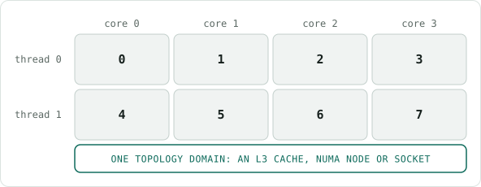
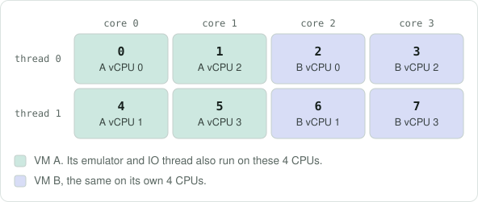
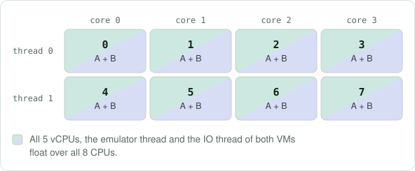
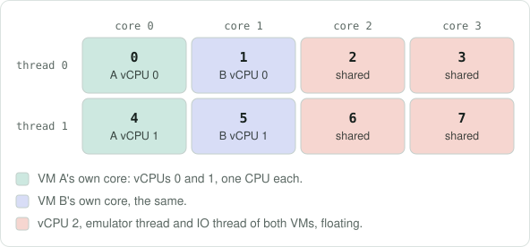

# VEP #152 Phase 3: CPU sharing requirements

This document collects the use cases and requirements for [Phase 3](vep.md#phase-3--advanced-use-cases-host-allocation-intent) of VEP #152: VMs whose vCPUs run on host CPUs shared with other VMs, either alone or together with exclusive CPUs. It proposes no API. Phase 1, exclusive CPUs from a generated claim, is unchanged.

## Three buckets

Every VM falls into exactly one bucket, depending on who else may use its host CPUs:

- **Exclusive:** every CPU the VM uses is its own.
- **Shared:** the VM uses CPUs that other VMs also use; none is its own.
- **Shared + exclusive:** some vCPUs have CPUs of their own; the remaining vCPUs, the emulator thread and the IO threads use CPUs shared with other VMs.

Phase 1 covers the first bucket. Phase 3 needs the other two. In the terms of the Phase 3 discussion example, the exclusive bucket is one `Exclusive`/`OneToOne` group, the shared bucket is one `Shared`/`SharedSet` group, and shared + exclusive is one group of each.

The scenarios below show two VMs in each bucket on the same small host, and what the domain XML tells libvirt in each.

## Example host: one topology domain with 4 cores, 2 threads each

The kernel sees 8 CPUs. Core *n* is CPU *n* (thread 0) and CPU *n*+4 (thread 1), so CPUs 0 and 4 are the two threads of core 0.



The 4 cores form one **topology domain**: a set of CPUs that share a hardware resource, such as an L3 cache, a NUMA node or a socket. Domains nest, and the whole node is the largest one. Neither the kind nor the size of the domain changes the scenarios below; what matters is that a VM's CPUs stay inside one domain. This document says "topology domain" to keep it apart from a libvirt domain.

### The three scenarios at a glance

| Scenario | vCPUs per VM | Guest topology | CPUs each VM has to itself | CPUs both VMs share | vCPUs on the 8 CPUs |
|---|---|---|---|---|---|
| 1. Exclusive | 4 | 1 socket × 2 cores × 2 threads | 4 (2 whole cores) | None | 8 |
| 2. Shared | 5 | 1 socket × 5 cores × 1 thread | None | All 8 | 10 |
| 3. Shared + exclusive | 3 | 1 socket × 3 cores × 1 thread | 2 (1 whole core) | 4 (cores 2 and 3) | 6, plus both VMs' emulator and IO threads |

## Scenario 1: Exclusive

*Supported today.*

Each VM gets 2 whole cores that no one else uses (`dedicatedCpuPlacement`). Each vCPU is pinned to exactly one CPU.

### Who runs where



**CPUs the pod may use:** A `0,1,4,5`; B `2,3,6,7`. No overlap.

### Domain XML, VM A

```xml
<vcpu placement="static">4</vcpu>
<iothreads>1</iothreads>
<cputune>
  <vcpupin vcpu="0" cpuset="0"/>
  <vcpupin vcpu="1" cpuset="4"/>
  <vcpupin vcpu="2" cpuset="1"/>
  <vcpupin vcpu="3" cpuset="5"/>
  <iothreadpin iothread="1" cpuset="0,1,4,5"/>
</cputune>
<cpu>
  <topology sockets="1" cores="2" threads="2"/>
</cpu>
```

Rendered with KubeVirt's own pinning code for a pod allowed CPUs `0,1,4,5`, with one shared IO thread. VM B is the same with CPUs 2, 6, 3 and 7.

### What the domain sees

- Every vCPU has exactly one CPU. vCPUs 0 and 1 are the two threads of core 0, so the guest's `threads="2"` matches the hardware.
- There is no `<emulatorpin>`. The emulator thread runs wherever the pod may run, which is only the VM's own 4 CPUs.
- The IO thread is pinned to all 4 of the VM's CPUs.
- `<vcpu>` has no `cpuset`; all placement comes from `<vcpupin>`.
- Nothing of VM B can run on A's CPUs, because B's pod is not allowed to use them.

## Scenario 2: Shared

*Not possible today.*

Overcommit within one topology domain. Two 5-vCPU VMs share all 8 CPUs: 10 vCPUs on 8 CPUs. No vCPU has a CPU of its own, but neither VM leaves the topology domain.

### Who runs where



**CPUs the pod may use:** A `0-7`; B `0-7`. Both pods get the same set.

### Domain XML, VM A

```xml
<vcpu placement="static" cpuset="0-7">5</vcpu>
<iothreads>1</iothreads>
<cputune>
  <vcpupin vcpu="0" cpuset="0-7"/>
  <vcpupin vcpu="1" cpuset="0-7"/>
  <vcpupin vcpu="2" cpuset="0-7"/>
  <vcpupin vcpu="3" cpuset="0-7"/>
  <vcpupin vcpu="4" cpuset="0-7"/>
</cputune>
<cpu>
  <topology sockets="1" cores="5" threads="1"/>
</cpu>
```

VM B's domain XML is identical.

### What the domain sees

- Every vCPU may run on any of the 8 CPUs. Pinning only keeps the VM inside the topology domain; the `<vcpupin>` lines repeat `<vcpu cpuset>` and could be left out.
- There is no `<emulatorpin>` or `<iothreadpin>`. Both inherit `<vcpu cpuset>` and float over the same 8 CPUs.
- The XML doesn't say the CPUs are shared, or with how many VMs. The limit of 10 vCPUs on 8 CPUs has to be enforced when VMs are placed on the topology domain, not in the XML.
- The guest sees 5 single-thread cores. It cannot tell that they share 8 hardware threads with another VM.

## Scenario 3: Shared + exclusive

*Not possible today.*

Each 3-vCPU VM gets one core of its own for vCPUs 0 and 1, plus a share of cores 2 and 3, where both VMs put their vCPU 2, emulator thread and IO thread. Both parts come from the same topology domain.

### Who runs where



**CPUs the pod may use:** A `0,4` + `2,3,6,7`; B `1,5` + `2,3,6,7`. Only the shared part overlaps.

### Domain XML, VM A

```xml
<vcpu placement="static" cpuset="0,4,2,6,3,7">3</vcpu>
<iothreads>1</iothreads>
<cputune>
  <vcpupin vcpu="0" cpuset="0"/>
  <vcpupin vcpu="1" cpuset="4"/>
  <vcpupin vcpu="2" cpuset="2,6,3,7"/>
  <iothreadpin iothread="1" cpuset="2,6,3,7"/>
  <emulatorpin cpuset="2,6,3,7"/>
</cputune>
<cpu>
  <topology sockets="1" cores="3" threads="1"/>
</cpu>
```

VM B is the same with CPUs 1 and 5 in place of 0 and 4. The shared lines are identical.

### What the domain sees

- vCPUs 0 and 1 each have one CPU of the VM's own core. They are the only exclusive part.
- vCPU 2, the emulator thread and the IO thread float over the 4 CPUs of cores 2 and 3, which VM B uses in exactly the same way.
- The guest sees 3 cores with 1 thread each, but its vCPUs 0 and 1 are the two threads of one host core.
- The XML only lists the shared CPUs; it doesn't mark them as shared. Keeping another VM's exclusive vCPUs off cores 2 and 3 has to happen when CPUs are handed out.

## Requirements

1. **R1 – Exclusive.** Exclusive VMs behave as in Phase 1: each vCPU is pinned 1:1 to a CPU that nothing else uses (scenario 1).
2. **R2 – Shared pool within one topology domain.** A VM's vCPUs, emulator thread and IO threads can run on a set of host CPUs that it shares with other VMs. All CPUs of the set come from one topology domain (scenario 2).
3. **R3 – Bounded sharing.** The number of vCPUs placed on one shared pool can be limited, and the limit is enforced when VMs are scheduled. The domain XML cannot express it (scenario 2).
4. **R4 – Shared + exclusive in one VM.** A VM can pin some vCPUs 1:1 to CPUs of their own and put the remaining vCPUs, the emulator thread and the IO threads on a shared pool. Both parts come from the same topology domain (scenario 3).
5. **R5 – Shared CPUs stay shared.** CPUs that belong to a shared pool are not handed out as exclusive CPUs to another VM while the pool is in use (scenario 3).
6. **R6 – virt-launcher knows the mapping.** For each vCPU, virt-launcher knows whether it is exclusive or shared and which host CPUs back it, and which CPUs the emulator and IO threads use, so it can write `<vcpupin>`, `<emulatorpin>` and `<iothreadpin>`. This is the gap Phase 3 names.
7. **R7 – Discoverable placement.** The host CPUs and topology domain a running VM got can be read without hard-coded CPU IDs or topology assumptions, for example by node-level tuning such as cache allocation or interrupt affinity.

## Open questions

1. **Isolation.** May exclusive-CPU VMs, other pods or host processes run on a shared pool's CPUs?
2. **Accounting.** What does a VM on a shared pool count against the node's allocatable CPU and its pod's CPU request, and which QoS class does the pod get?
3. **Guest topology.** In shared + exclusive, should the guest see that its exclusive vCPUs are SMT siblings? Scenario 3 shows them as separate single-thread cores.

## Related designs

These are the designs proposed so far in the VEP 152 and VEP 300 reviews. They are listed for reference; this document does not choose between them. For v1.10 the reviews settled on the generated exclusive claim (VEP 152) and aligned claims (VEP 300), and left shared CPUs to Phase 3 ([comment](https://github.com/kubevirt/enhancements/pull/432#issuecomment-5502428224), [comment](https://github.com/kubevirt/enhancements/pull/432#issuecomment-5520019159)).

### How a VM says which vCPUs are exclusive or shared (R6)

- **A1. Claim references on the CPU.** A list of claim references under `domain.cpu`, so that shared cores come from one claim and dedicated cores from another ([proposal](https://github.com/kubevirt/enhancements/pull/414#discussion_r3849067984)). Not adopted: reviewers objected to claim references on the CPU field ([comment](https://github.com/kubevirt/enhancements/pull/414#discussion_r3849154642), [comment](https://github.com/kubevirt/enhancements/pull/414#discussion_r3866548120)), and Phase 1 has no VMI API change.
- **A2. `hostAllocation.groups` with access mode and mapping policy.** Each group targets a set of vCPUs and asks for a number of host CPUs with `accessMode: Exclusive | Shared` and `mappingPolicy: OneToOne | SharedSet` ([proposal](https://github.com/kubevirt/enhancements/pull/432#issuecomment-5453934486)). This is the discussion example in [Phase 3](vep.md#phase-3--advanced-use-cases-host-allocation-intent).
- **A3. Trimmed groups.** `groups: [{vcpus, exclusive, hostCPUs}]`. `dedicatedCpuPlacement` expands to one all-exclusive group and cannot be combined with groups ([proposal](https://github.com/kubevirt/enhancements/pull/432#issuecomment-5485228539)).
- **A4. CPU classes.** `cpu.classes: [{name, count, isolation: exclusive | shared}]` ([proposal](https://github.com/kubevirt/enhancements/pull/432#issuecomment-5520019159)).
- **A5. CPU profiles.** `cpu.profile: <name>`, where a documented convention defines the split and a policy supplies the details ([proposal](https://github.com/kubevirt/enhancements/pull/432#issuecomment-5520019159)).
- **A6. No new VM API.** Keep `dedicatedCpuPlacement`, `isolateEmulatorThread` and the IO thread settings, and let an admin-defined policy or translation layer decide oversubscription and mapping ([comment](https://github.com/kubevirt/enhancements/pull/432#issuecomment-5500327129), [comment](https://github.com/kubevirt/enhancements/pull/432#issuecomment-5490850285)). The counter-argument is that virt-launcher renders the domain XML without access to such policies, so the mapping has to reach it through the VMI ([comment](https://github.com/kubevirt/enhancements/pull/432#issuecomment-5502428224)).

### Who builds the claim, and how shared CPUs are allocated (R2–R5)

- **B1. `ManagedClaimProvisioner`.** The VMI names a provisioner, and a provisioner controller generates the claim, including `matchAttribute` constraints. CPUs are requested as consumable capacity from a group device ([VEP 300](https://github.com/kubevirt/enhancements/pull/432)).
- **B2. `ManagedClaimPolicy`.** A MigrationPolicy-style object selects VMIs by label and passes parameters, such as alignment, exclusive and shared counts and an oversubscription ratio, to a provisioner. Claim names reach virt-controller through VMI status and a `ManagedClaimsReady` condition. Each VMI gets its own claim against the same capacity pool; a single claim shared by many VMIs (`claimScope: Group`) is left for later ([proposal](https://github.com/kubevirt/enhancements/pull/432#issuecomment-5443995265)).
- **B3. One claim with exclusive and shareable devices.** The provisioner creates one claim per VM that holds both exclusive and shareable CPU devices ([Phase 3](vep.md#phase-3--advanced-use-cases-host-allocation-intent)).
- **B4. One claim shared across VMIs.** Several VMIs reference the same claim for their shared CPUs ([proposal](https://github.com/kubevirt/enhancements/pull/414#discussion_r3849067984)). The alternative view is per-VMI claims against a shared pool, because a claim usually has one consumer ([comment](https://github.com/kubevirt/enhancements/pull/432#issuecomment-5443995265)).
- **B5. Driver support.** Mixed exclusive and shared allocation is tracked in dra-driver-cpu [#103](https://github.com/kubernetes-sigs/dra-driver-cpu/issues/103) and [#305](https://github.com/kubernetes-sigs/dra-driver-cpu/issues/305). The device layout is not decided yet and may need node cgroup changes and KEP-5517 ([comment](https://github.com/kubevirt/enhancements/pull/414#discussion_r3850303128)).

### How placement becomes visible (R7)

- **C1. Device metadata.** virt-launcher reads the allocated CPUs from KEP-5304 device metadata ([comment](https://github.com/kubevirt/enhancements/pull/432#issuecomment-5443995265)).
- **C2. Publishing placement to the guest.** Expose the allocated CPUs inside the guest through a stable convention, as [kubevirt#6946](https://github.com/kubevirt/kubevirt/pull/6946) does for device NUMA information ([comment](https://github.com/kubevirt/enhancements/pull/432#issuecomment-5520019159)).

### Coverage of the requirements

- **R2 and R3:** B2 is the only concrete proposal for a bounded shared pool, and it depends on B5.
- **R4:** B1 and B2 constraints can keep both parts in one topology domain. An L3-cache domain would also need a driver attribute to match on.
- **R5:** depends on B5.
- **R6:** A2–A5 map vCPUs to groups, but none places the emulator and IO threads on the shared part, as scenario 3 does. A6 does not meet R6.
- **Open question 3** relates to C2: both are about what the guest can learn about its placement.
