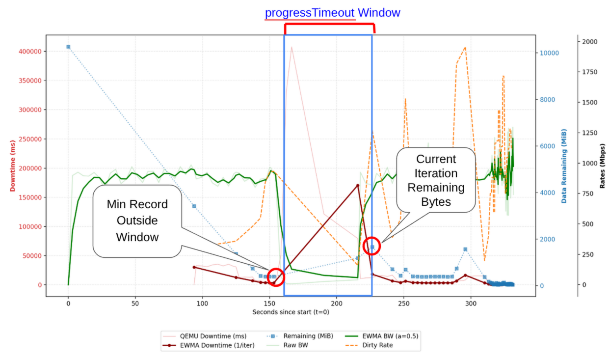
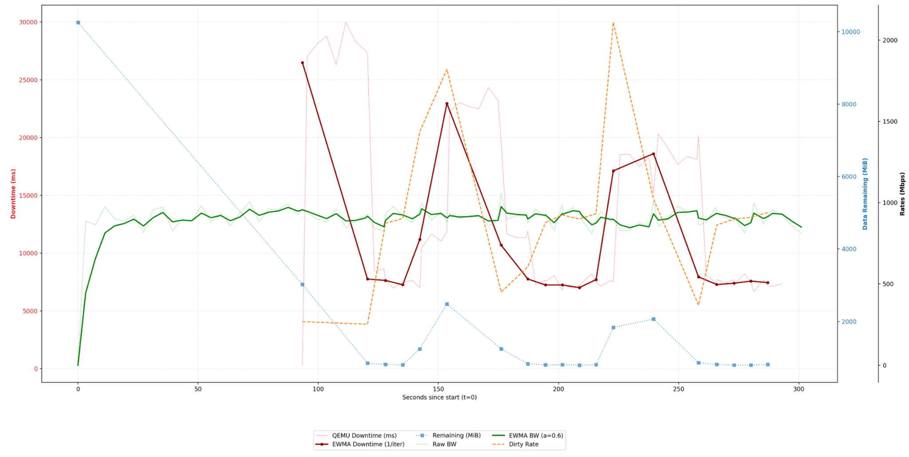
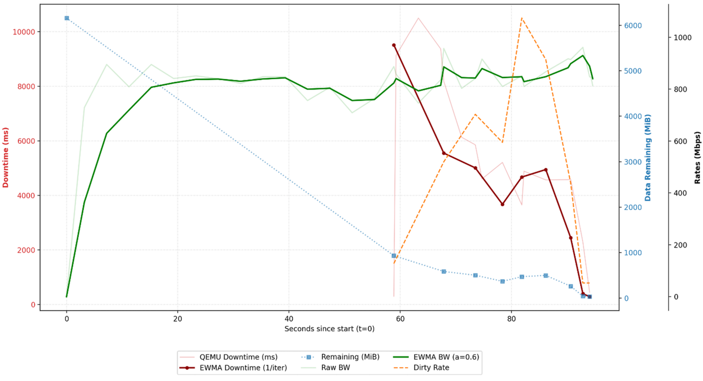
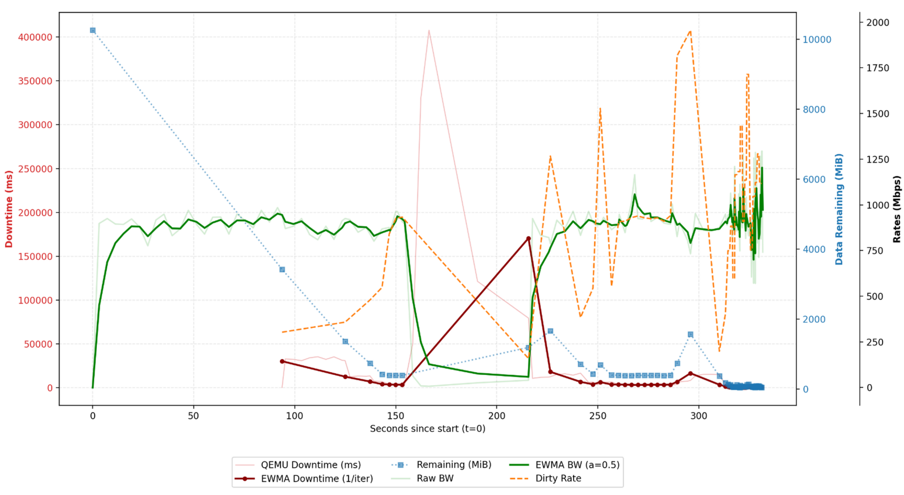
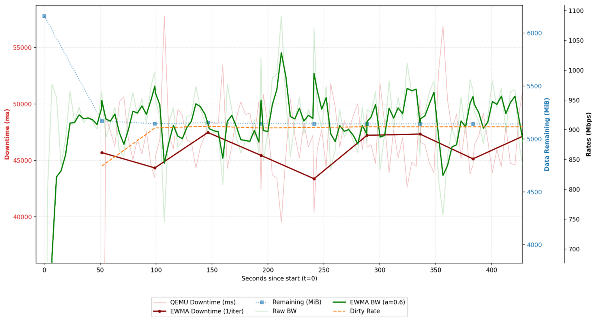
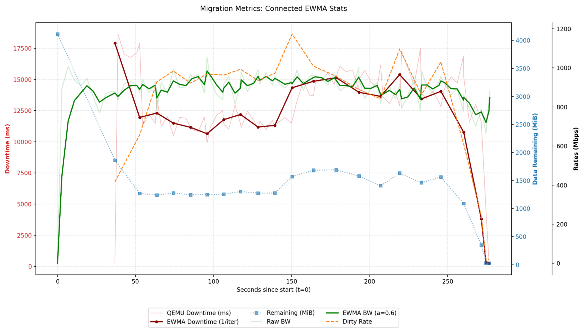
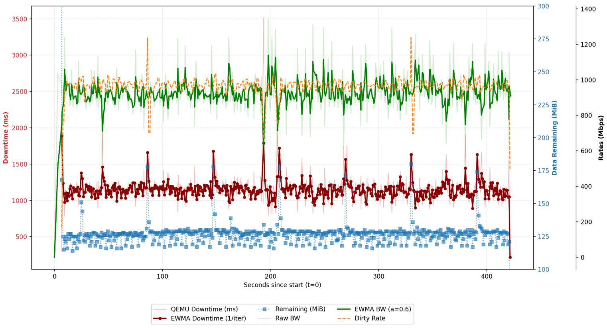

# VEP 248: Live Migration Stability & Convergence Improvements 

## VEP Status Metadata

### Target releases

<!--
A PR must update this section during the planning phase of a given release in order to track it.
PRs that will not update the VEP during the planning phase will not be able to graduate the
VEP by creating a code PR to kubevirt/kubevirt to bump the phase in-code.

Please avoid targeting future releases in this section. Only capture the upcoming release.
For example, during the planning phase for version v1.123, do **not** target beta for v.124 in advance.
-->

- This VEP targets alpha for version: v1.9
- This VEP targets beta for version: v1.11
- This VEP targets GA for version: TBD

### Release Signoff Checklist

Items marked with (R) are required *prior to targeting to a milestone / release*.

- [X] (R) Enhancement issue created, which links to VEP dir in [kubevirt/enhancements] (not the initial VEP PR)
- [X] (R) Alpha target version is explicitly mentioned and approved
- [ ] (R) Beta target version is explicitly mentioned and approved
- [ ] (R) GA target version is explicitly mentioned and approved

## Overview

<!--
Provide a brief overview of the topic
-->

This proposal adds **iteration-aligned stall detection** using **remaining bytes** reported by QEMU. Once pre-copy stalls, the monitor uses the minimum remaining bytes in a trailing time window to choose when to switch to post-copy or stop-and-copy. This aims to reduce both total migration time and the downtime (or time spent in post-copy) once pre-copy plateaus.

## Motivation

<!--
Why this enhancement is important
-->

When a VM's writable working set (WWS) is large compared to bandwidth, downtimes cannot be brought down low enough to trigger switchover automatically. Today, such cases are addressed by a static timeout derived from the VM size. However, this wastefully burns energy, compute, and bandwidth waiting for a conservative timeout:
    (a) **`completionTimeoutPerGiB`** defaults to **150s per GiB** (e.g. a 16 GiB VM can run **40+ minutes** before aborting). However, in most cases, a VM often stops making progress on the "remaining bytes" to transfer well before that.
    (b) existing stall detection using the legacy `progressTimeout` ("remaining bytes did not decrease") doesn't work as it fails to consider that remaining bytes **oscillate** up and down with workload phases or bandwidth fluctuations and consequently resets progress timers anytime "remaining bytes" decreases.

> __Workload Phase__
Many applications experience different "workload phases" throughout their lifecycle. For example, a database application might occasionally have a "flush phase" where it stops everything it is doing and flushes all data to disk. The key feature of a "phase" is that the underlying workload characteristics change, exhibiting different dirty rates, CPU usage, memory etc. Attempting to take advantage of short-term phase changes to lower downtime (or time spent in post-copy) is a key objective of this proposal.

> __Writable Working Set (WWS)__
WWS refers to the set of pages that are actively being written to. In the context of live migration, it is the portion of memory which the VM is writing to faster than can be transferred over.


## Goals

<!--
The desired outcome
-->

- Decrease total migration time, downtime, and/or the time spent in post-copy for VMs with high dirty rates.
- Trigger post-copy or pause-and-copy when pre-copy has meaningfully stalled, rather than only after long generic timeouts, so migrations do not spin indefinitely once they have converged as far as they can.
- Minimize permanent user-facing API surface. **`maxDowntimeMs`** is the only new top-level field in alpha. Stall-detector tunables live in **`MigrationPolicy.spec.experimental`** — a temporary, alpha-only block whose name and scope signal that its fields are not stable API and will be removed at GA (see **API Changes**). Operators on experimental clusters may tune stall-detector hyper-parameters there while we decide what to promote or bake into defaults.
- Ensure robustness against network fluctuations and failures.
    * Since migrations can last minutes, a temporary network drop should not trigger a switch-over as this is harmful especially in post-copy mode leading to data loss or significant performance degradation.

## Non Goals

<!--
Limitations on the scope of the design
-->

- Guarantee that `MaxCompletionTime` will never be exceeded. Only a best-effort attempt.
- Optimize bandwidth in multi-VM scenarios.

## Definition of Users

<!--
Who is this feature set intended for
-->

Cluster Admins: Admins managing multi-node clusters.
VM Admin: A VM owner/manager running their VM in a multi-node cluster.

## User Stories

<!--
List of user stories this design aims to solve
-->

- As a cluster admin, I want migrations to not waste bandwidth. For on-premise nodes, bandwidth consumption has been shown to be proportional to energy consumed during a migration (Performance and energy modeling for live migration of virtual machines, Liu et al.). For nodes hosted on the cloud, in many cases, bandwidth consumption is charged to me on a per-use basis. Either way, wasteful bandwidth usage costs me money.
- As a cluster admin, I want migrations to complete faster.
- As a VM Admin, I want to minimize the outage (downtime) for the applications running on my VMs.

## Repos

<!--
List of repositories this design impacts
-->
- kubevirt/kubevirt

## Design

<!--
This should be brief and concise. We want just enough to get the point across
-->

### Pre-requisite
This design discussion assumes the reader is familiar with the following concepts:
- Live migration
- Pre-copy, Post-copy, hybrid migration, and stop-and-copy
- Downtime
- Relationship between dirty rates, bandwidth, remaining data, and downtime
- Relevant parts of KubeVirt source code


### Stall Detection

The key idea behind our proposed stall detection algorithm is as follows: Near "convergence", dirty rate, bandwidth, and remaining bytes vary by iteration: remaining data flattens and oscillates instead of trending down. We switch at a **local minimum** of remaining bytes (over the trailing window), not at an arbitrary iteration, in hopes of optimizing downtime duration.

> __Convergence__:
Pre-copy **convergence** here means no net progress on remaining bytes iteration-to-iteration: remaining bytes fluctuate around the same level rather than continuing to fall monotonically.

At the end of each iteration, the monitor records the remaining bytes and the job's `TimeElapsed`. `targetRemainingBytes` is the lowest reading less than `stallProgressTimeout` seconds old, including the current reading.

With `searchLocalMinima` enabled, the monitor starts checking for switch-over on the iteration that detects stall. An iteration qualifies when `remainingBytes <= targetRemainingBytes × (1 + stallMargin/100)`.

### Defining Stall

**Stall:** at the end of an iteration, remaining bytes for that iteration is greater than OR within an x% "stall margin" of the smallest remaining bytes among iterations whose job `TimeElapsed` is at least **`stallProgressTimeout`** seconds in the past. More concretely, at the end of any given iteration, we are stalled if the following holds:
* `currIterationRemainingBytes` $\geq$ `minRecordOutsideWindowRemainingBytes` * (1 - `stallMargin`/100)
* Where `minRecordOutsideWindowRemainingBytes` = min({$\forall$ `record` $\mid$ `record.elapsedSeconds` $\leq$ `elapsedSeconds` - `stallProgressTimeout`})
* `stallMargin` is an integer percentage (default **4** meaning 4%), applied as `stallMargin/100`



> __Stall Progress Timeout (`stallProgressTimeout`)__:
New stall-detector knob (default **40s**) controlling the sliding window for stall detection and local-minimum selection (note: this is different from the legacy `progressTimeout` field).

Our proposed stall definition is reasonable and robust because it allows remaining bytes to rise temporarily—whether from a dirty-rate spike that pushes remaining bytes up or a temporary bandwidth drop—as long as the overall trend is still downward within the `stallProgressTimeout` window.

### Pre-copy Improvements with Dynamic Downtimes

We further propose taking advantage of how this stall detection algorithm optimizes downtime even in pre-copy only migrations. After stall, we can raise QEMU’s target downtime up to a "max downtime" so pre-copy-only migrations still complete when the default **300 ms** target is unreachable but a higher downtime is still acceptable (even if not ideal).

> __Target Downtime:__
The "target downtime" refers to the downtime configured in QEMU. This is the threshold that when met, QEMU triggers its internal switch-over to stop-and-copy.

We achieve this by proposing a new API field called `maxDowntimeMs` which specifies the maximum acceptable downtime before we consider additional downtimes as a "workload disruption". Today migrations use QEMU’s fixed **300 ms** target and fail migration if pause would exceed it unless post-copy is permitted or workload disruptions are allowed (e.g. `allowWorkloadDisruption`).

> Note that since users can specify a `maxDowntimeMs` lower than QEMU's default of 300ms, virt-launcher must set QEMU target downtime once at migration start to `min(maxDowntimeMs, 300ms)` so a user-configured cap below **300 ms** is honored during pre-copy.

In **pre-copy only mode with no workload disruptions allowed**, after stall we track **implied downtime** each iteration: `impliedDowntimeMs ≈ remainingBytes / bandwidthBpms`. The switch/abort rules below apply **only at a local minimum**.

**At a local minimum only:**
- **If** `impliedDowntimeMs <= maxDowntimeMs`: We set QEMU's target downtime to `maxDowntimeMs` ("soft stop-and-copy"). Note that even though we set target downtime to `maxDowntimeMs`, typically we expect the actual downtime to be better due to switching at a local minimum. Nevertheless, since this does not guarantee an immediate switch-over, we further add a timeout for the switchover deadline as follows: `switchOverDeadline = elapsedTime + switchoverTimeout`. If QEMU fails to switchover by this deadline, it aborts.
- **Else if** `impliedDowntimeMs <= maxDowntimeMs * precopyPossibleFactor`: Same as above. The rationale is we are close enough to our target downtime that it's plausible we can get lucky in a future iteration.
- **Else**: exceeds `maxDowntimeMs * precopyPossibleFactor` thus the required downtime is hopelessly far from the acceptable `maxDowntimeMs`, so we immediately abort the migration.

> __Bandwidth Note (`bandwidthBpms`)__
Libvirt’s `bandwidth` in `DomainJobInfo` is effectively a **~100ms** snapshot, so raw values jitter. We smooth with EWMA: `ewmaEstimate ← ewmaAlpha·sample + (1−ewmaAlpha)·ewmaEstimate` (seeded with the first sample).  Here `ewmaAlpha` is the regularization factor that controls how strongly we "smooth" bandwidth samples. See [Wikipedia](https://en.wikipedia.org/wiki/Moving_average) for further details.

`maxDowntimeMs` applies only on the **pre-copy-only, no-workload-disruption** stall path. When `allowWorkloadDisruption = true`, stall-triggered switchover uses QEMU’s maximum allowable downtime instead (as that nearly guarantees a switchover will be triggered).

> __Switchover Timeout (`switchoverTimeout`)__:
After triggering soft or hard stop-and-copy, `switchOverDeadline` is set to wall-clock `elapsedSeconds + switchoverTimeout` (default **60s**). If switchover does not complete by then, the migration aborts. This is a dedicated knob.

> __Time Bases Note:__ 
Stall-detection algorithm bookkeeping (outside-window min, stall detection, local-minima checks) uses libvirt job **`TimeElapsed`**. Completion-timeout triggers, switchover deadlines, and other timeout/budget deadline checks use **wall-clock** time from monitor start.

### Adaptive Capabilities to Workload Phase Shifts

After a sustained increase in dirty rate, the window minimum naturally rises as lower samples from the previous phase expire. A lower sample in a less write-intensive phase lowers the minimum as soon as it enters the window. Notice that this behavior provides this algorithm with robust capabilities for workload phase shifts.

### Switch-over Budget Check

Before stall-triggered switch-over at the local-minima, projected pause must fit the remaining migration budget:

`impliedDowntime <= (maxCompletionTime × completionTimeoutFactor) - elapsedTime`

where `maxCompletionTime = completionTimeoutPerGiB × vmSizeGiB`.

This guards stop-and-copy from excessive pause and is most critical for **post-copy**, which cannot be cancelled mid-flight. Low bandwidth inflates `impliedDowntime` and defers switch-over until it recovers.

Notice this is similar to the two-phase model in KubeVirt today: `completionTimeoutPerGiB` sets the base budget (unchanged); 1× forces switch-over with `allowWorkloadDisruption`, deadline doubles, hard abort at 2×. `completionTimeoutFactor` (default **2**) generalizes the hard-coded ×2. The inequality above is evaluated both when deciding a stall-triggered switch-over (`decideAction`) and when the completion-timeout path first fires (`checkCompletionTimeout`).

### Interactions with Auto Converge

**Auto-converge** (when enabled via existing migration policy) is a QEMU-side mechanism that throttles the guest so dirtying slows and pre-copy is more likely to reach QEMU’s target downtimes. In a typical migration, this feature should not conflict with the stall detection functionality.

Auto-converge checks only trigger after the first pre-copy pass. In a typical migration, every iteration (after the first) triggers a check. If the dirty rates over the time period is more than half as high as the total bytes transferred on the wire for two or more checks, QEMU throttles the guest by 20%. In consecutive iterations, if the dirty rates to bytes transferred ratio is still more than 1:2 for at least another two checks, guest is throttled by another 10%.

> __Note:__
The throttle thresholds, amounts and steps are all configurable in QEMU but KubeVirt does not touch the default. So this description is assuming these defaults.

If an iteration lasts longer than 5 seconds, an additional fallback timer triggers auto-converge checks anyway. Therefore, as long as `stallProgressTimeout` is greater than 10 seconds, the stall detection should not prematurely declare the migration stalled given that throttling the CPU is reducing the dirtying.

### Hyper-Parameters

During the design discussion, we have made mention of several hyper-parameters that go into this algorithm:

* `maxDowntimeMs`
* `stallProgressTimeout`
* `switchoverTimeout`
* `completionTimeoutFactor`
* `completionTimeoutPerGiB`
* `stallMargin`
* `ewmaAlpha`
* `precopyPossibleFactor`
* `searchLocalMinima`
* `progressTimeout` (legacy path only — unchanged semantics; see API Changes)

We present an argument for reasonable defaults that we can start with for these hyper-parameters in [migration-hyperparameters.md](./migration-hyperparameters.md), at least for the alpha phase of this proposal.

We hope to fine-tune these values throughout the alpha and beta phase by validating on experimental clusters to deduce optimal values for these hyper-parameters, or perhaps to even re-evaluate parts of this proposal entirely.

### API Changes

#### Permanent vs temporary API

This VEP adds **`maxDowntimeMs`** to `MigrationConfiguration` / `MigrationPolicy` as a **permanent** top-level field (shipping in alpha).

> __Note 1:__ CR validation rejects values larger than 2,000,000ms (the QEMU hard limit on downtimes) or less than or equal to 0.

During alpha/beta, stall detection uses **`experimental.stallDetector.stallProgressTimeout`**, not top-level `progressTimeout`. Legacy `progressTimeout` remains on the KubeVirt CR `migrationConfiguration` (default **150s**, "remaining bytes did not decrease") and is **not** on `MigrationPolicy` in alpha; it is expected to be added to MigrationPolicy later when fields are merged/repurposed toward GA.

At **GA**, **`stallProgressTimeout`** becomes permanent by **repurposing** top-level `progressTimeout`. Pre-existing custom `progressTimeout` values **will be overridden** on upgrade to the new default (**40s** under current design): legacy values are a poor fit for stall-detector semantics and are not preserved.

Other experimental knobs may be promoted to permanent API based on alpha/beta operational experience. Today the only additional candidate worth considering is **`switchoverTimeout`**; the rest are expected to bake in as constants.

#### Feature gate

`MigrationStallDetection` (Alpha) enables stall-detector behavior in virt-launcher. When disabled, migration convergence remains today's timeout-based monitor unchanged.

Per-field defaults, validation, and `spec.experimental` layout are documented in [migration-hyperparameters.md](./migration-hyperparameters.md).


### Exploring Real World Workloads

The mechanisms and definitions included in this VEP were inspired by real workloads. We looked at real data to see how different migrations behave when running varying workloads with different configurations. Included below are *some* of the workloads we looked at and their corresponding graphs. These graphs are intended to show the variations in behaviors like iteration times, remaining bytes, and dirty rates across different workloads.


 
 
 
 



### Limitations & Risks

In this section we acknowledge certain limitations of this approach and list scenarios where the current timeout approach wins:
1. Network drops can cause the stall detection algorithm to trigger (due to remaining bytes increasing). Switch-over can trigger once lower samples age out of the window, including while pre-copy is still making improvements after the network recovers. Perhaps future work can better address this edge case.
2. A benefit of the current timeout approach in KubeVirt today can allow migration to continue for a long time. In some cases, this can be good because you can get lucky and a phase changes in underlying application can allow VM to convergence at the target downtime. Nevertheless, if we increase the duration of the `stallProgressTimeout` window, we can still trade-off migration time in hopes of getting lucky and switching-over without help.
3. Since a large part of this design is to exploit fluctuations in dirty rates to trigger switchover at a local minimum, a significant risk factor with this design is that any delays in triggering the iteration boundary logic could trigger switchover too late to exploit that window. However, this is a quality risk. Not a correctness risk. The exact impact and severity of this risk is difficult to evaluate until after implementation.
4. Remaining bytes estimate as reported via QMP in QEMU currently do not include remaining data from VFIO devices. In **alpha**, when stall detection is enabled on a VFIO VM, a warning is logged and post-copy switchover is skipped; switchover decisions may be suboptimal because VFIO state size is not considered. Full VFIO support is a **beta** requirement (QEMU 11.1+).
5. For massive VMs (e.g. order of 1000GB RAM) or VMs with VFIO devices it's possible that dirty bitmap sync at the end of pre-copy takes several hundred milliseconds to a few seconds to complete. In such a case, we can expect bandwidth to drop (because we ran out of known dirty pages we can push) skewing `impliedDowntime` results. Using an exponentially weighted moving average helps partially mitigate some risks caused by "bad samples". The use of a kernel feature called "KVM Dirty Ring" could also help mitigate some risks but use of this feature has other trade-offs. See **Alternatives** §8 for more info.


## Implementation

Below is a condensed description of how the stall detector wires into virt-launcher's migration monitor. Feature-gating is described under **Feature gate** in **API Changes** above.


### Plumbing: Event-Based Iteration Loop

The migration monitor loop needs to react to iteration boundaries fired by QEMU. QEMU emits a `MIGRATION_PASS` QMP event each time it completes a dirty bitmap sync at the start of a new pre-copy iteration (i.e., the previous iteration's page transfer is complete and the dirty bitmap has been re-scanned). Libvirt translates this into a migration-iteration domain event that virt-launcher subscribes to.


### How the monitor loop is structured

The migration monitor loop gains an **`iterationChan`** beside the existing error and polling channels. QEMU fires iteration events only between pre-copy passes; the **polling** arm still runs at its existing **400ms** cadence so a single long iteration (e.g. network stall) gets logging, timeout checks, and fresh bandwidth samples for the EWMA estimate.

| Arm | Cadence | With stall detection enabled |
|-----|---------|------------------------------|
| **Poll loop** | every 400ms | Update EWMA bandwidth, log, run completion-timeout checks — unchanged from today |
| **Iteration boundary** | each `MIGRATION_PASS` | Run the stall algorithm below |
| **Migration errors** | on failure | Unchanged |

When stall detection is disabled, the iteration channel falls through to today's timeout-based monitor logic; polling is unchanged. Thread safety is ensured using channels. All stall-detector state lives in and is managed by the monitor goroutine.

> __Note:__ Pseudocode below omits feature-gate checks, VFIO guards, and certain implementation optimizations (e.g. skipping further stall decisions once switchover is triggered).


### Core algorithm

At each **pre-copy iteration boundary**, the monitor:

1. **Tracks progress** — record the current iteration, expire samples whose elapsed time is at least **`stallProgressTimeout`** in the past, and fold those samples into `outsideWindowMin` (see **Design §Defining Stall**).
2. **Detects stall** — stalled when `remainingBytes ≥ outsideWindowMin × (1 − stallMargin/100)`.
3. **Acts on stall** — either evaluate switch-over immediately (`searchLocalMinima = false`) or wait for remaining bytes to dip near the current window minimum.

With `searchLocalMinima` enabled, feed samples into a monotonic deque from the first iteration. The deque keeps samples in increasing order of remaining bytes, with the minimum at the front. Expire old samples from the front, remove samples from the back whose remaining bytes are greater than or equal to the current sample's, then append the current sample. The current sample stays in the window at least as long and provides an equal or lower minimum. Keep the FIFO that supplies expired samples to `outsideWindowMin`, since the deque can discard samples before they qualify for the stall check.

**Pseudocode** (iteration-boundary path only; `bandwidthBpms` comes from the poll loop's EWMA):

```
minCandidates = empty deque

ON_ITERATION_BOUNDARY(elapsedSeconds, remainingBytes):
    outsideWindowMin = updateOutsideWindowMin(elapsedSeconds, remainingBytes)
    if searchLocalMinima:
        cutoff = elapsedSeconds - stallProgressTimeout
        while !minCandidates.empty() && minCandidates.front.elapsedSeconds <= cutoff:
            minCandidates.popFront()
        while !minCandidates.empty() && minCandidates.back.remainingBytes >= remainingBytes:
            minCandidates.popBack()
        minCandidates.pushBack({elapsedSeconds, remainingBytes})

    logMigrationInfo(...)
    checkCompletionTimeout(...)                 // see table below

    bandwidthBpms = toBytesPerMilliseconds(ewmaBandwidth)

    if !stallDetected:
        if outsideWindowMin != nil
           && remainingBytes >= outsideWindowMin * (1 - stallMargin/100):
            stallDetected = true
        else:
            return

    if !searchLocalMinima:
        trySwitchover(remainingBytes / bandwidthBpms)
        return

    targetRemainingBytes = minCandidates.front.remainingBytes
    if nearLocalMinimum(remainingBytes, targetRemainingBytes):
        trySwitchover(remainingBytes / bandwidthBpms)


nearLocalMinimum(remainingBytes, targetRemainingBytes):
    return remainingBytes <= targetRemainingBytes * (1 + stallMargin/100)
```


### Switchover policy

`decideAction(impliedDowntimeMs)` runs on each stalled iteration. It chooses post-copy, dynamic downtime, wait, or abort:

| Migration mode | Condition | Action |
|----------------|-----------|--------|
| (any) | not at local minimum (`searchLocalMinima`) | Wait; retry on a later iteration |
| (any) | `impliedDowntimeMs` exceeds remaining time before `(maxCompletionTime × completionTimeoutFactor)` | Wait; retry on a later iteration |
| Post-copy allowed (`allowPostCopy` + `allowWorkloadDisruption`, non-VFIO) | at local minimum; budget check passes | `MigrateStartPostCopy` |
| Workload disruption allowed, pre-copy only | at local minimum; budget check passes | `MigrateSetMaxDowntime(QEMU_MAX)`; set `switchOverDeadline` |
| Pre-copy only, no disruption | `impliedDowntimeMs ≤ maxDowntimeMs` | `MigrateSetMaxDowntime(maxDowntimeMs)`; set `switchOverDeadline` |
| Pre-copy only, no disruption | `maxDowntimeMs < impliedDowntimeMs ≤ maxDowntimeMs × precopyPossibleFactor` | `MigrateSetMaxDowntime(maxDowntimeMs)`; set `switchOverDeadline` |
| Pre-copy only, no disruption | `impliedDowntimeMs > maxDowntimeMs × precopyPossibleFactor` | `AbortJob` |

See **Design §Pre-copy Improvements with Dynamic Downtimes** and **§Switch-over Budget Check** for rationale.


### Completion timeout

`checkCompletionTimeout` runs on the poll loop and at iteration boundaries. When wall-clock `elapsedTime` first exceeds `maxCompletionTime` and switch-over has not started, apply the budget inequality from **Design §Switch-over Budget Check**:

`impliedDowntimeMs <= (maxCompletionTime × completionTimeoutFactor) - elapsedTime`

| Condition | Action |
|-----------|--------|
| `allowPostCopy` (non-VFIO) and inequality holds | `MigrateStartPostCopy` |
| `allowWorkloadDisruption` and inequality holds | `MigrateSetMaxDowntime(QEMU_MAX)`; extend abort deadline to `maxCompletionTime × completionTimeoutFactor`; set `switchOverDeadline = elapsedTime + switchoverTimeout` |
| Otherwise | `AbortJob` |

If switch-over was already initiated and the deadline still fires, abort. Post-copy is not aborted on completion timeout, same as today.

## API Examples

<!--
Tangible API examples used for discussion
-->

Cluster-wide default via KubeVirt CR:

```yaml
apiVersion: kubevirt.io/v1
kind: KubeVirt
metadata:
  name: kubevirt
spec:
  configuration:
    developerConfiguration:
      featureGates:
        - MigrationStallDetection
    migrationConfiguration:
      maxDowntimeMs: 900             # accept up to 900ms downtime rather than fail
```

Pre-copy-only migration with dynamic downtime — the VM can tolerate up to 5s of pause. If the migration stalls and the **implied** pause from remaining bytes and bandwidth is within 5s, QEMU’s target downtime is adjusted dynamically to allow convergence rather than failing:

```yaml
apiVersion: kubevirt.io/v1
kind: KubeVirt
spec:
  configuration:
    migrationConfiguration:
      maxDowntimeMs: 5000
      allowPostCopy: false
      allowWorkloadDisruption: false
```

Stall-triggered post-copy (alpha) — both flags are required; `maxDowntimeMs` does not influence this path:

```yaml
apiVersion: kubevirt.io/v1
kind: KubeVirt
spec:
  configuration:
    migrationConfiguration:
      allowPostCopy: true
      allowWorkloadDisruption: true
```

Workload disruption allowed (guest may be paused indefinitely) — `maxDowntimeMs` has no functional effect here since the guest is simply paused to allow stop-and-copy to complete regardless of how long it takes:

```yaml
apiVersion: kubevirt.io/v1
kind: KubeVirt
spec:
  configuration:
    migrationConfiguration:
      allowWorkloadDisruption: true
```

Experimental-cluster tuning via `MigrationPolicy.spec.experimental` (temporary — removed at GA; not for production use):

```yaml
apiVersion: migrations.kubevirt.io/v1alpha1
kind: MigrationPolicy
metadata:
  name: stall-detection-test
spec:
  selectors:
    matchLabels:
      special: vmi-test-label
  experimental:
    stallDetector:
      stallProgressTimeout: 5
      switchoverTimeout: 45
      stallMargin: 7
```


## Alternatives

<!--
Outline any alternative designs that have been considered
-->

1. **Iteration-count-based stall detection** (e.g. "no progress in N iterations") was considered but rejected. The primary concern is uncontrolled duration: since an iteration-count window has no sense of elapsed time, long iterations could consume a large fraction of the completion time budget for marginal benefit. Longer iterations already amortize dirty-rate fluctuations, so there is little variation to exploit, and when downtime is already in the tens of seconds the marginal benefit of shaving off a few seconds is low. A time-based window on job `TimeElapsed` (`stallProgressTimeout`) bounds stall detection regardless of iteration length.

2. **Dirty rate > bandwidth as a stall metric** was considered but rejected. Even when dirty rate exceeds bandwidth, remaining data can still decrease because page dirtying often involves the same working-set pages. The working set tends to be small, so migration can still make meaningful progress. Tracking **remaining bytes** (and bandwidth for derived pause hints) captures this nuance without relying on QEMU’s noisy per-iteration downtime estimate.

3. **Geometric-series completion-time model** ([alternate proposal](https://docs.google.com/document/d/15P45MB9LtXTBKMfFkC2CLvEj-Hf9B6lY-W4DIEAq_5w/edit?tab=t.0#heading=h.sj3tv6yulsis)) was considered. It modeled pre-copy as a geometric series to project completion time and defined "stall" as when projected completion time exceeded the budget or dirty rate > bandwidth. The current design was favored because it also optimizes **switch-over timing** using remaining bytes and better handles dirty-rate and bandwidth variability. Moreover, this proposal also had the same concerns described in (2).

4. **Iteration-count-based sampling** (e.g. use the last 5 samples) was dropped for **`stallProgressTimeout`-derived time windows** (job `TimeElapsed`): a fixed iteration count ignores iteration length. Time-based sampling **self-adjusts:** short iterations yield many samples when remaining-byte **swings are large**, where a **fine-grained** local minimum matters most; long iterations yield fewer samples—acceptable because **(a)** they average-out phase-scale dirty-rate variation (often seconds per phase based on Automatically Characterizing Large Scale Program Behavior, Sherwood et al. 2002), smoothing the trace, and **(b)** when remaining data and implied pause are already large, small **relative** swings matter less than near convergence.

5. **Iteration-based downtime ramp-up** was proposed in https://github.com/kubevirt/enhancements/pull/249. The main idea of this proposal was to ramp-up the max allowable downtime by some amount after x iterations. See discussions on the PR for further details.

6. **Defining stall and switch-over purely from QEMU’s estimated downtime** was rejected: the per-iteration estimate fluctuates too much in empirical data to drive stall boundaries or local-minimum selection reliably. That is likely because the estimate leans on recent bandwidth data, which itself can fluctuate.

7. **Proactive time budgeting** is not strictly an alternate *stall* design, but it was another considered enhancement in this VEP to improve convergence relative to `MaxCompletionTime`: act earlier when implied pause from remaining bytes and bandwidth suggests the migration cannot finish inside the budget (e.g. `estimatedDowntime > maxCompletionTime - elapsedTime`). However, this approach is sensitive to temporary (or longer) drops in the network; meaning a drop in the network can inflate implied pause and fire the logic wrongly; this is especially dangerous for post-copy. Handling that robustly would add **significant complexity** for marginal benefit compared to the core stall work, so **proactive time budgeting is out of scope for now** and may be revisited in a follow-up if needed.

8. **KVM Dirty Ring** was considered as a way to mitigate long phases at iteration boundaries where guest-RAM transfer appears to stall while QEMU synchronizes dirty tracking with KVM. Dirty ring uses per-vCPU ring buffers so dirty pages can be harvested incrementally instead of a single long bitmap sync. This *could* shorten the time QEMU spends idle (i.e. not pushing bytes) and smoothen bandwidth fluctuations in some configurations involving massive VMs (i.e. 1000GB RAM). However, we were advised against this by QEMU engineers since dirty ring has historically been more experimental, and enabling it has other trade-offs such as a perpetual per-vCPU memory overhead and kernel version limitations. It also does not solve sync-delays caused by VFIO devices. Nevertheless, we intend to look further into enabling this feature for massive VMs only in beta.


## Scalability

<!--
Overview of how the design scales
-->

The number of samples retained before and after stall is bounded by the `stallProgressTimeout` window.

### Justification
Let *k* be the number of iterations inside the `stallProgressTimeout` window. Per iteration boundary:
__Compute__:

- **O(1)** to read the window minimum from the front of the deque
- **O(1)** amortized to update the FIFO and deque, since each sample is inserted and removed at most once per queue

__Memory__:

- **O(k)** for the FIFO and deque combined

Notice that at an iteration cadence of 300 ms (QEMU's default downtime target is 300ms), the default 40-second window holds about 133 samples.


## Update/Rollback Compatibility

<!--
Does this impact update compatibility, and how?
-->

This VEP primarily introduces migration policy improvements. No compatibility issues are expected during alpha/beta updates.

At **GA**, when `MigrationStallDetection` graduates, the legacy timeout-based migration monitor (including "remaining bytes did not decrease") is removed. The top-level `progressTimeout` field is **repurposed** as `stallProgressTimeout` and **pre-existing custom `progressTimeout` values are overridden** to the new default (**40s** under current design). Legacy values are a poor fit for stall-detector semantics and are not preserved on upgrade.

This raises rollback compatibility concerns: downgrading after GA would leave `progressTimeout` at the new default with the old binary expecting legacy semantics. Nevertheless, we expect limited practical impact: legacy `progressTimeout` rarely mattered unless the network or QEMU made **no** progress for the full configured duration; the new default is much lower but still high enough that most clusters are unlikely to notice a behavior change even after a rollback.


## Functional Testing Approach

<!--
An overview of the approaches used to functionally test this design
-->

<!--
## Implementation History
Not Applicable

For example:
01-02-1921: Implemented mechanism for doing great stuff. PR: <LINK>.
03-04-1922: Added support for doing even greater stuff. PR: <LINK>.
-->

Functional testing must reliably trigger stall under controlled conditions: a sustained high dirty-rate workload plus capped migration bandwidth so pre-copy plateaus predictably. Outcomes are verified via migration phase/mode and virt-launcher logs.

Tests enable the `MigrationStallDetection` feature gate and use `stress-ng` in the guest. A `MigrationPolicy` sets `bandwidthPerMigration`, which the source migration proxy enforces on the direct migration stream, including multifd traffic. Each scenario sets policy fields such as `maxDowntimeMs` and `completionTimeoutPerGiB` as needed.

### Tests to update at feature-gate graduation

When `MigrationStallDetection` graduates and today's timeout-based monitor is replaced, existing migration E2E tests that assume legacy behavior must be revisited:

| Test area | Why |
|-----------|-----|
| Legacy progress abort | Expects abort via "remaining bytes did not decrease" with a short `progressTimeout` |
| Completion-timeout fallback | Completion-timeout switchover/abort semantics change with stall detector active |
| General migration monitor | Shared short `completionTimeoutPerGiB` setups may interact differently once stall detection is always on |

## Graduation Requirements

<!--
The requirements for graduating to each stage.
Example:
### Alpha
- [ ] Feature gate guards all code changes
- [ ] Initial implementation supporting only X and Y use-cases

### Beta
- [ ] Implementation supports all X use-cases

It is not necessary to have all the requirements for all stages in the initial VEP.
They can be added later as the feature progresses, and there is more clarity towards its future.

Refer to https://github.com/kubevirt/community/blob/main/design-proposals/feature-lifecycle.md#releases for more details
-->


### Alpha
* Initial implementation.
* Unit tests.
* `MigrationPolicy.spec.experimental` for temporary experimental-cluster tuning (removed at GA).
* Validate hyper-parameter choices on experimental clusters (no dedicated observability metrics).

Alpha implementation is split into three components spanning three PRs:
- Core Implementation
- Decoupling `MigrationConfiguration` in the KubeVirt CR from `MigrationPolicy` CRD
- Exposing Experimental API (`MigrationPolicy.spec.experimental`)

### Beta
* Stall-detector E2E tests (see **Functional Testing Approach**).
* Revisit hyper-parameter fine-tuning and how trade-offs should be exposed to users (since users should not be expected to manually configure knobs like "stallMargin").
* QEMU **11.1+** with full VFIO remaining-bytes support so switchover decisions account for VFIO device state (removes alpha VFIO warning and post-copy skip).
* Investigate how feature works with high memory VMs (~1000GB) especially in the context of "Limitation" #5.

### GA
* Remove legacy code paths.
* Stall-detector knobs under `MigrationPolicy.spec.experimental` removed; most baked into defaults.
* Top-level `progressTimeout` repurposed as `stallProgressTimeout`; `progressTimeout` added to `MigrationPolicy`; pre-existing custom values overridden on upgrade not preserved.
* Legacy migration E2E tests updated (see **Tests to update at feature-gate graduation**).
* User documentation and changelog (especially documenting repurposed `progressTimeout`).
