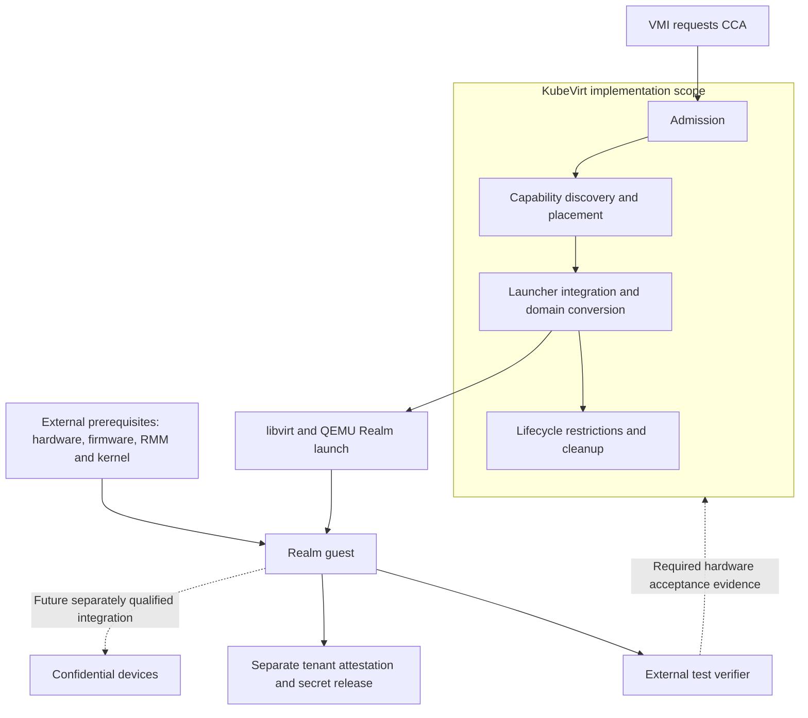

# VEP #338: Enable Arm CCA Realm VMs

## VEP Status Metadata

Status: Draft for SIG Compute review. Updated October 19, 2026.

- Owning SIG: SIG Compute. Request SIG Network and SIG Storage review of the device, shared-memory, and lifecycle restrictions.
- Enhancement tracker: [#338](https://github.com/kubevirt/enhancements/issues/338).
- Proposed feature gate: `WorkloadEncryptionCCA`.

### Target releases

- This VEP targets alpha for version: not assigned; requires SIG approval.
- This VEP targets beta for version: not assigned.
- This VEP targets GA for version: not assigned.

### Release Signoff Checklist

Items marked with (R) are required prior to targeting a milestone or release.

- [ ] (R) Enhancement issue links to the VEP directory in [kubevirt/enhancements](https://github.com/kubevirt/enhancements).
- [ ] (R) Alpha target version is explicitly mentioned and approved.
- [ ] (R) Beta target version is explicitly mentioned and approved.
- [ ] (R) GA target version is explicitly mentioned and approved.

## Overview

This VEP adds vendor-neutral Arm Confidential Compute Architecture (CCA) Realm launch and lifecycle support to KubeVirt. A VM author requests it through `spec.domain.launchSecurity.cca: {}`.

KubeVirt validates the configuration, selects a compatible Arm node, launches through native libvirt interfaces, and enforces the supported lifecycle. If Realm launch fails, KubeVirt must report failure. It must never remove the CCA request and retry as an ordinary VM.

The initial scope is a CPU Realm with fixed CPU and memory allocation, a qualified UEFI boot path, and basic virtual storage and networking. Host-device passthrough is rejected. Hardware acceptance includes independent verification of fresh Realm evidence. Verifier services, secret-release policy, and confidential-device enablement remain separate integrations.

## Motivation

Organizations running sensitive workloads need to protect code and data while they are in use. In shared or externally operated infrastructure, this includes protecting guest private memory from access by host software and the infrastructure administrator. Arm CCA Realms provide protected CPU execution for this class of confidential VM, within the platform threat model.

NVIDIA Vera Rubin is an initial integration target for this proposal. For Vera Rubin deployments that require confidential AI workloads, Arm CCA VM support is a foundational capability. It provides a protected CPU environment in which guest software can process sensitive data and participate in an attestation-based trust flow. Complete protection of a GPU-backed workload also requires separately qualified GPU protection, device assignment, and attestation integration. Those capabilities have their own implementation and acceptance requirements.

The first useful deliverable is a CPU Realm running a known guest image, with working virtual storage and networking, independently verified evidence, and tested stop and recreation behavior. This supports CPU workloads and establishes the VM foundation needed by later confidential-GPU integration. VEP-338 does not claim complete confidential AI support on Vera Rubin or qualification of any platform before its acceptance tests pass.

KubeVirt needs a native way to request and manage these Realms. VM authors need a portable API without QEMU arguments, firmware paths, or platform-specific annotations. Operators need capability-aware placement, compatible launcher configuration, predictable lifecycle restrictions, and clear failure reporting. VEP-338 provides this foundation through a vendor-neutral Arm CCA interface that also applies to other qualified Arm platforms.

Realm launch alone does not establish that a tenant should trust a VM. Remote attestation lets a relying party evaluate the execution environment before releasing secrets. KubeVirt must preserve this distinction in its API, status, and tests.

The proposal follows the limited launch-security API in [VEP #80](https://github.com/kubevirt/enhancements/blob/main/veps/sig-compute/80-tdx-sev-snp/vep.md). It keeps Realm launch and lifecycle in core KubeVirt while allowing attestation services and confidential-device support to develop as separate integrations.

## Goals

- Add a minimal CCA launch-security API behind an alpha feature gate.
- Validate architecture, boot settings, devices, memory, and lifecycle intent.
- Discover usable capability and constrain placement to compatible nodes.
- Integrate compatible QEMU, libvirt, firmware, and host access into the launcher; use native domain configuration.
- Support creation, shutdown, destruction, and cold recreation without a non-confidential fallback.
- Reject unsupported operations and expose useful failure reasons.
- Qualify the feature on hardware with externally verified Realm evidence, negative tests, and repeated lifecycle tests.
- Keep the API and common implementation usable across Arm CCA platforms.

## Non Goals

- Implementing or operating a production verifier, key broker, reference-value service, workload identity service, or guest attestation agent.
- Defining tenant secret-release policy or composite CPU/GPU attestation.
- GPU or other host-device passthrough, confidential DMA, device reset policy, SR-IOV, mediated devices, or new device-plugin/DRA APIs.
- Live migration, VM snapshot/restore, save/restore, suspend/resume, memory dumps, or CPU, memory, disk, and interface hotplug in the initial profile.
- Direct kernel boot or persistent UEFI variable storage in the initial profile.
- Exposing firmware paths, host granules, kernel capability numbers, measurement-log host paths, or experimental QEMU options in the VMI API.
- Installing or maintaining platform firmware, the Realm Management Monitor (RMM), the host kernel, or the guest operating system.
- Automatically protecting disks, network traffic, cloud-init data, or Kubernetes Secrets because a VMI requests CCA.

Launcher dependency integration is in scope. External attestation tools are also in scope as test dependencies, without becoming KubeVirt services.

## Definition of Users

- VM authors request a Realm and supply a compatible guest image.
- Cluster administrators enable the feature and maintain compatible nodes.
- Platform integrators qualify host, launcher, firmware, and guest combinations.
- Attestation developers consume guest evidence through a separate trust flow.

## User Stories

- As a VM author, I can request CCA without knowing the host vendor or VMM syntax.
- As an operator, I receive an admission error for a known incompatible request.
- As an operator, I can identify missing capability or firmware at launch.
- As a tenant, I can obtain fresh evidence from my Realm for an external verifier.
- As a platform integrator, I can test the same VMI API on different CCA systems.
- As an operator, I can stop or delete a Realm and recover from failed launches without leaking resources or weakening its launch-security request.

## Repos

- [kubevirt/enhancements](https://github.com/kubevirt/enhancements): proposal.
- [kubevirt/kubevirt](https://github.com/kubevirt/kubevirt): staged API, admission, controllers, node labeller, launcher integration, and tests.
- [kubevirt/api](https://github.com/kubevirt/api): published staged API.
- [kubevirt/user-guide](https://github.com/kubevirt/user-guide): user and operator documentation.

Linux/KVM, QEMU, libvirt, edk2, and RMM implementations remain external dependencies. Changes required in those projects must have separate owners.

## Design

### Security contract and ownership

CCA protects Realm private memory from Normal World software within the platform threat model. The RMM and platform root of trust are part of the trusted computing base. Shared memory and emulated I/O remain exposed to the host. The guest must authenticate or encrypt external data as its policy requires. See the [Linux CCA architecture](https://docs.kernel.org/arch/arm64/arm-cca.html).

KubeVirt controls orchestration. It does not make an untrusted control plane a source of cryptographic trust. A node label, VMI spec, or running condition is not attestation. The host can deny service, and a malicious administrator can misrepresent orchestration state.

| Workstream | Owned behavior | Acceptance evidence |
| --- | --- | --- |
| VEP-338 Realm foundation | API, placement, launcher integration, launch, lifecycle, and cleanup | Hardware boot, external evidence verification, negative and lifecycle tests |
| [VEP-418 confidential-device orchestration](https://github.com/kubevirt/enhancements/issues/418) | Proposed KubeVirt API, scheduling, launch configuration, stable device assignment, and lifecycle restrictions needed for guest-initiated CPU/device attestation | Separate device and platform qualification, including protected assignment, DMA, reset, cleanup and reuse |
| External attestation integration | Guest agent, session binding, reference values, verifier and secret-release policy; outside VEP-338 and VEP-418 | Approved evidence permits release; invalid, stale, or incorrectly bound evidence does not |

VEP-338 can graduate independently of VEP-418. Confidential-device support must explicitly extend the CPU-only restrictions through its own accepted design; the existence of that proposal does not permit passthrough in this VEP.



### API and feature gate

Add an optional empty CCA type to the existing launch-security union:

```go
type LaunchSecurity struct {
    // Existing fields omitted.

    // CCA requests an Arm CCA Realm.
    // +optional
    CCA *CCA `json:"cca,omitempty"`
}

type CCA struct{}
```

Generate the corresponding CRD schema, deep-copy code, and clients. The alpha gate `WorkloadEncryptionCCA` is off by default. Enabling it changes no VMI unless that VMI requests CCA. CCA is mutually exclusive with other launch-security types. The request cannot be removed or changed on a running VMI; changing launch security requires an explicit stop and recreation.

Use qualified lower-layer defaults for the measurement algorithm. Do not expose a measurement-log host path. Defer Realm Personalization Value (RPV) until there is a reviewed provisioning and identity-binding requirement.
Before alpha, demonstrate that the acceptance flow works without a new RPV field. If that flow requires tenant-controlled RPV, amend the API design before claiming acceptance; do not substitute an undocumented annotation.

### Admission and the initial profile

Validate the effective VMI after existing defaulting and preference resolution. Admission checks static constraints. Launcher checks enforce node-dependent constraints that admission cannot know.

1. Require the feature gate and effective `arm64` architecture.
2. Require CCA as the only launch-security type and the Arm `virt` machine family.
3. Require UEFI with no persistent variable storage; reject direct kernel boot.
4. Require the effective Secure Boot setting to be supported by the qualified firmware profile. An omitted setting follows existing Arm64 defaulting; CCA does not introduce a different default. Never silently disable a requested Secure Boot policy.
5. Apply the existing Arm CPU-model rules and require fixed CPU and memory sizing.
6. Reject GPU, generic host-device, mediated-device, and SR-IOV passthrough, including equivalent requests resolved through resource claims.
7. Reject unsupported lifecycle, memory-sharing, and device settings below.

A qualification profile is a versioned compatibility manifest and test record, not a new Kubernetes object or tenant API. The initial UEFI-only scope limits the boot paths and measurement inputs that must be qualified. Stateless firmware avoids adding variable-store persistence and recovery semantics. Direct kernel boot and persistent variables can be proposed later with their own measurement and lifecycle tests.

The initial profile proposes virtio block storage, virtio network through an existing supported binding, and a serial console. Exact models and binding combinations must pass the hardware suite before alpha. Other devices require explicit support-matrix entries. Disable implicit graphics and balloon devices for CCA; reject explicit requests for unsupported devices instead of dropping them.

Memory ballooning, free-page reporting, host memory sharing/deduplication, virtiofs, and unqualified shared-memory backends are excluded. No new CCA API selects a host page size or memory backend. The launcher must generate the private/shared memory configuration required by its qualified KVM/QEMU pair.

Secure Boot and Realm measured launch are distinct mechanisms. A profile may support Secure Boot enabled, disabled, or both. Capability discovery and launch validation must not imply that one setting works merely because CCA works.

### Capability discovery and placement

Extend node-labeller discovery to inspect native libvirt domain capabilities for the applicable Arm machine with KVM virtualization. Require a positive CCA capability and successful checks of the inspectable host-access and firmware prerequisites. Unknown, malformed, expired, or failed probe results are not positive capability.

The proposed discovery contract is:

| Responsibility | Required behavior |
| --- | --- |
| Probe execution | Run a bounded probe using the QEMU, libvirt, libraries, and firmware of the launcher build being advertised. Do not probe unrelated host-installed binaries or accept software emulation as hardware CCA capability. |
| Result identity | Record the launcher image digest, machine/firmware selection, probe time, and host boot identity with the result. Treat these as operational metadata, not attestation. |
| Refresh owner | The node labeller consumes fresh results and owns the labels. Probe at startup, after a launcher/probe configuration change, and periodically to detect prerequisite loss. Re-reading an unchanged startup XML file is not a new probe. |
| Invalidation | Remove advertised CCA capabilities on a negative result, identity mismatch, or result expiry. Define the probe timeout, refresh interval, and maximum result age in the implementation and test them with a fake clock. Node unavailability remains subject to normal Kubernetes scheduling controls. |
| Upgrade | Invalidate results for an old launcher before advertising its replacement. Re-probe the replacement; mixed versions must not reuse a result for a different image. |

The discovery PR must specify the probe process/container, its host access, and how it refreshes results in the existing node-labeller deployment. An init-container-only probe does not satisfy periodic refresh. Do not add a per-VMI verifier or create a test Realm on each refresh.

Advertise the proposed base label `kubevirt.io/cca=true` and a separate label for each qualified Secure Boot mode: `kubevirt.io/cca-secureboot-enabled=true` and/or `kubevirt.io/cca-secureboot-disabled=true`. For each mode, the selected firmware and device/machine configuration must satisfy the common initial profile. Labels are scheduling hints, not a capacity reservation or a claim that every firmware option works.

For a CCA VMI, `virt-controller` requires the base label and the label matching the effective Secure Boot setting, while preserving user placement restrictions. This permits placement in a pool with different supported boot modes. Incompatible restrictions must not remove the CCA requirement. Additional incompatible machine or device combinations must be excluded from the initial support matrix until placement can distinguish them.

The launcher checks its actual userspace, firmware, and host access again before QEMU starts. A stale label therefore cannot authorize an unsupported start in a correctly operating deployment. Successful prerequisite checks still do not prove that resources remain available: actual Realm creation can fail and must retain CCA intent. Neither the labels nor these checks establish trust against a malicious host or control plane.

### Launcher and dependency contract

The delivered launcher must contain compatible QEMU, libvirt, runtime libraries, and CCA-capable firmware or a supported mechanism to resolve that firmware. Integrate their versions, paths, permissions, device access, security profiles, and memory requirements into the launcher build and tests. Do not require tenant-supplied QEMU command-line overrides or XML hooks.

Use firmware descriptors and libvirt selection where the supported interfaces permit it, following [VEP #241](https://github.com/kubevirt/enhancements/blob/main/veps/sig-compute/241-firmware-auto-selection/vep.md).
Any temporary alpha firmware mapping must be internal to qualified packaging, versioned, and tested. Firmware paths do not enter the VMI API. Missing or incompatible firmware causes failure; an ordinary AAVMF image is not a fallback.

Each qualification profile records the following inputs:

| Layer | Required record |
| --- | --- |
| Platform | Hardware, enabled security mode, system firmware, RMM and attestation provisioning |
| Host | Kernel build/configuration, RMI compatibility, page granule, and required access |
| Launcher | Image digest, QEMU/libvirt versions, libraries, machine type, firmware identity and selection rules |
| Guest | Image identity, kernel, boot chain, RSI support and shared-buffer behavior |
| Test verifier | Version, trust anchors, endorsement inputs, reference values and challenge policy |
| KubeVirt | Revision, feature gate, device profile and test results |

Branch names or package installation alone do not qualify a profile. Host and guest granule compatibility belongs to that profile. Do not hard-code a platform granule or a downstream capability-number workaround in the CCA API.

The launcher integration PR must include a reviewable dependency record, not only version lower bounds:

- Public source revisions or patch-series links for each required Realm interface, with an integration owner and its upstream status.
- Captured positive and negative libvirt domain-capability fixtures for the selected machine/KVM combination, the exact CCA fields consumed, and their parser tests.
- The generated native domain XML, firmware descriptor or temporary package mapping, resolved firmware identity, and the resulting QEMU configuration. Test that optional properties are omitted when unsupported.
- The host UAPI/RMI, private/shared memory, required device/file access, and container security requirements for that same userspace build. Include a reproducible direct-libvirt smoke test and its result.

These records are required before accepting the corresponding integration implementation. A draft VEP can be reviewed before the dependencies merge, but cannot imply that unspecified interfaces are already implemented or compatible. No minimum kernel, QEMU, or libvirt version is asserted by this draft.

Pinned experimental dependencies can support development. Alpha merge requires maintainer agreement on the exact dependency and CI plan. Beta requires the consumed Realm interfaces in upstream releases and a maintained, reproducible KubeVirt integration. Availability of confidential-device extensions is not a dependency for the CPU-only profile.

### Launch and failure handling

1. Resolve the admitted VMI to a supported machine, boot, device, and memory profile.
2. Recheck capability and required access inside the launcher environment.
3. Select CCA firmware and generate the native libvirt Realm configuration.
4. Launch the Realm through QEMU, KVM, and the RMM.
5. Report lifecycle state through the existing VMI mechanisms.

The proposed minimal domain intent is:

```xml
<launchSecurity type='cca'/>
```

Use the schema supported by the approved libvirt dependency. Do not emit optional properties that the selected QEMU cannot consume. Any capability, conversion, memory, firmware, or launch error fails the CCA start operation. Recovery must retain the original CCA request.

On partial failure or deletion, destroy the libvirt domain, terminate its QEMU process, and release launcher-owned file descriptors, memory mappings, and temporary artifacts through the existing teardown paths. KVM and the RMM own destruction and reclamation of Realm resources; KubeVirt must not infer that reclamation succeeded only because a VMI object was deleted.

For KubeVirt, observable teardown completion requires confirmation that the domain/process has exited and launcher-owned resources are released. Report teardown errors through existing status/events and retain enough identifiers for diagnosis. Bound retries within each launch attempt and report persistent errors. Controller retries retain existing run-strategy and backoff semantics, always with the CCA request intact. Qualification must additionally verify lower-layer reclamation and repeated resource reuse using the stack's available diagnostics. If reclamation cannot be established after a lower-layer failure, the operator recovery procedure must require investigation and, where necessary, node maintenance before further CCA starts.

### Lifecycle and node maintenance

| Operation | Initial behavior |
| --- | --- |
| Create/start, guest shutdown, stop/delete | Supported |
| Cold recreation | Supported as a new Realm; fresh evidence is required by the relying party |
| In-guest reboot | Must pass the initial profile tests; does not itself imply a new Realm identity |
| Live migration and live storage migration | Rejected |
| KubeVirt VM snapshot/restore, save/restore, suspend/resume | Rejected |
| Host-readable memory dump | Rejected |
| CPU, memory, disk, interface or host-device hotplug | Rejected |

Set the existing migratability condition to false with a CCA-specific reason, proposed as `CCANotLiveMigratable`. Reject a migration request before transfer starts. Reject configurations that require live-migration eviction. Document that node drain can remain blocked until the operator arranges an explicit stop and restart, subject to the VM's availability policy.

A failed node can require cold recreation on another compatible node. This is not memory-state migration. The VEP does not provide transparent availability or secret restoration. The guest and relying party establish a new trust session as needed.

Storage-system backup of disk blocks is separate from restoring Realm memory state. This VEP neither adds storage backup support nor claims that a disk backup proves integrity or freshness. KubeVirt snapshot workflows remain unsupported until their own compatibility review.

The lifecycle implementation must map each restriction to all applicable entry points: VM/VMI create and update, migration and eviction, snapshot/restore and memory-dump requests, hotplug subresources, and domain operations used for save or suspend. Use admission for early errors and controller/launcher guards where execution can bypass that admission path or act on an existing object. Cover these paths after feature-gate removal as well. Do not rely on a libvirt error as the sole enforcement mechanism.

### Attestation boundary and observability

A guest can request evidence through the Realm Services Interface (RSI). External verification is required in the hardware acceptance suite, but KubeVirt does not wait for a tenant verifier or operate a secret-release service. No `Attested=True` status is derived from launch success or a node label.

Record actionable admission and launch errors, selected component identities, and non-migratability. Do not place guest secrets or complete attestation tokens in routine control-plane logs. Test evidence with sensitive claims needs appropriate access and retention controls.

Disks, cloud-init, guest-agent commands, network input, and Kubernetes Secrets are not automatically covered by Realm measurements. The test manifest must describe the Realm Initial Measurement (RIM), the Realm Extensible Measurements (REMs) used by the guest boot flow, and the source of their expected values. For firmware, bootloader, kernel/initramfs, root filesystem, and configuration inputs, state whether each is measured, authenticated by a measured component, or outside the evidence policy. Do not describe an entire guest image as verified when only its initial firmware is covered.

Secure Boot disabled does not mean that arbitrary unmeasured code is acceptable. The selected test flow must establish how the expected guest code is identified, such as measured boot or an authentication chain rooted in measured code. Mutable or unverified inputs must remain explicit limitations. Pin the test verifier, policy, trust anchors, endorsements, and reference-value generation procedure. Reference values must come from approved build inputs or a separately justified reference process, not automatic acceptance of the guest under test.

A fresh challenge prevents reuse of an old response; it does not by itself prevent a relay to another valid Realm. The acceptance test must bind evidence to a guest-held session key or an equivalent reviewed endpoint-binding mechanism and prove possession during that session. Include a negative test that substitutes evidence or a session from another acceptable Realm. The harness must also record how it associates the tested VMI with that session; a trusted laboratory association is not a production identity guarantee against an untrusted control plane. A production integration must establish the intended peer and policy before releasing secrets. A VMI UID or node label alone cannot provide that binding.

### Delivery and review decisions

VEP-338 defines the proposed Arm CCA API, orchestration behavior, lifecycle restrictions, and qualification requirements. Implementation will follow this design after community review. Earlier CCA proposals are background references and do not determine this VEP's scope or implementation.

Organize implementation PRs around the accepted requirements: API and admission; capability discovery and placement; launcher integration and domain conversion; lifecycle and cleanup; and tests and documentation. The VEP owner tracks these PRs, their reviewers, and acceptance evidence in enhancement #338. Any reused code must retain its attribution and satisfy this VEP's requirements. Defer optional launch parameters that have no accepted use case.

Use one hardware profile first; NVIDIA Vera is the initial proposed integration target. Keep vendor identifiers out of common API and conversion logic. Establish one reproducible acceptance result before adding platform variants. No vendor's GPU or product delivery milestone determines the Realm foundation release.

Portability has two independent dimensions: different compatible kernel/QEMU/libvirt distributions, and different CCA hardware/firmware implementations. A second software stack on Vera tests the first dimension; it does not prove the second. NVIDIA BaseOS, CentOS Stream/AIE, or another distribution can be candidates only when their actual host and launcher dependencies meet this contract. A distribution name, a component version, or ordinary Arm virtualization support does not establish Realm support. Platform qualification and commercial support claims remain separate.

Resolve these decisions before alpha signoff:

- The consumed libvirt capability/XML schema and matching QEMU interface.
- Firmware selection, Secure Boot combinations, and the initial device matrix.
- The probe deployment, required privileges, refresh/expiry limits, and final capability-label names.
- The launcher build, host-access checks, memory overhead and granule profile.
- The hardware CI owner, external verifier, reference values, and test trust anchors.
- The evidence/session-binding design needed to validate the empty CCA API.
- Any finite Realm resource that needs accounting beyond CPU and memory.
- The dependency merge policy and approved release target.

## API Examples

Enable the feature in the existing KubeVirt configuration. Preserve other feature gates and required installation fields; this is a configuration fragment.

```yaml
spec:
  configuration:
    developerConfiguration:
      featureGates:
        - WorkloadEncryptionCCA
```

The following VMI illustrates a proposed profile with Secure Boot disabled. Use it only after that mode and its measured or authenticated boot flow pass qualification. This setting is not a universal CCA requirement. Replace the illustrative image with a qualified Arm64 guest image pinned by digest. The example is proposed API usage, not a claim that the feature is already available.

```yaml
apiVersion: kubevirt.io/v1
kind: VirtualMachineInstance
metadata:
  name: arm-cca-realm
spec:
  architecture: arm64
  domain:
    cpu:
      model: host-passthrough
      cores: 2
    memory:
      guest: 4Gi
    firmware:
      bootloader:
        efi:
          secureBoot: false
          persistent: false
    launchSecurity:
      cca: {}
    devices:
      autoattachGraphicsDevice: false
      autoattachMemBalloon: false
      disks:
        - name: rootdisk
          disk:
            bus: virtio
      interfaces:
        - name: default
          model: virtio
          masquerade: {}
  networks:
    - name: default
      pod: {}
  volumes:
    - name: rootdisk
      containerDisk:
        image: quay.io/example/arm64-cca-guest:qualified
```

KubeVirt adds the CCA placement constraint. No vendor-specific selector or tenant firmware path is required. A `VirtualMachine` uses the same fields under `spec.template.spec`. Preferences may supply existing boot/architecture defaults, but must not bypass the effective-VMI validation.

## Alternatives

| Alternative | Decision |
| --- | --- |
| XML hook or command-line injection only | Useful for experiments; does not supply the API, placement, admission, and lifecycle contract |
| One VEP for Realms, verifier/secret-release services, and GPUs | Couples independently owned interfaces and makes CPU acceptance depend on unrelated services and devices |
| CPU/model-based capability labels | Do not establish the usable host and launcher combination |
| All experimental launch options in the first API | Creates compatibility obligations before semantics and use cases are agreed |
| A vendor-specific CCA API | Prevents reuse of the same security request across Arm platforms |
| A Realm device plugin/DRA resource from the start | Defer unless the supported stack exposes an independently consumable resource requiring accounting |
| Boot-only acceptance | Does not establish that the guest can produce authentic, fresh evidence for the expected environment |

## Does it belong to core KubeVirt?

Yes. Launch security affects the VMI API, admission, placement, domain conversion, migratability, and resource cleanup. These are existing KubeVirt responsibilities. Hooks, external controllers, or plugins cannot by themselves enforce consistent behavior across those paths. The proposal extends the existing launch-security model rather than adding a new controller.

Production attestation services, guest agents, and secret-release policy have separate trust and lifecycle requirements. They remain outside core KubeVirt. Using an external verifier in CI does not change that ownership boundary.

## Scalability

Extend node-labeller discovery with bounded, periodic prerequisite probes and reuse the existing controller/launcher paths. Set probe intervals and timeouts to avoid overlapping work or excessive node load. No per-VMI verifier service, evidence polling loop, or new scheduling controller is introduced. Do not create test Realms during every label refresh.

CPU and guest memory use normal KubeVirt accounting, including measured launcher overhead. The qualification profile must account for additional kernel/RMM costs in node capacity planning. If the stack exposes a finite Realm resource that normal accounting cannot represent, resolve that resource contract before enabling the affected profile. Resource exhaustion must fail creation without a fallback or resource leak.

## Update/Rollback Compatibility

The API is optional. Existing non-CCA VMIs keep their behavior. Removing the feature gate prevents new CCA starts, including recreation, but must not stop running Realms or prevent their shutdown and cleanup. Security and lifecycle restrictions remain enforced for existing CCA VMIs after gate removal.

Launcher, firmware, and kernel updates can change capability and expected measurements. Refresh discovery, validate new launchers, and document changed launch inputs. Do not silently update an external verifier's reference policy to accept new measurements. Existing Realms remain subject to their original runtime constraints until stopped.

Upgrades must document the lack of live migration and the required maintenance procedure. Test mixed component versions within KubeVirt's supported upgrade window. On rollback to a version that cannot preserve or enforce the CCA API, stop CCA workloads and remove their objects from reconciliation first. Preserve the manifests for a later compatible installation. Never strip `cca` and restart the workload as an ordinary VM as a downgrade mechanism.

## Functional Testing Approach

### Unit and component tests

Cover API serialization, schema generation, feature-gate behavior, mutual exclusion, and validation of effective VMI settings. Test valid, absent, malformed, disappearing, and expired capabilities, probe timeouts, and mismatched launcher identities. Verify selector composition and preservation of user placement constraints, including mixed Secure Boot capability pools and defaulted versus explicit settings.

Test firmware selection, Secure Boot mismatch, native XML conversion, default device suppression, and explicit rejection of unsupported devices and lifecycle requests. Inject launch failures and verify error reporting, cleanup, and retention of the CCA request. Test gate disablement and downgrade handling.

### Packaging and emulation tests

Verify the launcher artifacts, firmware resolution, host-interface access, and generated domain configuration. Emulation may exercise control-plane and boot paths where supported. It cannot replace hardware acceptance. Pin emulation inputs separately from hardware qualification inputs.

### Hardware acceptance

The initial hardware suite must:

- Establish the recorded platform/host/launcher/guest combination through direct QEMU and libvirt launch before testing KubeVirt.
- Launch the same CPU Realm profile through KubeVirt and exercise basic disk, network, console, and shared-buffer operation.
- Obtain evidence for a fresh challenge from the intended test guest. An external verifier validates signatures, the applicable endorsement chain, platform/Realm binding, challenge binding, and expected measurements.
- Reject tampered evidence, an old response to a new challenge, incorrect reference values, and an untrusted endorsement chain. Test the measurement/authentication coverage declared for the guest boot chain. Verify session-key possession or the reviewed equivalent, and reject substitution from another acceptable Realm. Record the harness's VMI/session association and its trust assumptions. Development trust anchors must be identified as such.
- Exercise guest reboot, shutdown, stop, deletion, and cold recreation. Reverify evidence after recreation. Do not assume in-guest reboot creates a new Realm or resets its measurements.
- Repeat create/destroy cycles and inject failures after partial memory and vCPU creation. Verify domain/process exit, release of launcher-owned resources, and memory/vCPU reclamation and reuse through available lower-layer diagnostics. Test teardown-error reporting and the documented recovery procedure.
- Exercise a non-CCA node, a stale label, missing firmware, incompatible Secure Boot settings, unavailable host access, and exhausted resources. Every failure must preserve CCA intent.
- Reject passthrough, migration, snapshots, memory dumps, and unsupported hotplug. Test node-maintenance and feature-gate-disable behavior.
- Confirm ordinary Arm VM behavior is unchanged when the feature is enabled.

The verifier is a test dependency. These tests do not implement tenant key release or establish that every production workload is trustworthy. Token generation alone, guest messages, and a running VMI condition do not satisfy the evidence requirement. Platform isolation assurance also depends on the qualified lower layers; a passing token test is not a proof of every hardware security property.

### Portability and continuous testing

Maintain a hardware lane with an identified owner and triage policy; failed or skipped evidence checks must not be counted as successful qualification. Use the same VMI API and acceptance suite for each additional supported profile, with separate manifests for differing firmware, guests, and software stacks.

Seek both a second compatible software stack and a second independent Arm CCA hardware platform. Before beta, SIG Compute must review the available evidence on both dimensions and approve the declared support matrix. If additional hardware is unavailable, record that limitation, the owner and plan for broader validation, and the scope approved for beta. Do not claim qualification of untested platforms. Independent hardware diversity is a validation objective, not an unconditional dependency on another vendor's delivery schedule.

## Implementation History

- 2026-06-16: Enhancement tracker #338 opened.
- 2026-10-19: Draft revised to define launcher integration, CPU-only lifecycle, passthrough rejection, and external evidence verification in acceptance.
- 2026-10-19: Review revision clarified VEP-418 ownership, discovery refresh and boot-mode placement, dependency evidence, guest/session verification, teardown ownership, and portability review gates.

Implementation and graduation results will be recorded when their PRs and test evidence are available.

## Graduation Requirements

### Alpha

- [ ] SIG review accepts the VEP, initial profile, public dependency/interface record, integration owners, and release target.
- [ ] The off-by-default feature gate and minimal CCA API are implemented.
- [ ] Admission, discovery refresh/expiry, boot-mode placement, launcher integration, and native XML conversion are implemented and tested against captured dependency fixtures.
- [ ] Passthrough and unsupported lifecycle operations are rejected.
- [ ] Launch failures retain CCA intent; teardown, lower-layer resource reuse, and error recovery pass the declared tests.
- [ ] Unit, component, and launcher packaging tests pass.
- [ ] At least one hardware profile passes the complete acceptance suite, including external verification and negative evidence tests.
- [ ] The compatibility manifest, verifier inputs, measurement/authentication coverage, session-binding method and harness assumptions, device matrix, resource overhead, and operator procedures are recorded.
- [ ] A hardware CI owner and a monitored execution schedule are assigned.
- [ ] VEP-338 implementation PRs satisfy the accepted requirements and are linked from the enhancement tracker with their test evidence.
- [ ] The VEP, tracker, and implementation use the same feature-gate name.

### Beta

- [ ] Required Realm interfaces are accepted upstream and available in released
  kernel, QEMU, libvirt, and firmware components used by the supported integration.
- [ ] Firmware selection has a stable package/descriptor contract.
- [ ] API, security, and dependency reviews are complete.
- [ ] SIG Compute approves the portability evidence and supported profile matrix, with explicit limits and an owned validation plan for untested software-stack or hardware variants.
- [ ] Hardware CI has sustained passing results and an active failure-triage owner.
- [ ] Supported upgrades, gate disablement, maintenance, and cold recovery pass tests.
- [ ] No unresolved critical security or data-integrity defects remain in the profile.
- [ ] User documentation states the threat boundary and unsupported operations.

#### On-By-Default Readiness

- [ ] Beta criteria are satisfied; explicit `cca` opt-in remains required per VMI.
- [ ] Non-CCA workloads retain their behavior.
- [ ] Negative tests cover capability loss, unsupported configurations, and fallback prevention.
- [ ] Failure messages identify the actionable missing prerequisite.
- [ ] Packaging and resource accounting are sufficient for supported configurations.

### GA

- [ ] The API meets the KubeVirt feature lifecycle's stability requirements.
- [ ] Released dependencies and hardware CI have clear maintenance ownership.
- [ ] Upgrade, rollback, cleanup, and recovery behavior remain tested.
- [ ] There are no unresolved critical isolation, security, or data-integrity defects.
- [ ] The support matrix and operator procedures match the implemented behavior.
- [ ] The feature gate graduates according to KubeVirt policy.

Live migration, confidential devices, and a production attestation service are not GA prerequisites for the Realm foundation. They require separate designs and qualification before their restrictions can be relaxed.

## References

- [Enhancement #338](https://github.com/kubevirt/enhancements/issues/338)
- [VEP #80: TDX and SEV-SNP](https://github.com/kubevirt/enhancements/blob/main/veps/sig-compute/80-tdx-sev-snp/vep.md)
- [VEP #107: TDX attestation](https://github.com/kubevirt/enhancements/blob/main/veps/sig-compute/107-attestation-proposal/vep.md)
- [VEP #241: Firmware auto-selection](https://github.com/kubevirt/enhancements/blob/main/veps/sig-compute/241-firmware-auto-selection/vep.md)
- [KubeVirt feature lifecycle](https://github.com/kubevirt/community/blob/main/design-proposals/feature-lifecycle.md)
- [Linux Arm CCA architecture](https://docs.kernel.org/arch/arm64/arm-cca.html)
- [Arm RMM specification](https://developer.arm.com/documentation/den0137/)
- [VEP-418: Attestation-ready Arm CCA CVMs with confidential devices](https://github.com/kubevirt/enhancements/issues/418)
- [Earlier CCA RFC #17843](https://github.com/kubevirt/kubevirt/pull/17843) — non-normative historical reference; not a design or implementation dependency.
