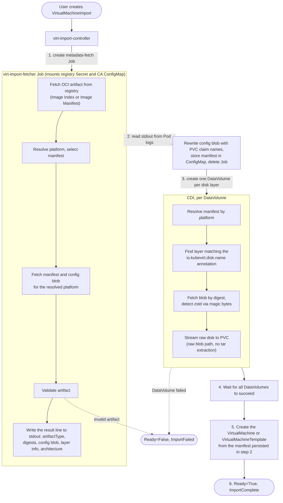

# VEP #395: OCI Artifact Import for VirtualMachines and VirtualMachineTemplates

## VEP Status Metadata

### Target releases

- This VEP targets alpha for version: v1.10
- This VEP targets beta for version:
- This VEP targets GA for version:

### Release Signoff Checklist

Items marked with (R) are required *prior to targeting to a milestone / release*.

- [ ] (R) Enhancement issue created, which links to VEP dir in [kubevirt/enhancements] (not the initial VEP PR)
- [ ] (R) Alpha target version is explicitly mentioned and approved
- [ ] (R) Beta target version is explicitly mentioned and approved
- [ ] (R) GA target version is explicitly mentioned and approved

## Overview

[VEP #256](../256-oci-export-proposal/vep.md) introduced
OCI artifact export for `VirtualMachines` and
`VirtualMachineTemplates`, but explicitly deferred import as a follow-up
design. Its graduation criteria for Beta/GA include "Import mechanism
implemented" and "Round-trip export/import tested."

This proposal introduces a `VirtualMachineImport` CRD (API group
`import.kubevirt.io`) and controller that imports `VirtualMachines` and
`VirtualMachineTemplates` from OCI artifacts stored in container registries.
The target kind is auto-detected from the OCI manifest's `artifactType`
field. The controller lives in a new `kubevirt/virt-import` repository and
ships two images, `virt-import-controller` and `virt-import-fetcher`. It is
installed from the manifest bundle the repository publishes with each
release, and will also be available through the
hyperconverged-cluster-operator (HCO).

Importing disk data is delegated to CDI via `DataVolumes`. This requires
extending CDI's `DataVolumeSourceRegistry` with a `Layer` field to
support selecting OCI artifact layers by annotations, and handling raw
(non-tar) layer blobs.

A proof-of-concept shell script exists at `kubevirt/kubevirt/hack/oci-import.sh`
that validates the overall approach.

### Implementation Phases

The work is split into three sequential phases:

1. **Phase 1 - CDI** (`kubevirt/containerized-data-importer`): Extend CDI's
   `DataVolumeSourceRegistry` with a `Layer` field, add raw blob handling
   for OCI artifact layers, and validate incompatibility with node pull
   mode.
2. **Phase 2 - virt-import** (`kubevirt/virt-import`): Implement the
   `VirtualMachineImport` CRD, the controller, the metadata-fetch binary and
   the `virtimportctl` CLI in a new repository, together with the manifest
   bundle that installs them.
3. **Phase 3 - HCO** (`kubevirt/hyperconverged-cluster-operator`): Make the
   component deployable through HCO.

Each phase depends on the previous one. All three target alpha in v1.10.
`kubevirt/kubevirt` is not modified.

## Motivation

By completing the import side of the OCI artifact workflow, we get:

* **Full round-trip** - export a VM or template from one cluster, push to a
  registry, import on another cluster
* **Declarative API** - `VirtualMachineImport` CR with status tracking,
  conditions, and garbage collection of intermediate resources
* **Registry-native distribution** - pull VMs and templates from existing
  registry infrastructure
* **Portable imports** - storage-specific details are not stored in the
  artifact; CDI applies cluster-appropriate defaults via StorageProfiles,
  making imports work across clusters with different storage backends

## Goals

* Import `VirtualMachines` from OCI artifacts in registries
* Import `VirtualMachineTemplates` from OCI artifacts in registries
* Auto-detect target kind from OCI `artifactType`
* Support multi-architecture OCI artifacts via optional
  `platform.architecture` selection
* Extend CDI's `DataVolumeSourceRegistry` with a `Layer` field for
  layer selection by annotations and raw blob handling
* Publish a manifest bundle that installs the controller standalone, and
  make the component deployable through HCO
* Provide a `virtimportctl` CLI

## Non Goals

* Node pull mode for OCI artifacts (future enhancement - see
  [Node Pull Mode](#node-pull-mode---future-enhancement))
* Multi-VM appliance import (single VM or template per artifact)
* Guest-level operations (sysprep, network reconfiguration) during import
* Import of non-KubeVirt OCI artifacts (only artifacts matching the VEP #256
  format); non-compliant artifacts are rejected
* Periodic or scheduled imports (could be built on top of
  `VirtualMachineImport` as a future enhancement)
* `virtctl` integration; the CLI commands move into `virtctl` at beta

## Definition of Users

* **VM owner**: imports VMs from registries for cross-cluster migration or
  disaster recovery
* **Template owner**: imports templates from registries for sharing reusable
  VM blueprints across clusters
* **Cluster admin**: manages RBAC to control who can create imports;
  configures storage classes and StorageProfiles

## User Stories

* As a VM owner, I want to import a `VirtualMachine` from a registry so I can 
  recreate it on another cluster.
* As a template owner, I want to import a `VirtualMachineTemplate` from a
  registry so I can share reusable templates across clusters.
* As a VM owner, I want to round-trip my VM: export to OCI, push to a
  registry, import on another cluster - and get an equivalent VM.
* As a cluster admin, I want imports to use cluster-appropriate storage
  defaults so I do not need to manually specify volume modes and access
  modes for each disk.

## Repos

* (Phase 1) [kubevirt/containerized-data-importer](https://github.com/kubevirt/containerized-data-importer) -
  `Layer` on `DataVolumeSourceRegistry` with selection by annotations,
  raw blob handling in importer
* (Phase 2) [kubevirt/virt-import](https://github.com/kubevirt/virt-import)
  (new) - import API, controller, metadata-fetch binary, CLI and manifest
  bundle
* (Phase 3) [kubevirt/hyperconverged-cluster-operator](https://github.com/kubevirt/hyperconverged-cluster-operator) -
  deployment of the import controller

`kubevirt/virt-import` is created through the KubeVirt org's repository
process, with @0xFelix and @akalenyu as maintainers.

## Design

### OCI Artifact Format (reference to VEP #256)

The import mechanism consumes artifacts in the format defined by
[VEP #256](../256-oci-export-proposal/vep.md). See its
[OCI Artifact Format Specification](../256-oci-export-proposal/vep.md#oci-artifact-format-specification)
for the full definition of artifact types, media types, layer annotations,
and config blob structure.

The import controller uses the `artifactType` field on the OCI manifest to
auto-detect the target kind (`VirtualMachine` or `VirtualMachineTemplate`).
It reads `io.kubevirt.disk.name` and `io.kubevirt.disk.size` from layer
annotations to correlate layers to volumes and to size DataVolumes.

**Not in the artifact:** `volumeMode` and `accessModes` are not stored in
the OCI artifact. CDI applies cluster-appropriate defaults via
StorageProfiles on the target cluster. This makes imports portable across
clusters with different storage backends.

### Phase 1: CDI - OCI Artifact Layer Support

This phase extends CDI's `DataVolumeSourceRegistry` to support selecting
individual layers from OCI artifacts by annotations and importing raw
(non-tar) blobs. All changes are in
[kubevirt/containerized-data-importer](https://github.com/kubevirt/containerized-data-importer).

#### DataVolumeSourceRegistry Layer

A new `Layer` field is added to `DataVolumeSourceRegistry`:

```go
// DataVolumeSourceRegistry provides the parameters to create a Data Volume from an registry source
type DataVolumeSourceRegistry struct {
    //URL is the url of the registry source (starting with the scheme: docker, oci-archive)
    // +optional
    URL *string `json:"url,omitempty"`
    //ImageStream is the name of image stream for import
    // +optional
    ImageStream *string `json:"imageStream,omitempty"`
    //PullMethod can be either "pod" (default import), or "node" (node docker cache based import)
    // +optional
    PullMethod *RegistryPullMethod `json:"pullMethod,omitempty"`
    //SecretRef provides the secret reference needed to access the Registry source
    // +optional
    SecretRef *string `json:"secretRef,omitempty"`
    //CertConfigMap provides a reference to the Registry certs
    // +optional
    CertConfigMap *string `json:"certConfigMap,omitempty"`
    //Platform describes the minimum runtime requirements of the image
    // +optional
    Platform *PlatformOptions `json:"platform,omitempty"`
    // Layer selects a specific layer from an OCI artifact manifest
    // by matching annotations on the manifest's layer descriptors.
    // The importer resolves the manifest (using Platform to select
    // from an image index; a set Platform is refused for a plain
    // manifest), finds the matching layer, and treats its blob as
    // raw data. Only the KubeVirt VM and VMTemplate artifactTypes
    // are accepted.
    // Incompatible with pullMethod: node.
    // +optional
    Layer *LayerSelector `json:"layer,omitempty"`
}

type LayerSelector struct {
    // MatchAnnotations selects a layer by annotations on the
    // OCI manifest's layer descriptors. Every entry must be present
    // on the same descriptor and match exactly, for example
    // "io.kubevirt.disk.name": "rootdisk".
    MatchAnnotations map[string]string `json:"matchAnnotations,omitempty"`
}
```

Selection must resolve to exactly one layer. The import fails if no
layer carries all the annotations in `matchAnnotations`, or if more
than one does. An empty or absent `matchAnnotations`, or an empty key in it, is
rejected by the webhook. Layer selection requires an OCI image manifest
with a KubeVirt VM or VMTemplate `artifactType`.

The `matchAnnotations` map follows the convention of Kubernetes label
selectors, and the selection by annotations itself follows podman's
[artifact extract](https://docs.podman.io/en/latest/markdown/podman-artifact-extract.1.html).
A `Digest` field for direct content-addressable selection could be added
to `LayerSelector` in the future if needed. CDI could also infer the
storage size from the layer's `io.kubevirt.disk.size` annotation when
resolving the manifest, removing the need for the controller to set it
on the DataVolume.

When `Layer` is set, `pullMethod` must be `pod` (or unset, defaulting
to `pod`). Node pull is incompatible with `Layer` because the container
runtime cannot handle OCI artifacts with custom media types. CDI's
webhook rejects DataVolumes that combine `Layer` with
`pullMethod: node`.

CDI's registry import behavior changes as follows:

| Step | Normal (container image) | With Layer (OCI artifact) |
|------|--------------------------|---------------------------|
| Manifest parsing | `image.FromSource()` | Fetch manifest; if image index, select by `Platform`; if plain manifest, or an index entry declaring no platform, refuse a set `Platform` |
| Layer selection | All layers, match by tar path | Match layer by annotations |
| Blob fetch | Via layer iteration | `GetBlob()` by matched layer's digest |
| Layer processing | `tar.NewReader()`, extract `disk/` files | Raw blob path: stream decompressed blob directly |
| Post-import inspection | `Inspect()` for labels | Skipped |

#### Node Pull Mode - Future Enhancement

Node pull mode cannot work for OCI artifacts because:

1. The container runtime (containerd/CRI-O) expects standard container
   image layers and would fail to pull an artifact with
   `application/vnd.kubevirt.disk.raw+zstd` layers
2. The sidecar container pattern used by CDI's node pull requires a valid
   container image as the sidecar's image reference
3. Even if the runtime could pull the artifact, it would try to unpack
   layers as filesystem overlays, which fails for raw disk blobs

Node pull would require one of:

* CRI-level OCI artifact support (upstream Kubernetes work)
* A different credential-sharing mechanism (e.g., projected service account
  tokens with registry auth)
* A proxy that uses node credentials to pull blobs and serves them to the
  importer pod

This can be a follow-up enhancement in the future.

### Phase 2: virt-import Controller

All changes are in
[kubevirt/virt-import](https://github.com/kubevirt/virt-import).

#### Repository Structure

The repository follows the same pattern as `kubevirt/virt-template`:

* Kubebuilder v4 scaffolding
* A separate `kubevirt.io/virt-import-api` module and a client generated
  from `staging/src/kubevirt.io/virt-import-client-go`
* A controller-runtime manager with leader election
* Kustomize overlays: `default`, from which `make build-installer` renders
  the standalone manifest bundle, and `hco`, from which
  `make build-installer-hco` renders the bundle HCO embeds

Two images are built: `virt-import-controller` runs the reconciler, and
`virt-import-fetcher` runs in the metadata-fetch Job, whose image the
controller reads from its `FETCHER_IMAGE` environment variable.

The OCI media types and layer annotations the importer reads are internal
constants of `kubevirt/virt-import`, matching VEP #256; they are not part of
the published `kubevirt.io/virt-import-api` module. The artifact format is
shared with the exporter, the constants are a copy: `kubevirt/virt-import`
does not depend on the `kubevirt.io/kubevirt` module. Promoting them to a
shared package is a GA item.

The controller does not access container registries directly. It spawns a
metadata-fetch Job whose Pod runs `virt-import-fetcher`. The Pod gets the
registry credentials as environment variables from the referenced Secret
(`secretKeyRef` on the `accessKeyId` and `secretKey` keys, CDI's format) and
mounts the referenced CA ConfigMap. The fetcher holds no API access, so the
only Pod that receives registry credentials contains an OCI client and
nothing else, and the controller needs no cluster-wide Secret or ConfigMap
read permissions.

#### Required and Optional API Groups

`cdi.kubevirt.io` is required; every import creates DataVolumes. An
availability controller polls discovery and starts the import reconciler once
the group appears. While it waits it patches pending `VirtualMachineImports`
with `Ready=False` and `Progressing=True`, reason `Waiting`, naming the
missing resources.

`template.kubevirt.io` is optional. It is only needed when an artifact's
`artifactType` names a `VirtualMachineTemplate`, and its absence fails that
one import rather than blocking the controller. `VirtualMachines` and
`VirtualMachineTemplates` are always read uncached, so a group installed later
needs no restart.

#### CRD Definition

```go
// VirtualMachineImportSpec defines the desired import.
type VirtualMachineImportSpec struct {
    // Source specifies where to import from.
    Source VirtualMachineImportSource `json:"source"`
    // TargetName is the name for the created VM or VMTemplate.
    // Defaults to the VirtualMachineImport CR name.
    // +optional
    TargetName string `json:"targetName,omitempty"`
    // StorageClassName overrides the default storage class for all
    // DataVolumes created during import.
    // +optional
    StorageClassName string `json:"storageClassName,omitempty"`
}
```

`VirtualMachineImportSpec` is immutable after creation, enforced by a CEL
validation rule (`self == oldSelf`) on the `spec` field of the CRD schema. To
change import parameters, delete the CR and create a new one. Further CEL
rules require a registry source and a `docker://` URL, and require
`targetName`, `storageClassName`, `secretRef` and `certConfigMap` to be
DNS-1123 subdomains.

```go
type VirtualMachineImportSource struct {
    // Registry specifies an OCI artifact in a container registry.
    // +optional
    Registry *VirtualMachineImportRegistrySource `json:"registry,omitempty"`
}

type VirtualMachineImportRegistrySource struct {
    // URL is the registry URL
    // (e.g. docker://registry.example.com/vms/fedora:v1).
    URL string `json:"url"`
    // SecretRef is the name of a Secret containing registry credentials.
    // +optional
    SecretRef string `json:"secretRef,omitempty"`
    // CertConfigMap is the name of a ConfigMap containing registry CA
    // certificates.
    // +optional
    CertConfigMap string `json:"certConfigMap,omitempty"`
    // Platform selects the architecture variant from a multi-arch
    // artifact.
    // +optional
    Platform *PlatformOptions `json:"platform,omitempty"`
}

type PlatformOptions struct {
    // Architecture selects the platform variant (e.g. amd64, arm64).
    Architecture string `json:"architecture,omitempty"`
}
```

```go
// VirtualMachineImportStatus reports observed import state.
type VirtualMachineImportStatus struct {
    // Conditions represent the latest observations of the import.
    // +listType=map
    // +listMapKey=type
    Conditions []metav1.Condition `json:"conditions,omitempty"`
    // ArtifactInfo contains metadata read from the OCI artifact.
    // +optional
    ArtifactInfo *ArtifactInfo `json:"artifactInfo,omitempty"`
    // DiskImports tracks the status of each disk being imported.
    // +listType=map
    // +listMapKey=name
    DiskImports []DiskImportStatus `json:"diskImports,omitempty"`
    // TargetRef references the created VM or VMTemplate in the namespace
    // of the VirtualMachineImport.
    // +optional
    TargetRef *corev1.TypedLocalObjectReference `json:"targetRef,omitempty"`
    // ManifestConfigMapHash is the sha256 hash of the data of the
    // manifest ConfigMap the controller created.
    // +optional
    ManifestConfigMapHash string `json:"manifestConfigMapHash,omitempty"`
    // FetchRestarts counts how often fetching the artifact metadata
    // started over because the result of a succeeded fetch was lost.
    // +optional
    FetchRestarts int32 `json:"fetchRestarts,omitempty"`
}

type ArtifactInfo struct {
    // ArtifactType is the OCI artifactType from the manifest.
    ArtifactType string `json:"artifactType"`
    // Architecture is the resolved platform architecture.
    Architecture string `json:"architecture"`
    // Digest is the digest the disks are imported from: the image index
    // digest for a multi-arch artifact, otherwise the manifest digest.
    Digest string `json:"digest"`
}

type DiskImportStatus struct {
    // Name is the volume name backed by this layer, from the
    // io.kubevirt.disk.name annotation.
    Name string `json:"name"`
    // DataVolumeName is the name of the created DataVolume.
    DataVolumeName string `json:"dataVolumeName"`
    // Phase mirrors cdiv1.DataVolumePhase values (e.g. "Succeeded",
    // "ImportInProgress", "Failed").
    Phase string `json:"phase"`
    // Progress mirrors the DataVolume progress (e.g. "45.3%").
    // +optional
    Progress string `json:"progress,omitempty"`
}
```

The disk count is `len(diskImports)`. `kubectl get vmimport` prints the
target name, the age, the status of the `Ready` and `Progressing` conditions
and the reason of `Ready`.

**Condition types and reasons:**

| Condition | Status | Reason           | Meaning |
|-----------|--------|------------------|---------|
| `Progressing` | `True` | `FetchingMetadata` | Metadata-fetch Job running |
| `Progressing` | `True` | `ImportingDisks` | DataVolumes created, CDI importing |
| `Progressing` | `True` | `CreatingTarget` | Disks done, creating VM/VMTemplate |
| `Progressing` | `False` | `ImportComplete` | Import finished successfully |
| `Progressing` | `False` | `ImportFailed`   | Import failed |
| `Progressing` | `True` | `Waiting`        | The `cdi.kubevirt.io` API group is not available |
| `Ready` | `True` | `ImportComplete` | Target resource created |
| `Ready` | `False` | `ImportFailed`  | Import failed (see message) |
| `Ready` | `False` | `Waiting`       | The `cdi.kubevirt.io` API group is not available |
| `Ready` | `False` | current phase   | Import in progress |

While an import is in progress, `Ready` carries the reason of the current
phase (`FetchingMetadata`, `ImportingDisks` or `CreatingTarget`). Transient
errors, such as an unavailable webhook or API throttling, keep that reason,
show the error in the `Ready` message and are retried with backoff.
`ImportFailed` is only set on terminal errors.

#### Import Flow



**Platform resolution (fetcher step 2):** If the artifact is a plain Image
Manifest (for example one copied without `--multi-arch=all`), its architecture
is derived from the config blob exactly like the exporter does: the VM's
`spec.template.spec.architecture`, for a template with parameter references
replaced by the parameters' default values, and `amd64` if unset or
unresolvable. A set `platform.architecture` must match it, otherwise the import
fails; an unset one uses the manifest as-is. If the artifact is an Image Index,
only `linux` manifests with a known architecture are considered, as CDI does. A
set `platform.architecture` selects the matching manifest and fails on either
no match or multiple matches (e.g. same architecture, different variant); an
unset one uses the only available manifest, or fails and asks the user to
specify when the index holds several.

**Artifact validation (fetcher step 4):** Non-compliant artifacts fail the Job.
The fetcher requires that:

- `artifactType` is a known KubeVirt type
  (`application/vnd.kubevirt.virtualmachine.v1` or
  `application/vnd.kubevirt.virtualmachinetemplate.v1`), and an Image Index's
  `artifactType`, if set, matches the manifest's
- The manifest, index and config blob match their digests, the config media
  type matches `artifactType`, and the config blob holds a `kubevirt.io/v1`
  `VirtualMachine` or a `template.kubevirt.io/v1beta1`
  `VirtualMachineTemplate` as `artifactType` names
- An Image Index entry selected for the architecture is an OCI image manifest,
  and its platform architecture matches the architecture in the config blob,
  if that sets one
- The config blob is at most 512 KiB
- Each disk layer has the `application/vnd.kubevirt.disk.raw+zstd` media type
  and carries the `io.kubevirt.disk.name` and `io.kubevirt.disk.size`
  annotations
- No volume name appears in more than one layer
- `io.kubevirt.disk.size` is a valid, positive Kubernetes resource quantity
- Every PVC volume in the config blob is named by exactly one disk layer's
  `io.kubevirt.disk.name`, and every disk layer names a PVC volume
- A `VirtualMachine` has no `dataVolume` volumes

**Fetcher interface:** The fetcher takes the registry URL, the architecture,
`--insecure-tls` and the CA directory as flags, and the credentials as the
environment variables `ACCESS_KEY_ID` and `SECRET_KEY`. The URL is parsed like
CDI does; a tag next to a digest is ignored, the digest decides. The
controller passes `--insecure-tls` when the registry host is listed in CDI's
`CDIConfig` `spec.insecureRegistries` (exact host match, as in CDI).

**Fetcher output:** Logs and the result share stdout. The result is exactly
one line starting with `{"fetchResult":`, the envelope
`{"fetchResult":{...},"version":1}`, written last and only on success, with
HTML escaping off. The controller ignores all other lines and fails on a
malformed result line, an unknown `version`, or zero or several results. A
result line over 2 MiB is an invalid artifact. The import fails when the
target and the result together exceed 1 MiB, the most the ConfigMap holds. On failure the reason is
written to the termination message. The fetcher exits with 2 for an invalid
artifact or URL and with 1 otherwise. The Job has `backoffLimit` 3,
`activeDeadlineSeconds` 600, and a `podFailurePolicy` that fails the Job on
exit code 2 and ignores disruptions (`DisruptionTarget`).

**DataVolume fields (controller step 3):** One DataVolume per disk layer, with:

```yaml
metadata:
  annotations:
    cdi.kubevirt.io/storage.bind.immediate.requested: "true"
spec:
  source:
    registry:
      url: docker://<repository>@<pinned digest>
      platform:  # only for an Image Index
        architecture: <resolved-arch>
      layer:
        matchAnnotations:
          io.kubevirt.disk.name: <annotation value, passed through verbatim>
      secretRef: <from spec, if set>
      certConfigMap: <from spec, if set>
  storage:
    resources:
      requests:
        storage: <disk-size, at least 1Mi>
    storageClassName: <from spec, if set>
```

The URL is pinned to the digest the fetcher resolved, so every disk is
imported from the same artifact even if the tag moves: the Image Index
digest plus `platform` for a multi-arch artifact, the manifest digest without
`platform` for a plain manifest. The digest is reported in
`status.artifactInfo.digest`. The PVCs are bound immediately, also on
`WaitForFirstConsumer` storage classes. Disk sizes below 1Mi are rounded up
to the smallest DataVolume CDI accepts.

**Metadata persistence:** The controller reads the fetcher's output from the
Job's Pod logs once, immediately after the Job succeeds. Target PVC names
derive from the `VirtualMachineImport` alone, so the config blob is rewritten
at that point and the ready-to-apply manifest stored in a `ConfigMap` owned
by the CR, with the keys `target` (the rewritten object) and `result` (the
fetch result without the config blob). Later reconciles resume from it, so an
import survives a controller restart and the wait for the DataVolumes, and it
is garbage collected with the CR. The Job is deleted only once the
controller's cache shows the ConfigMap, so a lagging cache never starts a
second fetch.

Because the controller creates the target with its own permissions, it
records the sha256 hash of the ConfigMap data in
`status.manifestConfigMapHash` before creating the ConfigMap. The import fails
if the data no longer matches the hash, or if the stored object is not of the
expected kind, name and namespace.

If the Pod of a succeeded Job or its logs are gone before the result was
read, the controller deletes the Job and fetches again, counting each restart
in `status.fetchRestarts`. After three restarts the import fails.

**Resource naming:** Names derive from the import and are stable across
reconciles. A DataVolume and its PVC are named
`${RESOURCE_NAME}-${HASH}` (e.g., `fedora-vm-1f0c3a7e`), where
`RESOURCE_NAME` is the `targetName` if set, otherwise the
`VirtualMachineImport` CR name, and `HASH` is derived from `RESOURCE_NAME`,
the import's UID and the layer's `io.kubevirt.disk.name`, like the clone
DataVolumes of a `VirtualMachineTemplateRequest`. This keeps names valid for
any disk name and unique per import. The Job and the ConfigMap are named
after the CR in the same way. `status.diskImports` maps each disk to its
DataVolume. Everything the controller creates carries the
`import.kubevirt.io/ImportUID` label.

**Namespace scoping:** All resources created during import (metadata-fetch
Job, ConfigMap, DataVolumes, PVCs, target VM or VMTemplate) are created in
the same namespace as the `VirtualMachineImport` CR. Cross-namespace import
is not supported.

**Volume sources on imported VMs:** The export format (VEP #256) strips
`dataVolumeTemplates` and replaces DataVolume volume sources with PVC
references. Imported VMs therefore use `persistentVolumeClaim` volume
sources pointing to the PVCs created during import, and a VM artifact with a
`dataVolume` volume is invalid. Non-PVC volumes
(cloud-init, ConfigMap, containerDisk, etc.) are preserved as-is from
the config blob.

**Volume sources on imported VMTemplates:** `persistentVolumeClaim` volumes
are rewritten as for VMs. For a `dataVolume` volume whose
`dataVolumeTemplate` clones a PVC, `spec.source.pvc` is set to the name and
namespace of the imported PVC, so VMs created from the template clone the
imported disks. Other `dataVolume` volumes are kept as they are. `dataVolumeTemplates` with other sources, such as a
`DataSource`, are kept as they are and are not part of the layer mapping.

**Error semantics:** Import is all-or-nothing. If the metadata-fetch Job
or any DataVolume fails, the controller sets the `Ready` condition to
`False` with reason `ImportFailed` and does not create the target VM or
VMTemplate. A failed import keeps its intermediate resources (Jobs,
ConfigMaps, DataVolumes, PVCs) until the user deletes the
`VirtualMachineImport` CR (see garbage collection below). A
`VirtualMachineTemplate` artifact on a cluster without `template.kubevirt.io`
fails the same way, with a message naming the missing API group.

**Naming collisions:** If the target VM or VMTemplate already exists in the
namespace and was not created by this import, the import fails. DataVolume,
PVC, Job and ConfigMap names contain a hash of the import's UID, so they
cannot collide with existing resources in practice; one that exists without
this import's `ImportUID` label fails the import as well. The controller does
not overwrite or adopt existing resources.

**Garbage collection:** The controller uses a finalizer on the
`VirtualMachineImport` CR. Behavior depends on whether the target exists:

* **During import or after a failure** (no target created): deleting the CR
  triggers the finalizer, which deletes all intermediate resources
  (metadata-fetch Job, ConfigMap, DataVolumes, and their PVCs).
* **After successful import** (`Ready` is `True`): the controller hands the
  DataVolumes over to the created VM or VMTemplate by replacing their
  controller reference, as `virt-template` does for the DataVolumes of a
  `VirtualMachineTemplateRequest`, and deletes the Job and the ConfigMap. The
  DataVolumes and their PVCs are then deleted with the target, like the disks
  of a VM created with `dataVolumeTemplates`. The finalizer stays until the
  CR is deleted, and deleting the CR at this point only deletes the CR itself.

The target is found by `targetName` and the recorded `artifactType`, never
through the ConfigMap, and only if it carries the import's `ImportUID` label.
Keeping the DataVolumes follows KubeVirt's own `vmexport --manifest` flow and
`VirtualMachineTemplateRequests`, which also keep DataVolumes whose source is
gone; owning them by the target avoids leaking PVCs.

#### RBAC

**Controller RBAC:** The import controller requires permissions to:

* Read and patch `VirtualMachineImport` CRs and their status, and update
  their finalizers
* Create, read and delete Jobs, list and watch Pods and read Pod logs (for
  the metadata-fetch Job)
* Create, read and delete `ConfigMaps` (for the persisted metadata)
* Read CDI's `CDIConfig` (for `insecureRegistries`)
* Create, read, patch and delete CDI `DataVolumes` for disk import and the
  handover to the target
* Create and get `VirtualMachines` and `VirtualMachineTemplates`, and update
  their `finalizers` subresource, so the DataVolumes can carry a controller
  reference with `blockOwnerDeletion` to the target

The controller needs no access to PVCs, nor to the `Secrets` and
`ConfigMaps` referenced in the CR. The metadata-fetch Job's Pod references
them by name, which requires no additional RBAC for the controller (same
pattern as CDI's importer Pods).

**User RBAC:** A `ValidatingAdmissionPolicy` with CEL expressions guards
creation of `VirtualMachineImport` resources, ensuring the requesting
user has permissions to create `VirtualMachines`, `VirtualMachineTemplates`,
and `DataVolumes` in the target namespace. This prevents privilege
escalation where a user without those permissions could otherwise
leverage the controller to create resources on their behalf.

Users do not need `get` access to the referenced `secretRef` Secret.
This follows CDI's trust model, where users reference a Secret in a
`DataVolume` without needing read access to it: anyone allowed to create a
`VirtualMachineImport` can send any Secret in the namespace to a registry of
their choice.

Aggregated `admin`, `edit` and `view` cluster roles are provided, as they are
for the other KubeVirt resources.

#### Known Limitations

* The metadata-fetch Job does not use CDI's import proxy (`CDIConfig`
  `status.importProxy`). On clusters that reach the registry only through a
  proxy, imports fail while fetching the metadata. CDI's importer Pods are
  not affected. Support is a follow-up.

#### CLI: virtimportctl

```shell
# Import a VM from a registry
$ virtimportctl create my-import \
    --url=docker://registry.example.com/vms/fedora:v1 \
    --secret=registry-credentials

# Import with a custom target name for the created VM
$ virtimportctl create my-import \
    --url=docker://registry.example.com/vms/fedora:v1 \
    --target-name=fedora-vm

# Import a VMTemplate (auto-detected from artifact type)
$ virtimportctl create tpl-import \
    --url=docker://registry.example.com/templates/fedora:v1
```

`virtimportctl` only provides `create`. Imports are inspected and deleted
with `kubectl get`, `describe` and `delete vmimport`.

**Flags on `virtimportctl create`:**

| Flag               | Default | Description                                                          |
|--------------------|---------|----------------------------------------------------------------------|
| `--url`            | -       | Registry URL (required, e.g. `docker://registry.example.com/vm:v1`) |
| `--target-name`    | -       | Name for the created VM or VMTemplate (defaults to CR name)          |
| `--secret`         | -       | Name of a Secret containing registry credentials                     |
| `--cert-configmap` | -       | Name of a ConfigMap containing registry CA certificates              |
| `--storage-class`  | -       | StorageClass override for all DataVolumes                            |
| `--arch`           | -       | Architecture variant for multi-arch artifacts (e.g. `amd64`). Optional; when unset, single-manifest artifacts are used as-is, multi-manifest artifacts fail with a request to specify |

`virtimportctl` follows the same internal structure as `virtctl`, so at beta
its commands can be moved into `virtctl` and `virtimportctl` dropped.

### Phase 3: Deployment

#### Standalone Installation

`make build-installer` renders the `default` overlay into a single
`install.yaml` published with each release. Applying it installs the
`VirtualMachineImport` CRD, the controller and everything it needs.
cert-manager issues the metrics serving certificate.

#### HCO Integration

`make build-installer-hco` renders the `hco` overlay into `install-hco.yaml`,
published with each release next to `install.yaml` and listed in
`CHECKSUMS.sha256`. HCO embeds it and deploys everything in it at runtime,
the CRD included, the pattern `virt-operator` uses for `virt-template`. HCO
does not merge a virt-import `ClusterServiceVersion`: with a CSV, OLM owns the
`Deployment`, so HCO could not apply node placement, turn the component off
or later pass the TLS profile, and a CSV cannot carry the
`ValidatingAdmissionPolicy` guarding against privilege escalation or the
aggregated roles.

* **HyperConverged API:** a new alpha feature gate `deployVirtImport`, off by
  default. The handlers only run when the HCO `Deployment` sets
  `VIRT_IMPORT_CONTROLLER_IMAGE` and `VIRT_IMPORT_FETCHER_IMAGE`.
* **What HCO deploys:** every object in the embedded bundle, in HCO's
  namespace with HCO's labels and infra node placement, both images from
  HCO's environment. HCO adds what the bundle cannot carry for its
  environment, such as NetworkPolicies and TLS settings. HCO's `ClusterRole`
  gains create on CRDs plus the rules of the virt-import role.
* **Disable and uninstall:** turning the feature gate off or deleting the
  `HyperConverged` CR deletes the CRD first, which removes all
  `VirtualMachineImports`; VMs, templates and PVCs of finished imports are
  kept. HCO removes the other objects only once the CRD is gone, so the
  controller can still clear the finalizers.

Access to the feature is governed by RBAC on
`import.kubevirt.io/virtualmachineimports`.

## API Examples

### Import a VirtualMachine

```yaml
apiVersion: import.kubevirt.io/v1alpha1
kind: VirtualMachineImport
metadata:
  name: my-import
  namespace: default
spec:
  source:
    registry:
      url: docker://registry.example.com/vms/fedora:v1
      secretRef: registry-credentials
      certConfigMap: registry-ca
  targetName: fedora-vm
  storageClassName: ceph-block
```

### Import a VirtualMachineTemplate with architecture selection

```yaml
apiVersion: import.kubevirt.io/v1alpha1
kind: VirtualMachineImport
metadata:
  name: tpl-import
  namespace: templates
spec:
  source:
    registry:
      url: docker://registry.example.com/templates/fedora:v1
      platform:
        architecture: arm64
```

### DataVolume created by the import controller (CDI side)

```yaml
apiVersion: cdi.kubevirt.io/v1beta1
kind: DataVolume
metadata:
  name: fedora-vm-1f0c3a7e
  namespace: default
  annotations:
    cdi.kubevirt.io/storage.bind.immediate.requested: "true"
  labels:
    import.kubevirt.io/ImportUID: <import UID>
  ownerReferences:
    - apiVersion: import.kubevirt.io/v1alpha1
      kind: VirtualMachineImport
      name: my-import
      controller: true
spec:
  source:
    registry:
      url: docker://registry.example.com/vms/fedora@sha256:<index digest>
      secretRef: registry-credentials
      certConfigMap: registry-ca
      platform:
        architecture: amd64
      layer:
        matchAnnotations:
          io.kubevirt.disk.name: rootdisk
  storage:
    storageClassName: ceph-block
    resources:
      requests:
        storage: 10Gi
```

### Import status when ready

```yaml
status:
  conditions:
    - type: Ready
      status: "True"
      reason: ImportComplete
      message: VirtualMachine fedora-vm created with 2 disk(s)
    - type: Progressing
      status: "False"
      reason: ImportComplete
  artifactInfo:
    artifactType: application/vnd.kubevirt.virtualmachine.v1
    architecture: amd64
    digest: sha256:<index digest>
  diskImports:
    - name: rootdisk
      dataVolumeName: fedora-vm-1f0c3a7e
      phase: Succeeded
      progress: 100.0%
    - name: datadisk
      dataVolumeName: fedora-vm-8d42b6c5
      phase: Succeeded
      progress: 100.0%
  targetRef:
    apiGroup: kubevirt.io
    kind: VirtualMachine
    name: fedora-vm
  manifestConfigMapHash: <sha256 of the ConfigMap data>
```

### Full round-trip example

```shell
# Cluster A: export
$ virtctl vmexport create my-export --vm=fedora-vm
$ virtctl vmexport download my-export --format=oci --output=fedora.oci.tar

# Push to registry
$ skopeo copy --multi-arch=all oci-archive:fedora.oci.tar \
    docker://registry.example.com/vms/fedora:v1

# Cluster B: import
$ virtimportctl create fedora-import \
    --url=docker://registry.example.com/vms/fedora:v1 \
    --secret=registry-credentials
```

## Alternatives

### Use Kubernetes ImageVolume for disk data

Kubernetes ImageVolume (KEP-4639) merges layers as filesystem overlays,
expecting standard OCI/Docker layer media types. The KubeVirt OCI export
format uses `application/vnd.kubevirt.disk.raw+zstd` - raw zstd-compressed
blobs, not tar archives. The kubelet and container runtime would reject
these. Disk data must be pulled via CDI's pod-pull path.

### Implement the controller in kubevirt/kubevirt

The API and controller could be in-tree, at
`staging/src/kubevirt.io/api/vmimport/v1alpha1` and
`cmd/virt-import-controller/`, sharing the OCI artifact format constants in
`pkg/storage/oci` with the export writer. This was rejected because import
does not need to be a core component. A separate repository keeps it out of
the core release cycle while the API settles, and it can move in-tree later.

### Run the import controller inside virt-controller

The reconciler could run in the `virt-controller` process under its existing
leader election lease, needing no new binary, image or `Deployment`. This was
rejected for the same reason, and because a controller-runtime manager there
would maintain a second informer cache alongside `virt-controller`'s shared
informer factory.

### Deploy the controller from virt-operator

`virt-operator` could deploy the controller from a manifest bundle vendored
into `kubevirt/kubevirt` and gated by a feature gate, as it does for
`kubevirt/virt-template`. This was rejected because it makes an optional
component part of the core deployment, costing a feature gate and a
deployment toggle in the `KubeVirt` CR and a job to vendor the bundle on each
release. It stays available if import becomes a core component later.

### Deploy from a CSV generated by virt-import

`kubevirt/virt-import` could ship a `csv-generator` in its controller image,
as other components HCO deploys do, and HCO would merge the
`ClusterServiceVersion` it prints. This was rejected because OLM then owns the
`Deployment`, so HCO could not apply node placement, turn the component off
or later pass the TLS profile, and because a CSV cannot carry the
`ValidatingAdmissionPolicy` guarding against privilege escalation or the
aggregated roles.

### Add a new CDI source type (DataVolumeSourceOCIArtifact)

A dedicated `DataVolumeSourceOCIArtifact` could encapsulate all OCI
artifact-specific logic. This was rejected because extending
`DataVolumeSourceRegistry` with `Layer` is less invasive - it reuses
the existing registry pull infrastructure (auth, certs, TLS, transport,
platform resolution) and requires fewer changes to CDI's controller and
webhook logic.

### Client-side only import (no CRD)

The CLI could pull the OCI artifact, extract the config blob and disks, and
create resources directly. This was rejected because there would be no
declarative API, no status tracking, no automation, and large disk data
would need to transfer through the client machine.

## Scalability

Minimal impact. Each import creates one `VirtualMachineImport` CR, one
metadata-fetch Job, one `ConfigMap`, and one `DataVolume` per disk. The
import controller is a single-replica deployment with leader election and
standard watch/reconcile mechanics. DataVolume imports use CDI's existing
scheduling and rate limiting. The Job and the ConfigMap are deleted once the
import completes; the DataVolumes and PVCs are then owned by the target.
Without a target, all intermediate resources are deleted with the import CR.

## Update/Rollback Compatibility

The feature is a self-contained component: a CRD, a controller deployment
and their RBAC. It versions independently of `kubevirt/kubevirt`, and
installing or removing it affects neither KubeVirt nor CDI. In either
deployment, uninstalling while `VirtualMachineImport` CRs exist leaves them
unable to complete or clean up, because their finalizers need the controller.
Created VMs, templates and PVCs are unaffected.

**Standalone:** the cluster admin controls the lifecycle. Upgrade and
rollback mean applying a different release of the manifest bundle, and the
CRs can be deleted before uninstalling.

**HCO:** the component follows the HCO release and the virt-import version HCO
pins; HCO syncs the bundle from the matching virt-import release asset.
Downstream builds can override the bundle like the KubeVirt feature gate
file. Turning `deployVirtImport` off removes the CRD before the controller,
so imports are cleaned up. A rollback to a release predating this feature
takes the controller with it, stranding any imports in progress until it is
reinstalled.

The CDI `Layer` field is additive. On rollback to a CDI version without it,
the API server prunes `layer` while decoding. The controller reads each
created DataVolume back, finds `layer` missing and fails the import with "the
installed CDI does not support layer selection", before CDI imports anything.

### Version Compatibility

`kubevirt/virt-import` releases on its own cadence, so each release names the
versions it works with:

* **CDI:** the `Layer` field is a hard dependency, and each release documents
  the minimum CDI version providing it.
* **KubeVirt:** the coupling is the OCI artifact format of VEP #256 and the
  API versions of the objects in the config blob, not a controller version.
  Each release accepts the API versions it was built with, `kubevirt.io/v1`
  and `template.kubevirt.io/v1beta1`, and rejects artifacts carrying others.
* **HCO:** a single HCO release pins KubeVirt, CDI and the import controller
  together.

## Functional Testing Approach

### Phase 1: CDI

**Unit tests:**

* Annotation-based layer selection with Platform resolution when Layer is set
* Raw blob path (skip tar extraction when Layer is set)
* Webhook rejection of Layer + `pullMethod: node`

**Functional tests:**

* DataVolume with Layer + Platform imports a single layer blob selected
  by annotations from a multi-layer OCI artifact pushed to a test registry

### Phase 2: virt-import

**Unit tests:**

* OCI manifest and config blob parsing
* Platform resolution logic (single-arch auto-select, multi-arch selection,
  error on ambiguous)
* `artifactType` validation
* Data exchange between controller and metadata-fetch `Job`
* Resuming from the persisted `ConfigMap` when the Pod logs are gone
* Config blob rewriting (PVC claimName mapping for VMs and
  `dataVolumeTemplates` for VMTemplates)
* DataVolume generation from layer descriptors
* Controller reconciliation state machine
* Availability controller: waiting while `cdi.kubevirt.io` is absent, and
  failing a VMTemplate import when `template.kubevirt.io` is absent

**Functional tests:**

* **Round-trip (VM):** export VM -> push to registry -> import ->
  verify imported VM matches original (modulo PVC names)
* **Round-trip (VMTemplate):** export template -> push -> import ->
  verify template matches, including `dataVolumeTemplates`
* **Multi-disk:** import artifact with multiple disk layers -> verify all
  PVCs created and wired correctly
* **Multi-arch:** import artifact with multiple platform variants ->
  verify `platform.architecture` selection works
* **Error cases:** invalid artifact type, missing layer, unreachable
  registry, invalid credentials
* **Cleanup:** delete import CR before it completes -> verify
  metadata-fetch Job, ConfigMap, DataVolumes, and PVCs are garbage
  collected; after it completes -> verify the DataVolumes are owned by the
  target and deleting the CR keeps them

### Phase 3: HCO

* `make build-installer-hco` renders `install-hco.yaml` in
  `kubevirt/virt-import` CI
* HCO deploys the embedded bundle with `deployVirtImport` on, and removes it,
  CRD first, when the feature gate is turned off

## Implementation History

* 2026-07-21: Initial proposal. PR: [#396](https://github.com/kubevirt/enhancements/pull/396).
* 2026-11-23: Updated to match the Phase 2 implementation and the HCO
  bundle.

## Graduation Requirements

### Alpha

#### Phase 1: CDI

- [ ] `Layer` field on `DataVolumeSourceRegistry` API
- [ ] Raw blob handling in importer (no tar extraction for OCI artifact
  layers)
- [ ] Webhook rejects `Layer` + `pullMethod: node`
- [ ] Unit and functional tests for CDI changes pass

#### Phase 2: virt-import

- [ ] `import.kubevirt.io/v1alpha1` API module and generated client published
- [ ] `VirtualMachineImport` CRD and controller in `kubevirt/virt-import`
- [ ] `virt-import-fetcher` image and metadata-fetch Job
- [ ] Import of `VirtualMachines` from OCI artifacts
- [ ] Import of `VirtualMachineTemplates` from OCI artifacts
- [ ] Auto-detection of target kind from `artifactType`
- [ ] Multi-architecture support with single-arch auto-default
- [ ] Config blob rewriting for PVC name mapping (VM and VMTemplate paths)
- [ ] Imports resume across controller restarts
- [ ] Availability controller for `cdi.kubevirt.io` and
  `template.kubevirt.io`
- [ ] Minimum supported CDI version documented with the release
- [ ] Released manifest bundle installs the component standalone
- [ ] `virtimportctl` CLI functional
- [ ] Unit and functional tests pass
- [ ] Round-trip export/import tested for both VMs and VMTemplates
- [ ] User-facing documentation for the CRD and `virtimportctl` published

#### Phase 3: HCO

- [ ] `install-hco.yaml` bundle published with each `kubevirt/virt-import`
  release
- [ ] HCO deploys the embedded bundle behind the `deployVirtImport` feature
  gate

### Beta

- [ ] API graduated to `v1beta1`
- [ ] `virtimportctl` commands moved into `virtctl` as `virtctl vmimport`,
  and `virtimportctl` dropped
- [ ] Any API changes based on Alpha feedback incorporated
- [ ] User-facing documentation polished

#### On-By-Default Readiness

Standalone has no feature gate: a cluster that installs the component can use
it. Under HCO, `deployVirtImport` stays alpha and off by default. Graduating to
beta therefore means declaring the API and the controller stable, not enabling
the component by default:

- [ ] No critical or high-severity bugs open against OCI import
- [ ] E2e tests stable and gating in CI
- [ ] Round-trip export/import passes reliably in CI for both VMs and VMTemplates

### GA

- [ ] OCI artifact format constants promoted to a package shared by the
  exporter and the importer, replacing the copy in `kubevirt/virt-import`
- [ ] Stable API with no breaking changes from beta
- [ ] Production usage feedback incorporated
- [ ] Node pull mode implemented or explicitly deferred with justification
