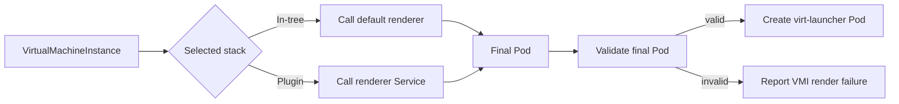

# VEP 82 Supplement: Pluggable virt-launcher Pod Rendering in virt-controller

## VEP Status Metadata

### Target releases

- This VEP targets alpha for version: `v1.11.0`
- This VEP targets beta for version: TBD
- This VEP targets GA for version: TBD

### Release Signoff Checklist

Items marked with (R) are required *prior to targeting to a milestone / release*.

- [ ] (R) Enhancement issue created, which links to this document
- [ ] (R) Alpha target version is explicitly mentioned and approved
- [ ] (R) Beta target version is explicitly mentioned and approved
- [ ] (R) GA target version is explicitly mentioned and approved

## Overview

This document is a focused companion to
[VEP 82: Plugin-based generalization of KubeVirt's virtualization stack](./vep.md).
It defines how `virt-controller` makes rendering of `virt-launcher` Pods
pluggable while retaining ownership of Kubernetes orchestration and validation
of the final `virt-launcher` Pod returned by the plugin.

Today, `virt-controller` renders a `virt-launcher` pod spec that contains several values specific to the in-tree Libvirt/QEMU virtualization stack. Examples are the `compute` container's image itself, command-line arguments, runtime directories, memory overhead, and stack-specific node-selectors. This prevents an out-of-tree virtualization stack from supplying its own `virt-launcher` without modifying KubeVirt core.

This VEP splits rendering into three stages:

1. `virt-controller` builds a versioned request containing the VMI and render
   context.
2. The RPC plugin selected for the VMI constructs the complete `virt-launcher` Pod spec.
3. `virt-controller` validates the returned Pod spec before creating it.

The plugin implements the following logical transformation:

```text
VirtualMachineInstance + render context -> complete virt-launcher Pod spec
```

The plugin is responsible for every field in the returned Pod, including
virtualization-agnostic fields that the in-tree renderer normally populates.
The final Pod is validated by `virt-controller` for structural correctness and
cluster policy, but validation does not make KubeVirt responsible for the
plugin's rendering behavior. Plugin implementers are responsible for the
correctness, compatibility, and stability of their complete `virt-launcher`
Pod implementation.

## Motivation

The current launcher Pod renderer combines common KubeVirt Pod construction
with details required by the in-tree Libvirt/QEMU/KVM stack.

Examples of stack-specific behavior include:

- selecting the `virt-launcher` image and pull policy;
- setting the launcher command, arguments, and environment;
- mounting `/var/run/libvirt` and other runtime directories;
- calculating memory consumed by the VMM and management processes;
- selecting nodes by machine type, CPU model, firmware, or stack capability;

Allowing a plugin to construct the complete `virt-launcher` Pod lets alternate
virtualization stacks define both stack-specific and stack-agnostic parts of the 
Pod spec - giving them complete liberty to customize the `virt-launcher` as they want.

## Goals

- Allow an RPC plugin to construct the entire `virt-launcher` Pod from VMI 
  spec supplied by `virt-controller`.
- Make plugin implementers responsible for virtualization-specific and
  virtualization-agnostic Pod fields and for maintaining stable behavior for
  KubeVirt.
- Keep Kubernetes clients, informer stores, controller caches, and resolved
  cluster state inside `virt-controller` core.
- Enforce structural and security requirements on the complete Pod returned by
  a plugin.
- Isolate renderer failures to affected VMIs and avoid making
  `virt-controller` unavailable.
- Preserve current Libvirt/QEMU/KVM rendering behavior when the feature is
  disabled or the default in-tree renderer is selected.
- Define the plugin interface such that it can be versioned and tested independently
  of a specific virtualization stack.

## Non Goals

- Making admission webhooks, `virt-handler`, node labeling, or
  `virt-launcher` lifecycle APIs pluggable. Those are covered by the parent VEP
  or separate follow-up VEPs.
- Defining how a VMI selects a virtualization stack.
- Removing Libvirt/QEMU semantics from the KubeVirt v1 API. Generalizing the KubeVirt API
  to make it virtualization-stack-agnostic is a much bigger work that will be taken up in 
  the future based on the learnings from the parent VEP #82.
- Allowing a renderer plugin to create Kubernetes resources or call back into
  `virt-controller`.
- Exposing controller-local clients, informer stores, or Go implementation
  types through the proposed plugin API. The plugin implementation does not have access to any data structures from core KubeVirt. The plugin implementation should be self-sufficient and not 
  depend on more information from `virt-controller` than what is provided via the interface.


## Definition of Users

- **Virtualization stack developers** who provide a launcher implementation
  and need to construct its Pod without changing KubeVirt core.
- **Platform operators** who install and configure virtualization stack
  plugins.
- **KubeVirt maintainers** who own the RPC contract, orchestration, and final
  validation.
- **KubeVirt distributors** who may ship additional renderers while preserving
  the upstream control-plane contract.

## User Stories

- As a cluster administrator, I want to run VM workloads on a virtualization
  stack that KubeVirt does not support in tree, without maintaining a fork of
  KubeVirt.
- As a cluster administrator, I want to use a specialized virtualization stack
  for workloads that require different hypervisor capabilities, hardware
  integration, isolation properties, or performance characteristics.
- As a virtualization stack developer, I want to integrate an experimental or
  niche launcher with KubeVirt so that users can exercise it in real clusters
  and provide feedback before it is considered for broader upstream support.
- As a KubeVirt distributor, I want to ship and support a differentiated
  virtualization stack while continuing to consume upstream KubeVirt releases
  without carrying invasive changes to `virt-controller`.

## Repos

- [kubevirt/kubevirt](https://github.com/kubevirt/kubevirt)
- [kubevirt/enhancements](https://github.com/kubevirt/enhancements)
- Out-of-tree repositories that implement Pod-level RPC renderers

## Design

### Rendering Pipeline

The launcher manifest pipeline is:

1. Build a versioned render request consisting of VMI spec, `KubeVirtConfiguration` and rendering mode.
2. Invoke the selected RPC renderer plugin.
3. Receive the complete `virt-launcher` Pod spec.
4. Validate the Pod.
5. Create the Pod, or report a render failure on the VMI and retry according
   to controller policy.



Conceptually, core uses a single renderer interface:

```go
type LauncherManifestRenderer interface {
    Render(
        context.Context,
        *LauncherManifestRenderRequest,
    ) (*corev1.Pod, error)
}

type LauncherManifestRenderRequest struct {
    VMI           *virtv1.VirtualMachineInstance
    Configuration *virtv1.KubeVirtConfiguration
    Mode          LauncherRenderMode
}
```

The in-tree default renderer and RPC adapter both implement this interface.
Every implementation receives the same request, constructs a complete Pod, and
enters the same validation path. Implementations must not mutate shared
informer objects or the request's VMI.

### Relationship to VEP 359

This VEP and [VEP 359](../359-public-pod-render-api/vep.md) refactor the same
`TemplateService.RenderLaunchManifest` pipeline. The work must be sequenced as
follows:

1. VEP 359 implements the default `ManifestRenderer` for the in-tree
   Libvirt/QEMU stack.

2. Virt-Controller starts using VEP 359's `RenderConfig` and `ManifestRenderer`
   to build default Libvirt/QEMU-based `virt-launcher` pods.

3. `virt-controller` creates an RPC-backed `ManifestRenderer` implementation
   that delegates complete Pod construction to the selected plugin.

### Pre-render Resolution

`virt-controller` resolves only the serializable values explicitly defined by
the versioned render request. It does not construct or send a partial Pod.
When a plugin requires additional controller-resolved state, that state must
be added to a new compatible version of the request rather than encoded in a
base Pod.

The plugin translates the request into a complete Pod. This includes fields
that are not specific to a virtualization stack, such as VMI labels and
annotations, ownership, namespace, service account, image pull secrets,
security contexts, probes, ports, resources, scheduling constraints, volumes,
mounts, and environment. The exact implementation is deliberately outside
KubeVirt core; the plugin author must track relevant KubeVirt behavior and
maintain compatibility.

### Renderer Input

The RPC method receives these logical values:

| Field | Type | Description |
|---|---|---|
| `vmi` | `VirtualMachineInstance` | The VMI being reconciled. |
| `configuration` | `KubeVirtConfiguration` | Effective, defaulted, serializable cluster configuration. |
| `mode` | `LauncherRenderMode` | The lifecycle operation for which the Pod is rendered. |
| `apiVersion` | string | The negotiated renderer contract version. |

Supported render modes are:

- `launch`: a normal source `virt-launcher` Pod;
- `migration-target`: a migration target Pod;
- `provisioning`: a temporary Pod used for storage provisioning.

Renderers must reject unknown modes. Go's `context.Context` is mapped to the
RPC deadline and cancellation. It is not serialized into the request.

Only versioned, serializable values cross the renderer boundary. Plugins never
receive Kubernetes clients, informer handles,
`TemplateService`, `ClusterConfig`, or internal caches.

### Renderer Output

The RPC produces one logical result:

| Field | Type | Description |
|---|---|---|
| `pod` | `Pod` | The complete launcher Pod to pass to core validation. |

### Plugin Responsibilities

A renderer owns the complete Pod specification. Its responsibilities include:

- set the compute-container image and image pull policy;
- set the compute command and arguments;
- add stack-specific environment variables;
- add stack-specific volumes, mounts, and volume devices;
- request hypervisor resources and stack-specific resource claims;
- calculate and add stack-specific memory overhead;
- add stack capability node selectors;
- add CPU model, CPU feature, machine type, firmware, or
  confidential-computing scheduling constraints;
- add stack-specific affinity;
- add stack-specific annotations, including a memory-overhead annotation;
- populate virtualization-agnostic metadata, ownership, security contexts,
  resources, scheduling, networking, storage, probes, and supporting
  containers required for a valid `virt-launcher` Pod;
- preserve user intent represented by the VMI and render context.

A renderer must:

- construct the complete Pod without relying on a core-provided base Pod;
- produce correct VMI ownership and identity;
- produce deterministic output for the same request and plugin configuration;
- be safe when the same request is evaluated more than once;
- avoid creating resources or causing side effects during rendering;
- return errors explicitly; and
- maintain compatibility and stable behavior across supported KubeVirt
  versions.

### Pod-level RPC Renderer

The RPC method is provided by a cluster Service referenced by the
`VirtualizationStackPlugin` resource. The plugin provider owns its Deployment,
Service, scaling, and lifecycle.

The logical API is:

```proto
service LauncherManifestRenderer {
  rpc GetPluginInfo(GetPluginInfoRequest)
      returns (GetPluginInfoResponse);

  rpc RenderLauncherManifest(RenderLauncherManifestRequest)
      returns (RenderLauncherManifestResponse);
}

message GetPluginInfoRequest {}

message GetPluginInfoResponse {
  string plugin_name = 1;
  repeated string supported_api_versions = 2;
}

message RenderLauncherManifestRequest {
  string api_version = 1;
  kubevirt.io.api.core.v1.VirtualMachineInstance vmi = 2;
  kubevirt.io.api.core.v1.KubeVirtConfiguration configuration = 3;
  LauncherRenderMode mode = 4;
}

message RenderLauncherManifestResponse {
  k8s.io.api.core.v1.Pod pod = 1;
}

enum LauncherRenderMode {
  LAUNCHER_RENDER_MODE_UNSPECIFIED = 0;
  LAUNCHER_RENDER_MODE_LAUNCH = 1;
  LAUNCHER_RENDER_MODE_MIGRATION_TARGET = 2;
  LAUNCHER_RENDER_MODE_PROVISIONING = 3;
}
```

`virt-controller` discovers the Service, calls `GetPluginInfo`, and selects the
highest mutually supported renderer API version. Negotiation is cached and
invalidated when the registration, Service endpoint set, or controller version
changes.

Automatic retries must not multiply calls within one reconcile without a
strict bound. Normal controller work-queue retry and backoff are the primary
recovery mechanism. Because rendering is side-effect-free and idempotent, a
request may be repeated after an ambiguous transport failure.

### Registration and API Example

```yaml
apiVersion: virstackplugin.kubevirt.io/v1alpha1
kind: VirtualizationStackPlugin
metadata:
  name: openvmm-mshv
spec:
  controller:
    renderer:
      apiVersion: v1alpha1
      rpc:
        service:
          namespace: openvmm-system
          name: openvmm-controller-plugin
          port: 9443
        timeout: 5s
  runtime:
    socketName: openvmm-mshv.sock
```

### Renderer Selection

The mechanism by which the selected virtualization stack is recorded on a VMI
is defined by the parent architecture. Once a stack is selected,
`virt-controller` resolves exactly one `VirtualizationStackPlugin` and its
renderer.

The selection is stable for the lifetime of a launcher Pod. Reconciliation may
re-render before Pod creation, but it must not mutate an already-created
launcher Pod to a different stack or renderer. Migration targets use the same
stack as the source VMI.

The in-tree Libvirt/QEMU/KVM renderer implements the same coarse-grained
`LauncherManifestRenderer` interface as the RPC adapter. Its implementation
calls in-process functions rather than invoking a cluster Service. Both
implementations construct a complete Pod and enter the same final validation
path.

### Validation

The final Pod returned by an RPC plugin is treated as untrusted.
Validation runs immediately after rendering and before Pod creation. Core does
not mutate or repair the renderer output before validating it.

Validation must verify:

- a non-nil Pod and structurally complete compute container;
- correct VMI identity, owner references, namespace, and generated name;
- required labels, annotations, containers, volumes, mounts, probes, ports,
  and environment;
- user-requested resources and scheduling requirements;
- no unauthorized service account, host namespace, host path, privilege,
  capability, device, or security-context escalation;
- permitted host devices against effective cluster policy;
- consistency of requests, limits, resource claims, mounts, and volumes;
- a launcher image, command, and runtime configuration appropriate to a
  completed Pod;
- valid supporting sidecars and init containers;
- output object size and collection-count limits;
- consistency with the requested render mode.

Validation errors include the field path and a stable machine-readable reason,
but do not expose credentials or sensitive configuration in events. Passing
validation establishes that core may create the Pod; it does not certify the
plugin's functional correctness or transfer maintenance responsibility to
KubeVirt.

### Failure Handling and VMI Status

Renderer failure never makes `virt-controller` itself unready. It prevents Pod
creation only for the affected VMI.

Failures are classified as:

| Class | Examples | Handling |
|---|---|---|
| Registration | missing plugin, invalid RPC configuration | condition/event; no render call |
| Compatibility | no common API version, unsupported mode | condition/event; retry after plugin or VMI change |
| Availability | RPC unavailable, deadline exceeded | condition/event; work-queue retry with backoff |
| Evaluation | RPC application error | condition/event on affected VMI |
| Output | nil, incomplete, malformed, or forbidden final Pod | condition/event; Pod is not created |

Stable reasons should distinguish at least:

- `VirtualizationStackPluginNotFound`;
- `VirtualizationStackPluginNotReady`;
- `RendererAPINotCompatible`;
- `RendererUnavailable`;
- `RendererFailed`;
- `RenderedPodInvalid`.

Repeated events are rate limited. Conditions include the selected stack,
observed plugin generation, and a sanitized error summary. They must not
include the full VMI or Pod.

There is no automatic fallback from a selected external renderer to the
default Libvirt/QEMU stack. Such fallback could silently launch a VM with different
isolation, device, firmware, or compatibility properties.

### Security

Installing a renderer is a cluster-administrator operation. A renderer can
influence node selection, container images, resources, and security-sensitive
Pod fields, so registration must be protected by RBAC and admission policy.

RPC protections include:

- communication uses mutually authenticated TLS;
- `virt-controller` authenticates the endpoint against registration-specific
  trust material;
- the plugin authenticates requests as coming from KubeVirt;
- Service references cannot redirect to an arbitrary namespace unless allowed
  by cluster policy;
- deadlines, response size limits, and connection limits are enforced;
- no service-account token or Kubernetes client credential is sent.

Final validation is the security boundary. Core must not assume that a
registered renderer is correct or uncompromised.

## API Versioning

Three versions evolve independently:

1. the `VirtualizationStackPlugin` CRD version;
2. the launcher-render contract version;
3. the RPC protocol version implementing that contract.

The selected contract version determines:

- input field semantics;
- required properties of the complete output Pod;
- supported modes;
- final validation rules.

An RPC plugin advertises supported protocol versions. Core must not run a
renderer when no compatible version exists.

Changes that only add optional input or response fields may be compatible.
Changes to required fields or interpretation of existing fields require a new
version.

## Scalability

Rendering occurs in the VMI reconciliation hot path.

RPC renderer Deployments may scale independently. `virt-controller` reuses
connections, caches successful version negotiation, and bounds concurrent
requests per endpoint. Render results are not cached across VMIs because
requests include VMI-specific data.

Controller work queues provide backpressure. When an RPC endpoint is
unavailable, retries use exponential backoff and jitter rather than a tight
loop. Circuit breaking may suppress repeated calls to a known-unavailable
endpoint for a short bounded interval, but must not turn failures into success
or hide status updates.

## Update/Rollback Compatibility

The `PluggableVirtualizationStack` feature gate guards plugin selection and
dispatch during alpha.

With the gate disabled, only the default in-tree virtualization stack is supported:

- external RPC registrations are not invoked;
- existing VM and VMI APIs require no changes.
- The in-tree default stack continues to use its existing launcher Pod
  renderer. Golden and end-to-end tests enforce this invariant.

Already-running launcher Pods are not re-rendered during a
`virt-controller` upgrade. A renderer update affects only Pods rendered after
the new plugin generation is observed. Operators are responsible for ensuring
that plugin updates remain compatible with the corresponding runtime and
launcher images.

During a KubeVirt upgrade:

- an existing compatible contract version remains usable through the supported
  version-skew window;
- a new controller must negotiate an older RPC version or reject it explicitly;
- incompatible registrations become not ready rather than being interpreted
  using new semantics.

Rollback cannot preserve VMIs created with a renderer or stack unknown to the
rolled-back KubeVirt version. Before beta, the project must define and test the
supported rollback window.

## Alternatives

### Fine-grained RPCs

The parent VEP originally proposed RPCs such as `GetLauncherImage`,
`GetLauncherCommand`, `GetAdditionalVolumes`, `GetLauncherCapabilities`,
`GetRunAsUserGroup`, and `GetNodeSelectors`.

This design rejects that approach. It mirrors today's implementation details,
requires protocol growth for each new Pod concern, creates ordering and
conflict questions across calls, increases network round trips, and can combine
individually valid fragments into an invalid Pod. The Pod-level contract
replaces these RPCs.

### Sidecar RPC renderer

Running an RPC renderer beside each `virt-controller` avoids a cluster Service
call but couples plugin installation, scaling, upgrade, and failure domains to
the core Deployment.

Rejected in favor of the independently managed Service model selected by the
parent VEP.

## Does it belong to core KubeVirt?

Yes. Dispatch, validation, VMI status, and Pod creation remain part of
`virt-controller`'s core reconciliation responsibility. They define the
security boundary shared by every virtualization stack.

Rendering for an external stack, including virtualization-agnostic Pod fields,
belongs to the external RPC plugin. The plugin implementer owns its behavior
and compatibility with KubeVirt.

This extension point is distinct from KubeVirt Structured Plugins. Structured
Plugins augment selected KubeVirt behavior, while this renderer supplies the
complete Pod required by the selected virtualization stack.

## Functional Testing Approach

### Unit tests

- Verify the in-tree default renderer produces semantically equivalent Pods to
  the pre-refactor path.
- Run the same output-validation test table against the in-tree default
  renderer and RPC adapter.
- Verify the RPC request never contains a base or partial Pod.
- Verify the plugin supplies required virtualization-specific and
  virtualization-agnostic fields.
- Verify nil, oversized, malformed, and incomplete output is rejected.
- Verify RPC negotiation, deadlines, cancellation, status mapping, and
  malformed responses.

### Fuzz tests

- Fuzz final-Pod validation with malformed and security-sensitive fields.
- Fuzz protobuf decoding and unknown-field preservation.
- Assert that renderer input is not mutated and validation does not panic.

### Conformance tests

A standalone conformance suite exercises the logical RPC renderer contract. It
verifies:

- deterministic and idempotent rendering;
- supported render modes;
- contract-version behavior;
- construction of a complete Pod;
- correct virtualization-specific and virtualization-agnostic fields;
- error handling;
- final-Pod validation compatibility.

RPC plugins run the suite against a service endpoint.

### Functional and end-to-end tests

- Start a VMI using the in-tree default renderer with the feature gate both
  disabled and enabled.
- Start equivalent VMIs using an RPC renderer.
- Verify migration-target and provisioning modes.
- Make the RPC service unavailable and verify only affected VMIs fail and
  recover after service restoration.
- Return a forbidden privileged Pod and verify Pod creation is blocked.
- Upgrade `virt-controller` while VMIs rendered by the RPC plugin are running.
- Verify renderer updates affect new Pods without mutating running Pods.

## Implementation History

- 2026-10-02: Initial companion VEP drafted.
- 2026-10-14: Changed the plugin contract to complete Pod construction over
  RPC only.

## Graduation Requirements

### Alpha

- [ ] Guard renderer selection and dispatch with the
  `PluggableVirtualizationStack` feature gate.
- [ ] Demonstrate semantic equivalence of the in-tree default renderer with
  pre-refactor behavior.
- [ ] Implement the versioned RPC render request without a base Pod and the
  complete-Pod response contract.
- [ ] Add RPC renderer configuration to `VirtualizationStackPlugin`.
- [ ] Implement validation for final launcher pod spec returned by the plugin.
- [ ] Run output-validation tests against the in-tree default renderer and RPC
  adapter.
- [ ] Demonstrate one non-default virtualization stack end to end.
- [ ] Verify that invalid output from the renderer plugin cannot create a Pod.
- [ ] Verify that a renderer failure affects only VMIs selecting that renderer.

### Beta

- [ ] Implement Pod-level RPC discovery, version negotiation, mTLS, deadlines,
  cancellation, and error mapping.
- [ ] Run contract tests against the RPC based renderer.
- [ ] At least two non-default RPC stack implementations have exercised the
  contract.
- [ ] The renderer API has documented compatibility and deprecation policies.
- [ ] Upgrade, version skew, and rollback behavior are covered by CI.
- [ ] RPC load, failover, and backoff behavior is validated at supported
  control-plane scale.
- [ ] The conformance suite is published for out-of-tree plugin authors.
- [ ] Security review of registration, mTLS, and final validation is complete.
- [ ] No unresolved high-severity renderer isolation or validation defects.

#### On-By-Default Readiness

- [ ] The default renderer has no known behavior regression.
- [ ] Operator status clearly identifies invalid and unavailable renderers.
- [ ] Metrics and alerts distinguish plugin failures from core reconciliation
  failures.
- [ ] Documentation covers installation, upgrades, troubleshooting, and
  removal.

### GA

- [ ] The render contract and compatibility policy are stable.
- [ ] The feature gate is removed.
- [ ] RPC implementations have sustained multi-release usage.
- [ ] All supported upgrade and rollback paths are continuously tested.
- [ ] Conformance is required for supported third-party renderers.

## Open Questions

- Which protobuf representation will preserve Kubernetes unknown fields while
  remaining consumable by out-of-tree plugins?
- What RPC timeout and concurrency defaults are appropriate at supported VMI
  creation rates?
- What authentication authority issues and rotates renderer server and client
  certificates?
- Which VMI condition should own render failures before the VMI has a launcher
  Pod?
