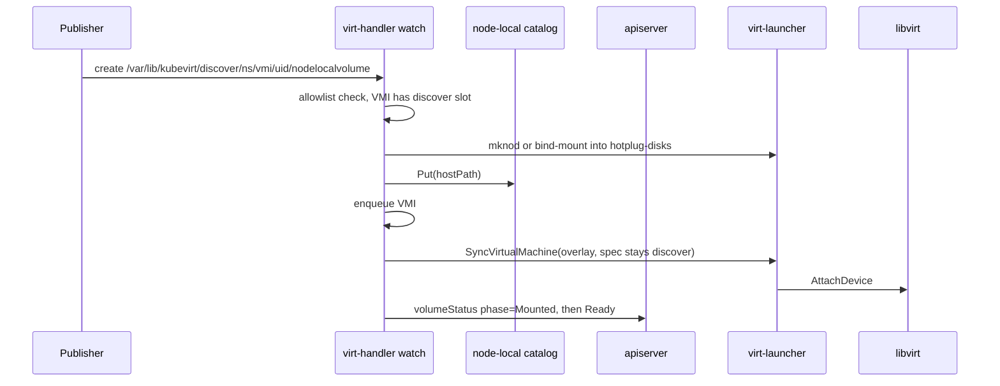
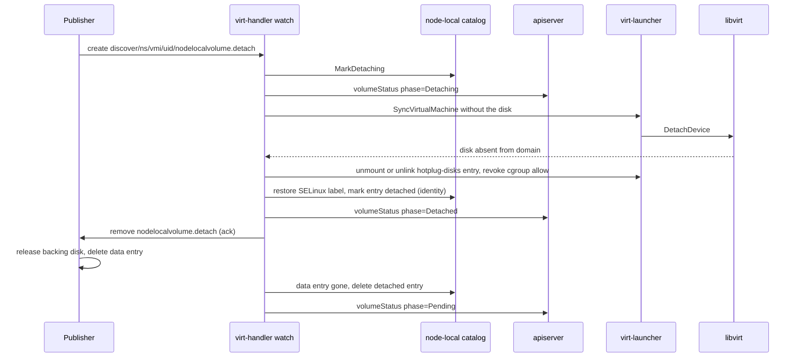

# VEP #293: Extend Hotplug APIs and add NodeLocalVolume hotplug

## VEP Status Metadata

### Target releases

-  This VEP targets alpha for version: v1.11
-  This VEP targets beta for version: TBD
-  This VEP targets GA for version: TBD

### Release Signoff Checklist

Items marked with (R) are required *prior to targeting to a milestone / release*.

- [+] (R) Enhancement issue created, which links to VEP dir in [kubevirt/enhancements] (not the initial VEP PR)
- [] (R) Alpha target version is explicitly mentioned and approved
- [] (R) Beta target version is explicitly mentioned and approved
- [] (R) GA target version is explicitly mentioned and approved

## Overview

This VEP extends volume hotplug by splitting the current monolithic flow into three steps that can be driven independently: **volume delivery**, **volume attach**, and **volume detach**. It adds a second, node-local delivery option next to the existing attachment pod. Attach and detach are shared by both. The VEP does not propose a general delivery plug-in interface. In alpha, the choice between the two options is a fixed branch on the volume source.

Volume delivery is the step the user selects. KubeVirt ships two optional delivery options, and the same attach and detach steps run after either of them:

1. **Attachment pod.** The existing virt-controller path for a hotpluggable PVC or DataVolume. The user opts into it. Turning on node-local hotplug leaves this path in place for volumes that ask for it.
2. **Node-local discover volume.** Optional, behind the `NodeLocalHotplug` feature gate. The empty `discover: {}` slot is added to the VMI spec when it is created. virt-handler watches `/var/lib/kubevirt/discover/<namespace>/<vmi-name>/<vmi-uid>/<volume>` and, as soon as that file is there, publishes it and updates the volume. The publisher detaches it by creating a `<volume>.detach` request next to the file, then waits for virt-handler to acknowledge before it releases the backing disk. No attachment pod is created.

`AddVolume` and `RemoveVolume` stay. They remain the way a user selects the attachment-pod option.

## Motivation

KubeVirt hotplug today works but is monolithic and Pod-heavy for PVC-backed volumes. The mechanism works by:

1. **Launching an attachment Pod** on the target node, which mounts the PVC so the volume is available on the host.
2. **Manipulating bind mounts on the host** to expose that volume into the `virt-launcher` Pod's mount namespace, since Kubernetes does not allow mutating a Pod's `volumes` spec after creation.
3. **Hotplugging the disk into the VM** via libvirt/QEMU once the volume is visible inside `virt-launcher`.

While this design successfully leverages standard Kubernetes components and reuses as many Kubernetes apis as possible to limit the burden on kubevirt to maintain custom code, the end-to-end flow is hard-wired inside KubeVirt and exposed through a single API surface. Every step — volume delivery, attachment into the VM, and detachment — is driven by the same built-in controllers, which makes it difficult to customize or replace any individual stage for workloads that have specialized requirements.

This VEP proposes an extension of the hotplug APIs that decomposes the current monolithic flow into discrete, independently replaceable stages. Some callers need the attachment pod. Others add an empty discover slot when the VMI is created and let an on-node publisher write a file. virt-handler watches that path and updates the volume as soon as the file is there. The user chooses the delivery option per volume. Attach into `virt-launcher` and the libvirt hotplug stay shared.

## Goals

- Decompose hotplug into three steps: volume delivery, volume attach, and volume detach. A new delivery option reuses attach and detach.
- Let the user choose the delivery option on the volume.
- Keep the attachment-pod flow as an optional delivery option for hotpluggable PVCs and DataVolumes.
- Add an optional node-local discover volume. The empty slot is added when the VMI is created. virt-handler watches the discover path and updates the volume as soon as the file is there.
- Leave the VMI spec free of host paths. A path on the spec remains a `HostDisk`.
- Keep libvirt attach and detach on the existing `syncDisks` path.
- Give node-local publishers an explicit, durable detach request and a completion signal, so they know when the backing disk is safe to release.

## Non Goals

- Removing the attachment pod for volumes whose delivery option is a hotpluggable PVC or DataVolume.
- Replacing the `AddVolume` / `RemoveVolume` subresources.
- Changing libvirt attach and detach semantics.
- Migrating a VMI that has a discover volume attached. The VMI is non-migratable while any of its discover volumes is not `Pending` or `Detached`. See [Migration](#migration).
- A gRPC API on virt-handler in alpha. See [Alternative B2](#alternative-b2--detach-through-a-node-local-rpc-only).
- Teaching virt-controller how to provision discover disks. Whoever writes the file on the node owns delivery.
- Image formats other than raw. A discover entry is one raw block device or one raw image file. See [Entry format](#entry-format).
- Layered images: qcow2 or any other format with a backing file, a backing chain, or overlays. virt-handler publishes exactly one entry per volume and does not stage any other file into `virt-launcher`.
- Dynamic slots. The number of discover slots is fixed by the VMI spec. A pool of slots is planned for a future release. Until then, bus, serial, cache mode, boot order and the other disk options come only from the slot's `disks:` entry.

## Definition of Users

- **Cluster administrators** who hotplug a PVC or DataVolume with today's attachment pod, and who also declare a discover slot on the same VM.
- **On-node publishers** (CSI sidecars, vendor agents, debug tooling) that write a file under the discover path and expect virt-handler to attach it without an attachment pod.
- **Operators** who add an empty discover slot when the VMI is created and let a node-local agent fill it.

## User Stories

* As a user hotplugging a PVC, I want the attachment pod to keep working when node-local hotplug is enabled, so that existing `addvolume` clients stay on the delivery option I selected.
* As an operator, I want to put an empty discover volume and its matching disk on the VM template so they are on the VMI at creation, and have a privileged on-node publisher write a file that virt-handler attaches without an attachment pod.
* As that publisher, I want to request detach explicitly and be told when it has finished, so I never release the backing disk while the guest still has it, and the same slot is left in place for the next file.
* As a cluster administrator, I want a VMI to be non-migratable while a discover volume is attached, because the file exists only on the node where it was published. An empty slot does not block migration.
* As a KubeVirt developer, I want a new delivery option to plug in at step 1 only, so attach and detach do not grow a new code path per volume type.

# Repos

[KubeVirt](https://github.com/kubevirt/kubevirt)

# Design

## High-level Approach

Volume hotplug today is a single, KubeVirt-managed pipeline exposed through one API. Conceptually, however, it breaks down into three independent steps:

1. **Volume delivery** — making the underlying storage available on the target node (today, by launching an attachment Pod that binds the PVC and exposes it on the host).
2. **Volume attach (hot plug)** — surfacing the delivered volume inside the running `virt-launcher` Pod and hotplugging the corresponding disk into the VM via libvirt/QEMU.
3. **Volume detach (hot unplug)** — reversing the above: detaching the disk from the VM, removing it from the `virt-launcher` Pod, and tearing down any delivery resources.

This VEP decomposes that flow into three steps — volume delivery, volume attach, and volume detach — so a delivery option can change on its own and still use the same attach and detach paths. The user selects the delivery option on the volume. The attachment pod stays an optional delivery option for a hotpluggable PVC or DataVolume. A discover volume is the other optional option. The empty `discover: {}` slot is added when the VMI is created. virt-handler watches `/var/lib/kubevirt/discover/<namespace>/<vmi-name>/<vmi-uid>/<volume>` and, as soon as that file is there, updates the volume through the shared attach path. A `<volume>.detach` request next to the file runs the shared detach path. No attachment pod is created for that volume.

### Phase Pipeline

The end-to-end flow is modeled as a three-phase pipeline. Phase 1 (Delivery) is pluggable and may run off-node or on-node; Phases 2 and 3 (Attach / Detach) are the node-local surface introduced by this VEP and run inside `virt-handler`:

```text
+-------------------------------+     +-------------------------------+     +-------------------------------+
| 1. Volume delivery            |     | 2. Volume attach              |     | 3. Volume detach              |
| user-selected, optional       | --> | shared                        | --> | shared                        |
|                               |     |                               |     |                               |
| Option A: attachment pod      |     | publish into virt-launcher    |     | drop the disk from the sync  |
|   hotpluggable PVC / DV       |     | hotplug-disks                 |     | libvirt DetachDevice          |
|   virt-controller             |     |   block: mknod + cgroup       |     | unmount / unlink in launcher  |
|                               |     |   file: bind-mount            |     |                               |
| Option B: discover volume     |     | overlay into launcher sync    |     | attachment pod: delete pod    |
|   virt-handler watches the    |     | syncDisks -> libvirt attach   |     | discover: .detach request,    |
|   discover path and updates   |     |                               |     | ack, Detached, then Pending   |
|   as soon as the file is there|     |                               |     | publisher then releases disk  |
+-------------------------------+     +-------------------------------+     +-------------------------------+
```

Enabling `NodeLocalHotplug` does not switch every volume onto option B. virt-controller still creates attachment pods for hotpluggable PVCs and DataVolumes. It skips the attachment pod only for volumes the user marked node-local (`discover: {}`, or `hotplugVolume.nodeLocal: true`).

A future delivery option is another way to produce a host path. If that option must skip the attachment pod, it sets `hotplugVolume.nodeLocal`. Attach and detach stay as they are.

### Option A — attachment pod

The user selects this option by hotplugging a PVC or DataVolume, through `AddVolume`, declarative volume hotplug, or `hotpluggable: true` on the volume. virt-controller creates the attachment pod, virt-handler bind-mounts it into `virt-launcher`, and `syncDisks` hotplugs the disk. That sequence is unchanged.

`volumesForAttachmentPod` filters the hotplug list before any pod is created:

- a volume with `discover: {}` is left out
- a volume whose status has `hotplugVolume.nodeLocal: true` is left out
- every other hotplug volume is passed through

With the feature gate off, the filter is a no-op and discover volumes are rejected at admission.

### Option B — node-local volume

The user selects this option by adding an empty discover slot to the VM template, so it is on the VMI spec at creation time. The slot is a volume plus a matching disk under `domain.devices.disks`, with the same name. Admission already requires every volume to map to a disk, and that rule covers `discover` too. Bus, serial, and boot order are set on that disk when the VMI is created. The spec never gains a host path.

`AddVolume`, `RemoveVolume`, and declarative volume hotplug apply to hotpluggable PVCs and DataVolumes. They do not add a discover slot to a VMI that is already running. While the VM is running, the publisher creates the file on the node to attach and creates a `<volume>.detach` request to detach. See [Publisher contract](#publisher-contract).

```yaml
domain:
  devices:
    disks:
    - name: nodelocalhotplugvolumes
      disk:
        bus: scsi
volumes:
- name: nodelocalhotplugvolumes
  discover: {}
```

`DiscoverVolumeSource` is empty. virt-handler computes one path and watches it. Until the file is there, the launcher sync omits this disk, so the guest domain does not contain it. As soon as the file is there, virt-handler publishes it into `virt-launcher` and includes that same disk in the sync. The disk on the VMI spec is the one the guest receives.

```text
/var/lib/kubevirt/discover/<namespace>/<vmi-name>/<vmi-uid>/<volume>
/var/lib/kubevirt/discover/<namespace>/<vmi-name>/<vmi-uid>/<volume>.img
```

One more entry lives next to the data entry. Volume names are DNS labels and cannot contain `.`, so this suffix cannot collide with another volume:

```text
/var/lib/kubevirt/discover/<namespace>/<vmi-name>/<vmi-uid>/<volume>.detach   # publisher creates, virt-handler removes when detach is done
```

The virt-handler DaemonSet mounts that directory from the host (`HostPathDirectoryOrCreate`). A publisher writes the data entry and the `.detach` request. The publisher does not call virt-handler, and it does not patch the VMI. It does read the VMI: results and failure reasons are in `status.volumeStatus`, so a publisher that releases a disk needs `get` on VMIs. See [Publisher contract](#publisher-contract).

virt-handler watches that path and updates the volume as soon as it finds the file:

1. On startup it watches the tree and attaches every file it finds.
2. On each VMI reconcile it creates `<namespace>/<vmi-name>/<vmi-uid>/` for the VMI running on this node, and attaches any file it finds there.
3. On `fsnotify` create, write, or rename-in of a matching name (see [Entry format](#entry-format)) it waits briefly for the file to settle, then attaches and updates the volume. Publishers should stage a file under a dot-prefixed name and rename it into place, so virt-handler never sees a half-written file.
4. On `fsnotify` create of `<volume>.detach` it marks the catalog entry detaching and enqueues the VMI. This is the detach trigger.
5. On remove or rename of the data entry while no `.detach` request exists, it treats the event as a forced detach. See [Removal without a request](#removal-without-a-request).

The path must be exactly those three components. `.`, `..`, empty segments, and names starting with `.` are ignored. The lookup uses the local VMI cache. A file for an unknown VMI is retried for a short window and then dropped.

#### Entry format

**Which names are requests.** Not every file in the directory is a hotplug request. virt-handler acts only on these names, and only when `<volume>` is declared as a `discover` volume on that VMI:

- `<volume>` or `<volume>.img` — the data entry, which attaches the volume
- `<volume>.detach` — the detach request

Every other name is ignored. It is not attached, not published into `virt-launcher`, and not deleted, and virt-handler logs it once. A file that does not match a declared volume therefore never triggers a hotplug, whether or not its name starts with a dot.

Names starting with `.` are reserved for publisher staging. A publisher writes a file under a dot-prefixed name and renames it into place. This is a documented contract, and virt-handler never publishes a dot-prefixed file.

**Format.** The data entry is raw:

- a block device node, or
- a regular file holding a raw disk image.

The overlay hands the entry to the existing converter as a hotplug volume, and the converter always gives libvirt `driver type='raw'` for it. virt-handler does not detect the format, and it does not read or parse image headers. Bytes in the entry are what the guest sees, one-to-one.

A qcow2 file, or any other image format, is therefore not interpreted. It would show up in the guest as raw bytes with the qcow2 header on it. To catch that mistake, virt-handler rejects a regular file whose first four bytes are the qcow2 magic (`QFI\xfb`). The volume stays `Pending`, nothing is published, and the message carries `reason: UnsupportedImageFormat`. This reads four bytes and trusts nothing else in the file.

**Layered images are not supported in alpha.** A qcow2 backing file path is stored in the image header and is resolved inside the `virt-launcher` mount namespace. virt-handler publishes one entry per volume, so no other layer would be visible to QEMU. Files placed in the discover directory as layers either match a volume name and each become their own hotplug request, or do not match and are ignored and never reach `virt-launcher`. Either way the chain cannot be opened. Nothing in this VEP exposes backing files to `virt-launcher`, so nothing has to clean them up on detach.

A publisher that needs layering does it before publishing, in one of two ways:

- flatten the chain into one raw file (`qemu-img convert -O raw`), or
- present a flat view from the storage layer, for example a thin snapshot, a clone, or a `dm` snapshot, as a raw block device.

While the file is absent, status stays `Pending` with message `Waiting for volume <name> to be published on the node`. `Pending` means only one thing: the slot is free and waiting for a file. A volume that has just been detached is not `Pending`. It is `Detached` until the publisher removes the data entry. See [Step 3 — detach](#step-3--detach). The disk is omitted from the launcher sync, so the guest does not see an empty device. A discover volume is not a hotpluggable PVC, so `Pending` does not block VMI startup. The guest boots with that disk left out.

On each reconcile, virt-handler scans the discover path before the domain sync. A file that is already in the VMI's `<vmi-uid>` directory when the VMI starts is published and included in that first sync. A publisher can stage a file once the directory exists, which is after the VMI is scheduled to this node.

A discover volume sets `status.volumeStatus[].hotplugVolume.nodeLocal: true` and leaves `attachPodName` / `attachPodUID` empty. virt-controller does not invent an attachment-pod phase for it. virt-handler owns the phase.

The on-node record of a delivered disk is a `NodeLocalVolume` in a catalog virt-handler keeps at `/var/run/kubevirt-private/node-local-hotplug/<vmi-uid>.json`:

- `name` — volume name on the VMI
- `hostPath` — the discover path virt-handler found
- `identity` — what the data entry was when it was published: file type, device and inode for a regular file, or `rdev` for a block device. virt-handler compares the data entry on disk against it on every scan and event. See [Entry identity](#entry-identity).
- `originalLabel` — the SELinux label the data entry had before virt-handler relabeled it for `virt-launcher`. Restored on detach. See [SELinux](#selinux).
- `disk` / `volume` — what the launcher sync should see
- `detaching` — set when detach has been requested and the guest disk is not gone yet
- `forced` — set when detach started without a `.detach` request, because the data entry vanished or was replaced
- `detached` — set when detach is acknowledged. It keeps the entry's `identity` and is kept until virt-handler sees the data entry removed. See [Detached entry](#detached-entry).

The catalog is node-local state. It is not a CRD and it is not written back onto the VMI spec. A host path on the VMI spec is a `HostDisk`.

### Step 2 — attach

Attach starts once delivery has a host path.

For an attachment-pod volume, virt-handler keeps using `hotplugVolumeMounter`: the pod's volume is bind-mounted into the launcher, then `syncDisks` calls libvirt.

For a node-local volume, virt-handler publishes the host path into the launcher Pod's `hotplug-disks` directory. The publisher does not need mount or mknod rights.

| Source | Action inside virt-launcher |
|---|---|
| Block device | `mknod` with the host major/minor, cgroup allow, chown |
| Regular file | bind-mount as `<volume>.img`, chown |

Any other file type, including a directory, a symlink, or a character device, is rejected and never published. See [Entry format](#entry-format).

The VMI object in the API is left as `discover: {}`. virt-handler deep-copies it for the launcher sync and overlays the catalog entry onto that copy only:

- the volume source on the copy becomes a synthetic hotpluggable PVC whose claim name is the volume name, so the existing converter looks in the launcher `hotplug-disks` directory
- that claim is not a PVC in the cluster and is never written back to the API
- the disk from the VMI spec is included
- volumes still waiting, and volumes marked detaching, are left out of the copy

`SyncVirtualMachine` then runs the existing converter and `syncDisks` path. libvirt attach is unchanged.



A catalog entry with the same host path and the same `identity` that is not detaching is left alone. A second publish of the same file does not stage the device again. A data entry at the same path with a different `identity` is a replacement, not a second publish. See [Entry identity](#entry-identity). A catalog entry in the `detached` state (detach acknowledged, data entry not yet removed) is also left alone. See [Detached entry](#detached-entry).

### Step 3 — detach

**Attachment pod.** `RemoveVolume` (or deleting the hotpluggable volume from the VM spec) follows today's flow: virt-controller deletes the attachment pod, virt-handler unmounts the launcher, libvirt detaches the disk, and the volume status is removed once the phase reaches `UnMountedFromPod`.

**Discover.** The slot stays on the spec. Detach starts when the publisher creates `<volume>.detach` in the discover directory. The data entry and the backing disk stay in place for the whole detach. Removing the data entry is not the trigger, because the publisher must not give up the backing disk until detach has finished.

1. The publisher creates `<volume>.detach`. virt-handler marks the catalog entry detaching.
2. virt-handler sets the volume phase to `Detaching` in `volumeStatus`, with `reason: DetachRequested`.
3. The launcher sync copy omits that disk. `syncDisks` issues libvirt detach.
4. After the domain no longer reports the disk, virt-handler removes the mount or device node from `virt-launcher`, revokes the device-cgroup allow rule for a block device, restores the entry's original SELinux label, and moves the catalog entry to the `detached` state (see below).
5. virt-handler writes `volumeStatus`: phase `Detached`, with message `Volume <name> detached. Remove the data entry to free the slot`.
6. Only after that status write succeeds, virt-handler removes `<volume>.detach`. Removal of the request is the ack.
7. The publisher deletes the data entry and releases the backing disk.
8. virt-handler sees the data entry removed, deletes the `detached` catalog entry, and writes phase `Pending`. The empty `discover: {}` slot is ready for the next file.

The flow for one volume is `Pending` → `MountedToPod` → `Ready` → `Detaching` → `Detached` → `Pending`.

**Completion guarantee.** When `<volume>.detach` has been removed, libvirt no longer reports the disk, the launcher mount or device node is gone, the cgroup allow is revoked, the SELinux label is restored, and nothing in KubeVirt references the backing resource. Only then is it safe to unmap, `dmsetup remove`, disconnect, or unmount it. A request that is still present means the disk may still be in use.

**Detached entry.** The data entry is still on disk after the ack, so a rescan would attach it again. The catalog entry therefore stays in the `detached` state and keeps the `identity` of the data entry. virt-handler does not attach an entry that matches a `detached` catalog entry. A new publish is a data entry that appears after the old one was removed, or one with a different `identity`. A filesystem can reuse an inode number, so virt-handler does not rely on the comparison alone. It clears the `detached` entry, and moves the phase from `Detached` to `Pending`, when it sees the data entry removed.

#### Entry identity

The catalog records the `identity` of the data entry at publish time, and virt-handler checks it for an attached entry as well as a `detached` one. After the debounce described in [Removal without a request](#removal-without-a-request), a data entry at the catalogued path is in one of three states:

| On disk | Meaning | virt-handler action |
|---|---|---|
| Same `identity` | Nothing changed. A second event for the same file. | None. |
| Missing | The publisher removed it, or something else did. | Forced detach, `reason: RemovedWhileAttached`. |
| Different `identity` | The entry was replaced, for example by a rename-over or a delete and recreate whose events were coalesced. | Forced detach, `reason: EntryReplaced`. The new entry is then published as a fresh attach once detach completes. |

virt-handler never swaps the backing resource under an attached disk in place. A regular file that was replaced would otherwise stay mounted from the old inode while the publisher believes the new content is attached. A publisher that wants to replace an entry safely runs a full detach first, with a `.detach` request, and publishes the new entry after the ack.

#### Detach request handling

virt-handler acts on `<volume>.detach` according to the catalog state of that volume. The same table covers a stale request, an early request, and a restart.

| Catalog state | `.detach` present | virt-handler action |
|---|---|---|
| Attached (`MountedToPod`, `Ready`) | yes | Start detach. Normal path. |
| Attaching (published, libvirt has not reported a target) | yes | Finish publish, then start detach. The request is honored after attach, so a publisher that writes the data entry and the request together does not lose the request. |
| Detaching | yes | Continue the detach already in progress. Do not start a second one. |
| `detached` | yes | Remove the request. It is the ack that was not yet written, or a duplicate. This makes a crash between the catalog update and the ack safe to resume. |
| No catalog entry (`Pending`) | yes | Nothing is attached. Remove the request, which is the ack. If a data entry is on disk, record it as `detached` with its `identity` so it is not attached later, and set the phase to `Detached`. Otherwise the phase stays `Pending`. Either way set `reason: DetachRequestIgnored` and emit a Normal event with that reason. |

The last row fails closed on purpose. A leftover `.detach` request from an earlier cycle, together with a fresh data entry, leaves the volume `Detached` and visible through the event. It never immediately detaches a new attach. To attach after that, the publisher removes the data entry and writes a new one.

A `.detach` request is acted on only when its path names the VMI UID that is currently running on this node, so a request left by an earlier VMI with the same name is never applied to the new one.

**Failure and timeout.** The detach timeout is an internal constant, **120 seconds** in alpha. It is measured from when virt-handler starts the libvirt detach. It only decides how soon a stuck detach is reported. A cooperating guest finishes in a few seconds, and a false alarm is cheap because the reason is cleared when the detach completes.

If libvirt detach has not completed when it expires:

- virt-handler sets `reason: DetachTimeout` on the `volumeStatus` entry and raises one Warning event. The phase stays `Detaching`.
- The disk stays attached and virt-handler never forces the detach. `<volume>.detach` stays in place, and virt-handler keeps retrying on every reconcile.
- There is no terminal failure state. The request stays open until the guest releases the device or the VMI is deleted. A guest that refuses the unplug stays in this state.
- After the timeout the publisher keeps the backing disk and keeps waiting. It alerts or escalates (for example by stopping the VM or investigating the guest). It never releases the disk while the request is present, and it cannot cancel the request.

**Error classes.** A timeout is one of four failure classes. More can be added when found during the implementation. All of them keep the request in place and keep retrying. None of them is safe to release on. virt-handler writes the class as `reason` on the `volumeStatus` entry, with the underlying error in `message`, and raises one Warning event per reason per request. The phase stays `Detaching`.

| `reason` | Cause | What virt-handler does | Safe to release? |
|---|---|---|---|
| `DetachTimeout` | libvirt accepted the unplug, and the device is still in the domain after the timeout. The guest refused or is slow. | Keeps retrying on every reconcile. | No. The guest may still use the disk. |
| `DetachFailed` | libvirt returned an error: device busy, operation refused, domain locked. | Retries with the controller's work-queue backoff. `message` carries the libvirt error. | No. |
| `CleanupFailed` | The guest no longer has the disk, but a cleanup step failed: removing the mount or device node, revoking the cgroup rule, or restoring the SELinux label. | Retries that step. `message` names the step. | No. KubeVirt still holds a reference, such as a mount in the launcher. |
| Phase `Detached`, message `domain not running` | The domain is gone, for example the VM is stopping. | Completes the cleanup and acks. No retry. | Yes. QEMU no longer holds the disk. |

Each retry that fails again updates `message` and does not raise a new event. When a retry succeeds, the reason is cleared and the detach continues to the ack.

**Reading the result.** The directory carries only the request and the ack. The result is in `status.volumeStatus` on the VMI. When `<volume>.detach` has been removed, there are two possible outcomes:

| Outcome | How the publisher tells | Meaning for the release step |
|---|---|---|
| Detached | `volumeStatus` for the volume is `Detached`. | The guest no longer has the disk and nothing in KubeVirt references it. Release is safe. |
| Ignored | `volumeStatus` is `Pending` or `Detached` with `reason: DetachRequestIgnored`, and a Normal event with the same reason was raised. This is the "No catalog entry" row in [Detach request handling](#detach-request-handling). | This request detached nothing, because nothing was attached for that volume. KubeVirt holds no reference to the backing resource, so release is safe. It is not evidence that the guest ever had the disk or that the publisher's earlier attach worked. The publisher should treat it as a bug in its own sequencing and check why the attach did not happen. |

**VMI deletion.** When the VMI goes away, a publisher releases a volume once the VMI object is gone. virt-controller clears the VMI finalizer only after all of the VMI's launcher pods are gone, so QEMU no longer holds the disk. During cleanup virt-handler also removes any `.detach` markers of that VMI and `/var/run/kubevirt-private/node-local-hotplug/<vmi-uid>.json`. The `virt-launcher` Pod going away drops the mounts and device nodes inside that Pod. virt-handler also removes the VMI's `<vmi-uid>/` directory, and then `<namespace>/<vmi-name>/` if it is empty, but only when the directory holds no data entry. It never deletes a data entry.



#### Publisher contract

A publisher that does not follow these rules can pull the disk out from under a running guest.

1. **Attach.** Write the data entry. A publisher that wants to know the disk is attached reads `status.volumeStatus` on the VMI, where the phase reaches `Ready`.
2. **Request detach.** Create `<volume>.detach` only after the phase has reached `Ready`. Do not remove or modify the data entry, and do not touch the backing resource, while the request exists.
3. **Wait for the ack.** The ack is `<volume>.detach` being removed by virt-handler. The publisher must treat a request that is still present as in use, however long that takes. The timeout is 120 seconds, but an expired timeout is not a failure state. It only sets `reason: DetachTimeout` and the request stays. See [Step 3 — detach](#step-3--detach).
4. **Check the result, then release.** After the ack, read `status.volumeStatus` for the volume. Delete the data entry and unmap only when the phase is `Detached`. A removed request with a phase of `Detaching` or `Ready` was not acked by virt-handler. Do not release. A `Pending` or `Detached` volume with `reason: DetachRequestIgnored` means the request detached nothing. Release is still safe, but the publisher must investigate why. See "Reading the result" in [Step 3 — detach](#step-3--detach).
5. **Do not replace in place.** Do not rename a new file over an attached data entry. That is a forced detach followed by a new attach. See [Entry identity](#entry-identity).
6. **Do not leave stale requests.** Create `<volume>.detach` only for a volume the publisher has attached. A request for a volume that is not attached is acked and ignored, and the data entry on disk is then not attached. See [Detach request handling](#detach-request-handling).
7. **Publish into the VMI's UID directory.** Use the UID of the VMI the volume is for, which is `metadata.uid` on the VMI. Release the volume when the VMI with that UID is gone, meaning it is not found or has a different UID. See [Step 3 — detach](#step-3--detach).
8. **Own the entry's lifetime.** virt-handler never deletes a data entry. An entry left under a deleted VMI's UID is not attached to anything, but it still holds the publisher's resource. Delete it and release the backing resource when the VMI is gone. See [Stale entries across VMI restarts](#stale-entries-across-vmi-restarts).
9. **Do not format-probe an exposed entry.** A guest can write any bytes into an entry it was given, including a qcow2 header that names a backing file. A host-side tool that auto-detects the format of that file can then be redirected to read host files. Always open an exposed entry with an explicit raw format.

#### Removal without a request

If the data entry is removed, renamed, or replaced while the volume is attached and no `.detach` request exists, virt-handler treats it as a forced detach. This covers a publisher crash, a cleanup job, an operator `rm`, or a rename-over. virt-handler waits a short debounce (an internal constant, 2 seconds in alpha) so a rename that is about to be followed by the new entry, and a restart in the middle of a publish, settle before it decides. After the debounce it compares the data entry against the catalog `identity` as in [Entry identity](#entry-identity). If the entry is missing, the reason is `RemovedWhileAttached`. If it is present with a different identity, the reason is `EntryReplaced`. In both cases it runs the same detach steps, marks the catalog entry `forced`, and raises a Warning event with that reason. A replacement entry is attached afterwards as a new publish.

This path gives no safety guarantee. The guest may already see I/O errors if the backing resource went away. Detaching is still safer than leaving a dead disk attached, and it keeps the slot usable. A missing discover directory, or a missing VMI directory (the `<vmi-uid>` directory), is not treated as removal of its entries. virt-handler logs it and does nothing, so a remount or a wiped directory cannot detach every disk at once.

### Status

`VolumeStatus` keeps its current fields. Node-local volumes add `hotplugVolume.nodeLocal: true`. They do not use `attachPodName` or `attachPodUID`.

Discover volumes move through these phases. virt-handler writes them. virt-controller preserves them.

| Phase | Meaning |
|---|---|
| `Pending` | Slot is declared. Nothing is published on the node yet. |
| `MountedToPod` (`HotplugVolumeMounted`) | The host path is published into `virt-launcher`. libvirt has not reported a target. |
| `Ready` | The domain XML has a target for the disk. |
| `Detaching` | Detach was requested with `<volume>.detach`, or forced. The catalog entry is kept until the guest disk is gone. |
| `Detached` | The guest disk is gone and detach was acknowledged. The data entry is still on disk and the catalog keeps the entry in the `detached` state. The publisher can release the backing disk. Nothing is attached, so this phase does not block migration. |
| `Pending` | Entered again when virt-handler sees the data entry removed after a detach. The slot is free for the next file. |

If libvirt detach does not complete in time, the phase stays `Detaching`, the entry carries `reason: DetachTimeout`, and virt-handler keeps retrying.

`Ready` is set only when the domain reports a target. `Pending`, `Detaching` and `Detached` clear `target` so a stale target cannot flip the phase back to `Ready`.

Attachment-pod volumes keep today's phases (`Pending`, `Bound`, `AttachedToNode`, `MountedToPod`, `Ready`, `Detaching`, `UnMountedFromPod`). virt-controller still fills those. A node-local phase is not overwritten by that logic.

If a node-local status entry no longer has a matching spec volume, virt-controller keeps it until the phase is `UnMountedFromPod`, then drops it. Discover slots stay on the spec, so a detach moves them through `Detached` back to `Pending` rather than deleting the status.

### Migration

A discover volume's file exists only on the node where the publisher wrote it, so a VMI cannot migrate while one is attached.

**Rule.** A VMI is non-migratable while at least one of its discover volumes has a phase other than `Pending` or `Detached`. That is `MountedToPod`, `Ready`, or `Detaching`. An empty slot (`Pending`) or a detached one (`Detached`) does not block migration. The `LiveMigratable` condition is false with `reason: DiscoverVolumeAttached` for as long as the rule holds. Migration of an attached discover volume stays a non-goal, and the VMI is not sent down the block-migration path that other local disks use.

**No publish during migration.** virt-handler acts on a VMI's discover directory only when `status.nodeName` is its own node and no migration of that VMI is in progress. It does not publish for a migration target node. A file that appears during a migration is picked up by the next reconcile scan after the migration finishes, on whichever node then runs the VMI. This closes the race between a publish and the migratable check.

### Feature gate and admission

`NodeLocalHotplug` is an alpha feature gate, off by default. When it is on, virt-handler creates the catalog, watches `/var/lib/kubevirt/discover`, and runs the node-local publish and release steps.

Admission counts `discover` as a volume source, so a volume still has exactly one source. A `discover` volume is rejected while the feature gate is off.

### Restart

On virt-handler start the catalog is reloaded from disk and the discover tree is scanned again. A `<vmi-uid>` directory that does not match a VMI running on this node is ignored and logged. A file that is still present is attached if the catalog does not already record it. A detaching entry finishes libvirt detach and cleanup. A `<volume>.detach` request found on disk at startup is resumed, because the request is durable and survives the restart. A catalog entry in the `detached` state keeps a data entry that is still on disk from being attached again. A `<volume>.detach` request found for a `detached` entry is removed, so a crash between the catalog update and the ack resumes cleanly. See [Detach request handling](#detach-request-handling). At startup, an attached catalog entry whose data entry has a different `identity` is treated as replaced, as in [Entry identity](#entry-identity).

A catalog entry whose data entry is missing at startup is treated as removed without a request, and follows [Removal without a request](#removal-without-a-request). A missing discover directory is not treated that way.

Recreating the `virt-launcher` Pod drops the `hotplug-disks` mounts inside that Pod. Re-publishing into a new launcher Pod after the catalog already has the entry is outside alpha. The caller can run a full detach (create `<volume>.detach`, wait for the ack, remove the data entry) and publish the file again, which attaches it cleanly.

### Security

virt-handler creates `/var/lib/kubevirt/discover` mode `0700`, owned by root, and the virt-handler DaemonSet mounts that host path. A publisher has to be a privileged on-node process that can create a file in that directory.

The directory is the allowlist. virt-handler attaches a file only when the path is `/var/lib/kubevirt/discover/<namespace>/<vmi-name>/<vmi-uid>/<volume>` and the VMI on that node has that volume as `discover` and `<vmi-uid>` is that VMI's current UID. Symlinks are rejected. The entry is always raw, and virt-handler never follows paths found inside an image header, because the converter uses the raw driver and no backing file is opened. The `<volume>.detach` request follows the same rules, so a request for a volume that is not a `discover` volume of that VMI is ignored. The `.detach` request carries no data and no path. It can only ask to detach a volume that is already attached, so it does not widen what a publisher can make virt-handler do. virt-handler removes the request when detach is done. That is the only file of the publisher's that virt-handler deletes, and it is never the data entry.

Privileged work (`mknod`, bind-mount, cgroup, chown) stays in virt-handler. The publisher does not get a socket that can name an arbitrary host path.

## API Examples

Attachment pod and node-local volumes can sit on the same VM. Each volume names its own delivery option.

```yaml
apiVersion: kubevirt.io/v1
kind: VirtualMachine
metadata:
  name: vm
spec:
  template:
    spec:
      domain:
        devices:
          disks:
          - name: root
            disk:
              bus: virtio
          - name: data
            disk:
              bus: scsi
          - name: nodelocalvolume
            disk:
              bus: scsi
            serial: nodelocalvolume-1
      volumes:
      - name: root
        dataVolume:
          name: root-disk
      # Option A — attachment pod. Selected by a hotpluggable PVC.
      - name: data
        persistentVolumeClaim:
          claimName: data-pvc
          hotpluggable: true
      # Option B — discover. The empty volume and its matching disk are
      # added when the VMI is created. virt-handler watches the discover
      # path and includes this disk in the guest domain as soon as the
      # file is there.
      - name: nodelocalvolume
        discover: {}
```

Enable the gate before using `discover`:

```yaml
apiVersion: kubevirt.io/v1
kind: KubeVirt
metadata:
  name: kubevirt
spec:
  configuration:
    developerConfiguration:
      featureGates:
      - NodeLocalHotplug
```

A discover volume that is waiting:

```yaml
status:
  volumeStatus:
  - name: nodelocalvolume
    phase: Pending
    reason: VolumePending
    message: Waiting for nodelocalvolume to be published on the node
    hotplugVolume:
      nodeLocal: true
```

The same volume after the file is published and libvirt has attached it:

```yaml
status:
  volumeStatus:
  - name: nodelocalvolume
    phase: Ready
    reason: VolumeReady
    message: Successfully attach hotplugged volume nodelocalvolume to VM
    target: sdb
    hotplugVolume:
      nodeLocal: true
```

API additions:

```go
// DiscoverVolumeSource is an empty node-local slot.
// The spec stays discover: {}. virt-handler computes
// /var/lib/kubevirt/discover/<namespace>/<vmi-name>/<vmi-uid>/<volume>
// and attaches the file published there.
// A path on the spec is a HostDisk.
type DiscoverVolumeSource struct{}

type VolumeSource struct {
    // Discover is an empty node-local volume.
    // virt-handler attaches a disk when a file for it appears on the node.
    // +optional
    Discover *DiscoverVolumeSource `json:"discover,omitempty"`
}

type HotplugVolumeStatus struct {
    AttachPodName string `json:"attachPodName,omitempty"`
    AttachPodUID  types.UID `json:"attachPodUID,omitempty"`
    // NodeLocal means virt-handler delivered this volume on the node.
    // virt-controller does not create an attachment pod for it.
    NodeLocal bool `json:"nodeLocal,omitempty"`
}
```

## Alternatives

### Alternative A — One API that always runs all three steps

Leave hotplug as it is today. `AddVolume` and the virt-controller hotplug loop own delivery, attach, and detach together. Every hotpluggable volume gets an attachment pod, a bind-mount into `virt-launcher`, and a libvirt attach.

* **Pros:** One code path. Callers already know `AddVolume` and `RemoveVolume`. PVC and DataVolume semantics stay as they are. No new volume source, feature gate, or on-node directory.
* **Cons:** Delivery cannot be swapped. A file a publisher writes on the node still pays for an attachment pod and a virt-controller reconcile. An on-node publisher has no way to hand virt-handler that file. The three steps stay fused, so a new delivery option means editing the same controllers that own attach and detach.
* **Conclusion:** Rejected as the only path. The attachment pod stays as an optional delivery option for callers who select a hotpluggable PVC or DataVolume. It is no longer the path every volume must take.

### Alternative B - Drive attach through a node-local gRPC service

Run a privileged Unix socket on virt-handler, for example `/var/lib/kubelet/plugins/node-local-hotplug/grpc.sock`, with `AttachVolume` and `RemoveVolume`. The caller passes a PVC, a DataVolume, or a host path. virt-handler resolves the on-node path, publishes it into `virt-launcher` with `mknod` or a bind-mount, and patches the VMI so the usual reconcile performs the libvirt attach.

* **Pros:** The caller stays on the node and avoids creating an attachment pod. virt-handler still performs the privileged publish. Detach is an explicit RPC, so the caller controls the lifetime, and the call can return once libvirt detach and unmount are done. A PVC can be resolved to a host path inside the handler.
* **Cons:** The socket is a new trust boundary. A successful call can name a host path and have virt-handler bind it into a running VMI, so the caller must already be root on the node. The caller has to know when the disk is ready and must retry the RPC itself. A publisher that only wants to create a file now has to speak gRPC. The volume and disk land on the VMI at call time, so the empty slot is no longer part of VMI creation. If the RPC called libvirt itself, virt-handler would have two writers to the same domain.
* **Conclusion:** Rejected for attach. The empty `discover: {}` slot and its disk are added when the VMI is created. virt-handler watches the discover path and updates that volume as soon as the file is there. Callers that want a PVC keep the attachment pod.

### Alternative B2 — Detach through a node-local RPC only

Keep the discover directory for attach, and add a small socket on virt-handler with a single `DetachVolume(namespace, vmi, volume)` call. The call returns, or reports status, once libvirt detach and unmount are done.

* **Pros:** The caller gets a synchronous completion signal and an error. The call names only a volume that is already attached and never a host path, so it widens the trust boundary far less than a general attach RPC. It avoids waiting on a file removal.
* **Cons:** Detach through a guest-cooperative hot-unplug can be slow or time out, so the call becomes a request followed by status polling anyway. A request in flight is lost if virt-handler restarts, so callers must retry idempotently, while a `.detach` file is durable on disk. A publisher has to implement two channels, a file for attach and a socket for detach, and a shell-script publisher cannot use the socket. Authorization has to be added for the socket, where the directory permission already covers the file.
* **Conclusion:** Not chosen for alpha. The `<volume>.detach` request, acknowledged by virt-handler removing it, with phase and reason on the VMI `volumeStatus`, gives the same guarantee with one mechanism and one trust boundary. See [Publisher contract](#publisher-contract). This stays the documented fallback and is revisited in beta if publishers need synchronous semantics.

### Alternative B2b — Result file next to the request

virt-handler writes a result file next to the request, for example `<volume>.detach.result`, with a phase and reason (`Detached`, `Ignored`, `Timeout`, `Failed`) and a message. It removes the request only on a successful ack.

* **Pros:** A publisher reads the outcome from the same directory, with no API access. A shell-script publisher can distinguish success from "ignored" without a client.
* **Cons:** It is a second durable file with its own write order. The result and the request removal have to be ordered, and a crash between them needs its own recovery rule. The result file needs a lifecycle (who deletes it, and when a stale one from an earlier cycle is ignored). The phase and reason are already in `volumeStatus`, so there would be two places to keep in sync. `Failed` has no meaning in alpha, because detach has no terminal failure state.
* **Conclusion:** Not chosen for alpha. The request file carries the request and the ack. The result is in `volumeStatus`, and the contract requires the publisher to read it before it releases the disk. This leaves a publisher with no API access without a safe release signal, which is stated in the contract. It is revisited in beta together with [Alternative B2](#alternative-b2--detach-through-a-node-local-rpc-only) if publishers need to work without API access.

### Alternative B3 — Acknowledge removal of the data entry

Keep removal of the data entry as the detach trigger and add only a completion marker, such as a `<volume>.released` file, which publishers must wait for before releasing the backing disk.

* **Pros:** The smallest change from the earlier design. A publisher has one action to remember.
* **Cons:** Removal stays overloaded. It is both the request and the end of the publisher's own use of the resource, so an accidental removal (publisher restart, cleanup job) starts a real detach. The name is already gone when detach starts, so a regular file leaves a dead host path in the catalog, a stalled detach cannot be retried or kept, and detach cannot be requested separately from deleting data.
* **Conclusion:** Rejected. Removal without a request is kept only as a best-effort forced detach.

### Put the host path on the VMI spec

Use `HostDisk`, or a new volume source that carries `path`, and set that path to the file on the node. virt-handler would read the path from the spec and attach it.

```yaml
volumes:
- name: inbox
  hostDisk:
    path: /var/lib/kubevirt/discover/default/vm/inbox
    type: Disk
```

* **Pros:** No watch directory and no node-local catalog. The path is visible to anyone who can read the VMI. Existing `HostDisk` machinery already turns a path into a libvirt source. A publisher that can patch the VMI can point the volume at a new file by editing the spec.
* **Cons:** The path is node-local layout stored in the API. It changes if the VMI is recreated on another node, and it records host filesystem details in etcd. Every publish and every removal is a spec write. `HostDisk` is attached for the life of the VMI. It does not stay out of the guest until a file appears, and it does not drop out of the guest when the file is removed. A discover slot has to exist before the file does.
* **Conclusion:** Rejected. The spec stays `discover: {}` plus the matching disk added at VMI creation. The host path is recorded only in the node-local catalog, and only after virt-handler has found the file.

### A CRD per hotplug

Define a namespaced request, for example `NodeLocalDiskRequest`, that names the VMI, the volume, and the host path. virt-handler watches requests for VMIs on its node, publishes the path, and writes status back on the CR. Detach is deletion of the CR.

* **Pros:** Kubernetes RBAC decides who may attach. The request and its status survive virt-handler restarts because they live in etcd. Audit logs show who created the request. There is no new socket and no host directory convention.
* **Cons:** Every attach is a create plus status updates, and every detach is a delete. That is apiserver and etcd load for a file that is already on the node. The publisher waits on CR status instead of creating a file. The empty slot on the VMI is still required, so the CR has to stay in sync with `discover: {}` and with `volumeStatus`. Crash recovery then has two stores, the CR and the VMI, beside the catalog file.
* **Conclusion:** Rejected. The VMI spec holds the slot from creation. The catalog under `/var/run/kubevirt-private/node-local-hotplug/` holds the host path virt-handler found. `volumeStatus` is the user-visible signal.

### Extend `AddVolume` with a node-local source

Keep a single subresource. Add a source such as `nodeLocalDevice` to `AddVolumeOptions`. virt-controller either creates an attachment pod, for a PVC or DataVolume, or skips the pod and signals virt-handler to attach a host path.

* **Pros:** `virtctl addvolume` gains one flag. Clients that already hotplug PVCs keep their call. The volume and the disk are added together at hotplug time, which matches the current hotplug API. There is no discover directory and no slot reserved at VMI creation.
* **Cons:** The subresource runs in virt-api, off the node. It cannot see the host path, classify block versus file, or publish into `virt-launcher`. It would still hand the work to virt-handler by writing the VMI and waiting for a reconcile, or by calling a node-local RPC, which brings back the gRPC and CRD options above. The publisher must be allowed to update the VMI. A file that appears on the node does not attach until someone calls `AddVolume`. Deleting the file would leave the disk in the guest until a later `RemoveVolume`.
* **Conclusion:** Rejected for the node-local option. `AddVolume` and `RemoveVolume` stay the way a user selects the attachment-pod option. The discover slot is part of the VMI spec from creation, and the file on the discover path is what starts attach and detach.

### Call libvirt directly from the discover watch

When the file appears, virt-handler builds a disk element and calls `AttachDeviceFlags` on the live domain. On removal it calls `DetachDeviceFlags`. The VMI spec stays `discover: {}`, and `syncDisks` is not the writer for this disk.

* **Pros:** The attach does not wait for a VMI reconcile. There is no overlay copy and no catalog entry for the launcher sync to consume. The watch is the only component that has just seen the file.
* **Cons:** The domain then has two writers. The discover watch attaches the disk, and the existing reconcile builds the domain from the VMI spec. A later sync drops the disk because the spec still says `discover: {}` and the overlay is absent, or it attaches a second copy. Detach races the same way. Crash recovery has to inspect the live domain instead of the catalog and `volumeStatus`. Attachment-pod volumes would keep using `syncDisks`, so the two delivery options would no longer share attach and detach.
* **Conclusion:** Rejected. The watch publishes the file into `virt-launcher` and records a catalog entry. The launcher sync overlays that entry onto a copy of the VMI, and the existing `syncDisks` path attaches and detaches the disk.

## Upgrade/Rollback Compatibility

This VEP introduces:

1. A `discover` volume source on `VolumeSource`.
2. `hotplugVolume.nodeLocal` on `HotplugVolumeStatus`.
3. The `NodeLocalHotplug` feature gate, off by default.

**Upgrade.**

`discover` and `hotplugVolume.nodeLocal` ship behind `NodeLocalHotplug`. Existing hotpluggable PVCs and DataVolumes keep using attachment pods whether or not the gate is on. A VMI created before the gate is enabled has no discover slot. Adding one means recreating the VMI from a template that includes it.

**Rollback.**

Remove discover volumes from VM templates and restart those VMIs before downgrading to a release that does not know `discover`. An older virt-handler does not watch the discover directory and does not overlay the catalog. The attachment-pod path is unchanged on downgrade.

**API compatibility.**

`DiscoverVolumeSource` and `hotplugVolume.nodeLocal` are added behind the alpha gate. New fields are `+optional`. No existing field is renamed or removed, and the JSON tags stay stable from alpha onward.

## Functional testing

* Unit tests
* Integration tests (in-tree, no real cluster)
* End-to-end tests

## Graduation Requirements

### Alpha

- [ ] `NodeLocalHotplug` feature gate, disabled by default.
- [ ] `discover` volume source, rejected while the gate is off.
- [ ] `hotplugVolume.nodeLocal` set by virt-handler and preserved by virt-controller.
- [ ] Attachment-pod hotplug still runs for hotpluggable PVCs and DataVolumes when the gate is on.
- [ ] Discover directory watch: virt-handler updates the volume as soon as it finds the file.
- [ ] Detach by `<volume>.detach`: the data entry stays until the ack, `volumeStatus` reports `Detaching` and then `Detached`, `<volume>.detach` is removed as the ack after the status is written, the cgroup allow is revoked, and the phase returns to `Pending` only after the data entry is removed.
- [ ] Detached entry: a data entry that is still on disk after the ack is not attached again, including after a virt-handler restart and after a delete-and-recreate that reuses the inode number.
- [ ] `DetachTimeout` leaves the disk attached, keeps the request, and raises a Warning event.
- [ ] Removal without a request is a debounced forced detach with `RemovedWhileAttached`. A missing discover or VMI directory does not detach anything.
- [ ] Migration: a VMI is non-migratable (`LiveMigratable` false, `DiscoverVolumeAttached`) while any discover volume is not `Pending` or `Detached`, and migratable when every slot is `Pending` or `Detached`. virt-handler does not publish for a VMI that is a migration target or has a migration in progress.
- [ ] Catalog reload on virt-handler restart, and catalog removal when the VMI is deleted.
- [ ] Unit and integration coverage from [Functional testing](#functional-testing).

### Beta

- [ ] End-to-end coverage for attachment-pod and discover volumes on the same VM.
- [ ] Metrics
- [ ] Add another potential delivery mechanisms.
- [ ] dynamic slots (several named entries in one slot, or a pool in the spec) and on disk parameters supplied with the hotplug request.

### GA

- [ ] User-facing documentation.
- [ ] Operational guidance for the discover directory permissions and for detaching node-local volumes before downgrade.
